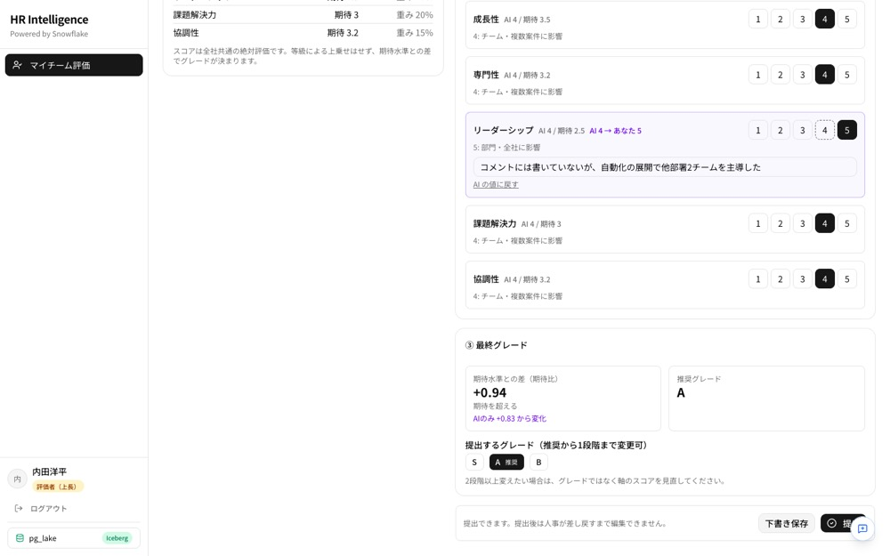
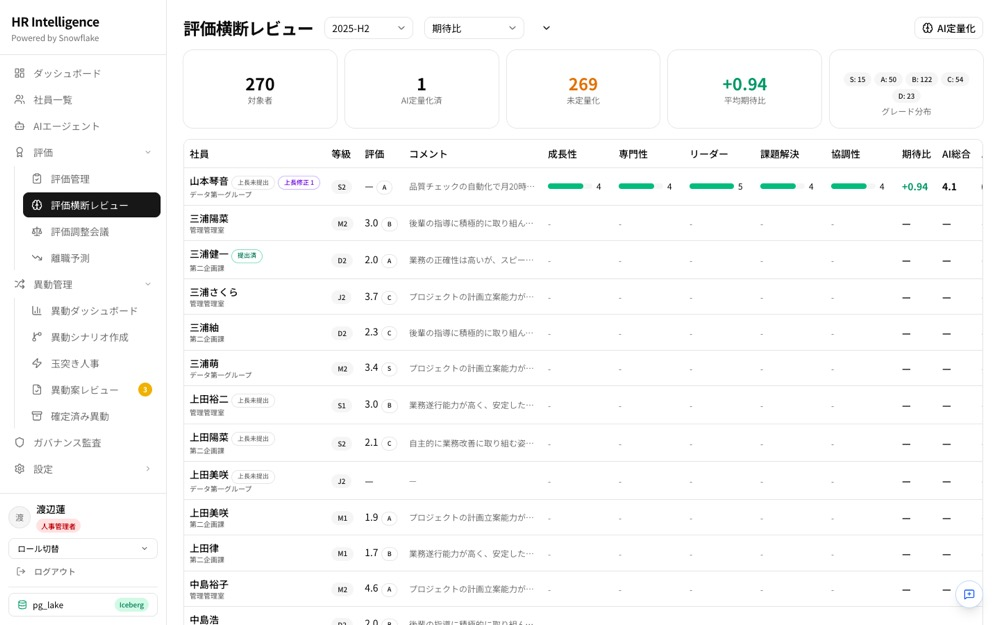
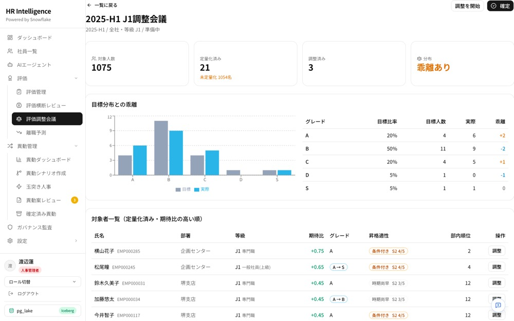

# HR Intelligence（人事分析・評価管理デモ） / HR Intelligence Demo

> [!IMPORTANT]
>
> **Disclaimer / 免責事項**
>
> **[EN]** All code and content in this repository is provided for **demonstration and educational purposes only**. **This content is not an official product.**
>
> **[JA]** このリポジトリ内のすべてのコード・コンテンツは、**デモおよび学習目的のみ** を意図して提供されています。**公式プロダクトではありません。**

---

## 概要 / Overview

このデモでは、Snowflake Postgres・Cortex AI・Snowflake ML・Snowflake App Runtime を組み合わせ、離職予測・配置シミュレーション・人材検索・評価の AI 定量化と評価調整会議までを 1 つの人事アプリで実現する方法を示します。

社員・評価などのデータはすべてスクリプトで生成した**架空のデータ**です。ログインはユーザー名のみのデモ用の簡易認証のため、本番データや外部公開環境では使用しないでください。

---

## 対象者 / Target Audience

- 人事データ活用（離職予測・評価・配置）のユースケースを検討している方
- Snowflake Postgres（OLTP）と Snowflake（OLAP / AI / ML）を組み合わせたアプリ構成に興味のある開発者

---

## 前提条件 / Prerequisites

- Snowflake アカウント（エディション: Enterprise 以上推奨）
- 必要なロール・権限: `ACCOUNTADMIN`（ロール・ウェアハウス・DB の作成、`SNOWFLAKE.CORTEX_USER` の付与のため）
- Snowflake Postgres（手順 1 で作成）
- Node.js 22+ / Python 3.10+ / Snowflake CLI (`snow`) / `psql`

### 使用する Snowflake 機能

- Snowflake Postgres / pg_lake（Iceberg 連携）
- Dynamic Tables
- Snowflake ML（Feature Store・Model Registry）
- Cortex AI（AI_COMPLETE 等）・Cortex Search・Cortex Analyst（Semantic View）
- Snowflake App Runtime

---

## 利用イメージ

画面に沿った利用の流れ（評価の準備 → 半期の評価 → 人材の把握と定着 → 異動、AI エージェント、Snowflake の機能）は `docs/usage_guide.html` にまとめています。GitHub 上では表示されないため、ファイルを開いて「Download raw file」で保存し、ブラウザで開いてください。

| 上長の評価（AI の採点を理由つきで修正） | 人事の横断確認 | 評価調整会議 |
|---|---|---|
|  |  |  |

> 画面の操作は `docs/operation_guide.md`、業務の流れは `docs/business_flow.md`、テーブルの全体像と役割は `docs/db_design.md`（列の定義は `sql/` の各ファイル）を参照してください。

---

## アーキテクチャ

```
Snowflake Postgres (OLTP)
  ↓  pg_lake (Iceberg V3 auto-sync)
Snowflake (OLAP)
  ├─ Dynamic Tables (特徴量)
  ├─ ML Model Registry (離職予測・関係性・配置適合)
  ├─ Cortex AI (エビデンス生成・感情分析・要約)
  ├─ Cortex Search (人材検索)
  └─ Semantic View (自然言語分析)
  ↓
Next.js App (hr-app-v2/)  ←  Snowflake App Runtime でホスティング
```

## ファイル構成 / File Structure

```
├── hr-app-v2/           # Next.js アプリ (TypeScript)
│   ├── src/app/api/     #   API Routes (Snowflake SDK + pg)
│   ├── src/app/(authenticated)/  #   画面
│   ├── app.yml.example  #   App Runtime デプロイ設定のテンプレート
│   └── .env.example     #   アプリ用環境変数テンプレート
├── docs/                # 操作マニュアル・業務フロー・DB設計・セットアップの補足
├── scripts/             # セットアップ・MLパイプライン
│   ├── generate_data.py           # Postgres へのデモデータ投入
│   ├── generate_ml_inputs.py      # ML の入力データ（異動履歴・360 度評価・感情分析など）
│   ├── setup_line_manager_demo.py # 上長（linemgr）のデモ状態
│   ├── sync_pg_to_iceberg.py      # PG → Snowflake 同期
│   ├── sync_remaining.py          # POSITIONS/APP_USERS 同期
│   ├── build_feature_tables.py    # ML の特徴量テーブル
│   ├── ml_pipeline_v3.py  # MLパイプライン (Feature Store + Model Registry)
│   ├── ml_reinference.py          # 再推論 (学習スキップ)
│   ├── register_shap_sproc.py     # SHAP Stored Procedure 登録
│   ├── add_transfer_fit_fv.py     # Feature Store 追加設定
│   ├── create_semantic_view.py    # Semantic View 作成（YAML から）
│   ├── setup_score_standards.js   # 評価基準（期待水準・重み）の初期値投入
│   └── session_util.py        # Snowpark Session ヘルパー
├── sql/
│   ├── setup_analytics.sql        # Snowflake オブジェクト作成 (ロール, WH, DB, テーブル, DT, Cortex)
│   ├── setup_postgres.sql         # Postgres テーブル定義
│   ├── setup_search_and_agent.sql # 人材検索と HR_AGENT（データ投入後に実行）
│   └── setup_app_runtime.sql      # アプリ ⇔ Postgres の通信と秘密情報（デプロイ前に実行）
├── semantic_models/
│   └── hr_semantic_view.yaml  # Cortex Analyst セマンティックビュー定義
├── requirements.txt     # Python パッケージ
├── teardown.sql         # クリーンアップ用 SQL
├── .env.example         # ルート環境変数テンプレート
└── .gitignore
```

---

## セットアップ手順 / Setup

すべての手順で、接続先のアカウントを明示します（`snow` は `-c <接続名>`、Python は `.env` の `SNOWFLAKE_CONNECTION_NAME`）。省略すると CLI の既定の接続が使われるため、別のアカウントに作ってしまうことがあります。

つまずきやすい点と対処、所要時間の目安は [docs/setup_notes.md](docs/setup_notes.md) にまとめています。

### 0. 事前準備

- `psql`（macOS なら `brew install libpq` で入り、`/opt/homebrew/opt/libpq/bin` にあります）
- Python パッケージ: `pip install -r requirements.txt`
- `~/.snowflake/connections.toml` に、ACCOUNTADMIN で使える接続を登録しておく

### 1. Snowflake Postgres インスタンスの作成

Snowsight の Postgres 画面か、次の SQL で作ります。作成結果に出る `snowflake_admin` のパスワードは**このときしか表示されない**ので控えてください。

```sql
-- 作業 PC からの接続を許可するルール（IP は下の「許可する IP の確かめ方」参照）
CREATE NETWORK RULE HR_ANALYTICS_PG_INGRESS_RULE  -- 任意の DB.SCHEMA に作る（下の注記参照）
    TYPE = IPV4 MODE = POSTGRES_INGRESS
    VALUE_LIST = ('<YOUR_PC_IP>/32', '<SNOWFLAKE_EGRESS_IP_RANGES>');
CREATE NETWORK POLICY HR_PG_POLICY ALLOWED_NETWORK_RULE_LIST = ('HR_ANALYTICS_PG_INGRESS_RULE');

CREATE POSTGRES INSTANCE HR_DEMO_PG
    COMPUTE_FAMILY = 'BURST_M' STORAGE_SIZE_GB = 10
    AUTHENTICATION_AUTHORITY = POSTGRES
    NETWORK_POLICY = 'HR_PG_POLICY';
```

- ネットワークルールは、ネットワーク系のオブジェクトをまとめて管理している DB（例: `SECURITY_DB.NETWORK`）があれば、そこに作るのがおすすめです。なければ、デモとは別の DB を用意してください。`HR_ANALYTICS` は手順 3 で SYSADMIN が作るため、ここでは使えません。
- `<SNOWFLAKE_EGRESS_IP_RANGES>` は、App Runtime のアプリから Postgres に入るための Snowflake の送信元 IP 帯です。リージョンによって値が違うため、`SELECT SYSTEM$GET_SNOWFLAKE_EGRESS_IP_RANGES();` の `ipv4_prefix` をすべて並べてください（有効期限があります）。
- この IP 帯での許可は、2026 年 10 月時点の App Runtime の仕様（アプリから Postgres への通信が Snowflake の送信元 IP 帯から届く）に合わせた対応です。仕様が変わると不要になる、または方法が変わる可能性があります。
- **許可する IP の確かめ方**: 社内のゲートウェイや VPN を経由していると、`checkip` などのサイトで見える IP と、Postgres に届く IP が違います。一時的に `0.0.0.0/0` で接続して `SELECT inet_client_addr();` を実行し、表示された IP に絞り直すのが確実です。許可していない IP からは、エラーの説明なしに `server closed the connection unexpectedly` で切られます。

### 2. 環境変数の設定

```bash
cp .env.example .env
```

`.env` を編集します。

| 変数 | 説明 |
|---|---|
| `SNOWFLAKE_CONNECTION_NAME` | `connections.toml` の接続名（Python スクリプトが使う） |
| `POSTGRES_HOST` | 手順 1 のインスタンスのホスト（`SHOW POSTGRES INSTANCES` の `host`） |
| `POSTGRES_USER` / `POSTGRES_PASSWORD` | `snowflake_admin` と、手順 1 で控えたパスワード |

```bash
export $(grep -v '^#' .env | xargs)
```

### 3. Snowflake と Postgres のテーブル作成

```bash
snow sql -c $SNOWFLAKE_CONNECTION_NAME -f sql/setup_analytics.sql
PGPASSWORD="$POSTGRES_PASSWORD" psql "host=$POSTGRES_HOST port=5432 dbname=postgres user=$POSTGRES_USER sslmode=require" \
  -v ON_ERROR_STOP=1 -f sql/setup_postgres.sql
```

どちらも何度流しても同じ状態になります。

### 4. デモデータの投入と Snowflake への同期

```bash
python3 scripts/generate_data.py            # 社員・評価・1on1 など（約 4 分）
python3 scripts/generate_ml_inputs.py       # 異動履歴・360 度評価・感情分析など ML の入力（約 4 分）
python3 scripts/setup_line_manager_demo.py  # 上長（linemgr）が部下 8 名を評価する場面
(cd hr-app-v2 && npm install) && NODE_PATH=hr-app-v2/node_modules node scripts/setup_score_standards.js  # 評価基準の初期値

python3 scripts/sync_pg_to_iceberg.py       # Postgres → Snowflake（約 6 分）
python3 scripts/sync_remaining.py
```

データはすべて固定の乱数で作る架空データで、何度実行しても同じになります。感情分析の値（`evaluation_analysis` / `oneonone_analysis`）は、本来は Cortex AI でコメントを読んで作るものですが、コメント自体が生成データのため、評価点から作っています。

### 5. ML（特徴量 → 学習・推論 → SHAP・根拠文）

```bash
python3 scripts/build_feature_tables.py            # 特徴量テーブル（約 30 秒）
python3 scripts/register_shap_sproc.py             # SHAP を計算するストアドプロシージャ
python3 scripts/ml_pipeline_v3.py # Feature Store・学習・Model Registry・推論・SHAP・根拠文（約 20 分）
python3 scripts/add_transfer_fit_fv.py             # 異動適合の Feature View
```

`register_shap_sproc.py` は ML パイプラインの途中で呼ばれるため、先に実行します。

パイプラインの最後に Model Monitor（`ATTRITION_MONITOR`）が無いという警告が出ることがありますが、学習・推論の結果には影響しません。

### 6. AI エージェントと人材検索

```bash
python3 scripts/create_semantic_view.py                              # Cortex Analyst 用の Semantic View
snow sql -c $SNOWFLAKE_CONNECTION_NAME -f sql/setup_search_and_agent.sql  # 人材検索と HR_AGENT
```

人材検索の元データは手順 3 の時点では空のため、ここで作り直します。

### 7. Snowflake App Runtime へのデプロイ

1. `sql/setup_app_runtime.sql` の `<...>` を自分の値に置き換えて ACCOUNTADMIN で実行します（アプリから Postgres への通信の許可と、パスワードなどの秘密情報）。
2. **アカウントにネットワークポリシーがある場合**は、Snowflake の送信元 IP 帯をそのポリシーにも追加します（同じファイルの 4. 参照）。追加しないと、アプリのコンテナが起動時に `390422 INCOMING_REQUEST_BLOCKED` で止まります。アカウントのポリシーは全員のログインに効くので、`UNSET` や置き換えはしないでください。
3. アプリをデプロイします。

```bash
cd hr-app-v2
cp app.yml.example app.yml   # <YOUR_...> を置き換える（EAI 名は HR_APP_EAI）
snow app deploy --target v3 --connection $SNOWFLAKE_CONNECTION_NAME
```

ローカルで動かす場合は `hr-app-v2/README.md` を参照してください（Snowflake への接続に PAT が必要です）。

> **データの読み取り経路について**
> アプリは既定で、Postgres の `hr_lake` スキーマ（pg_lake 経由の Iceberg）から ML 結果を読みます。この手順では `hr_lake` を作らないため、そのままではダッシュボードなどがエラーになります。
> ログイン後、**サイドバーのデータ経路の切り替えを `snowflake-sdk` にしてください**（Cookie に保存されます）。
> pg_lake は Postgres の STANDARD 以上の階層でしか有効にできません（BURSTABLE では `CREATE EXTENSION pg_lake` が失敗します）。

## 実行手順 / How to Run

1. アプリを開き、ログイン画面のカードから役割を選びます（デモ用の簡易認証で、パスワードは不要です）。
   - `admin`（人事管理者）: すべての画面を使えます。
   - `linemgr`（上長・評価者）: 「マイチーム評価」だけを使えます。
   - そのほかのユーザーは `hr-app-v2/README.md` の「デモ用ログイン」を参照してください。
   - `admin` では、最初にデータ経路を `snowflake-sdk` に切り替えます（手順 7 の注記参照）。
2. 評価期間の選択は `2025-H2` にします（デモデータはこの期間に入っています）。締切日の設定により「締切超過」と表示されますが、操作には影響しません。
3. `docs/usage_guide.html` の流れに沿って操作します。
   評価の準備 → 半期の評価（上長の評価 → 人事の横断確認 → 評価調整会議） → 人材の把握と定着 → 異動（シナリオ作成 → 玉突き → 承認・確定）

---

## 主要機能

| 機能 | 説明 |
|---|---|
| ダッシュボード | 部署別KPI、離職リスクヒートマップ |
| 社員管理 | 一覧・詳細・スキル・1on1メモ |
| 離職予測 | XGBoost + SHAP + Cortex AI エビデンス |
| 配置シミュレーション | 適合度スコアによる異動シミュレーション |
| 連鎖シミュレーション | 玉突き人事の影響分析 |
| 評価管理 | 評価入力・バッチ作成・ベンチマーク |
| 評価の AI 定量化・横断レビュー | Cortex COMPLETE で評価コメントを 5 軸採点、等級別の期待水準との差で推奨グレードと順位を算出 |
| マイチーム評価 | 課長が部下の評価を入力し、AI の採点を軸ごとに理由付きで修正して提出 |
| 評価調整会議 | 等級ごとに目標分布と比べてグレードを調整・確定 |
| ガバナンス | アクセス履歴・ロール別権限 |
| 人材検索 | Cortex Search による自然言語検索 |
| HR Agent | Cortex AI チャットボット (Semantic View 連携) |

## 再推論 (データ更新後)

データ更新後にモデル再学習なしで推論を更新:

```bash
python3 scripts/ml_reinference.py   # .env の SNOWFLAKE_CONNECTION_NAME を使う
```

---

## クリーンアップ / Cleanup

以下の SQL で作成したリソース（DB・ウェアハウス・ロール・EAI）を削除できます。App Runtime のアプリ、Postgres インスタンスとそのネットワークポリシーは、ファイル内のコメントを外して名前を確かめてから削除してください。アカウントのネットワークポリシーに IP 帯を足した場合は、控えておいたリストに戻してください。

```bash
snow sql -c $SNOWFLAKE_CONNECTION_NAME -f teardown.sql
```

---

## 参考リンク / References

- [Snowflake Postgres](https://docs.snowflake.com/en/user-guide/snowflake-postgres/about)
- [Dynamic Tables](https://docs.snowflake.com/en/user-guide/dynamic-tables-about)
- [Snowflake Feature Store](https://docs.snowflake.com/en/developer-guide/snowflake-ml/feature-store/overview)
- [Snowflake Model Registry](https://docs.snowflake.com/en/developer-guide/snowflake-ml/model-registry/overview)
- [Cortex Search](https://docs.snowflake.com/en/user-guide/snowflake-cortex/cortex-search/cortex-search-overview)
- [Cortex Analyst](https://docs.snowflake.com/en/user-guide/snowflake-cortex/cortex-analyst)

---

## 作成者 / Author

- 作成者: sfc-gh-ryoshida
- 作成日: 2026-10
- 最終更新: 2026-10
