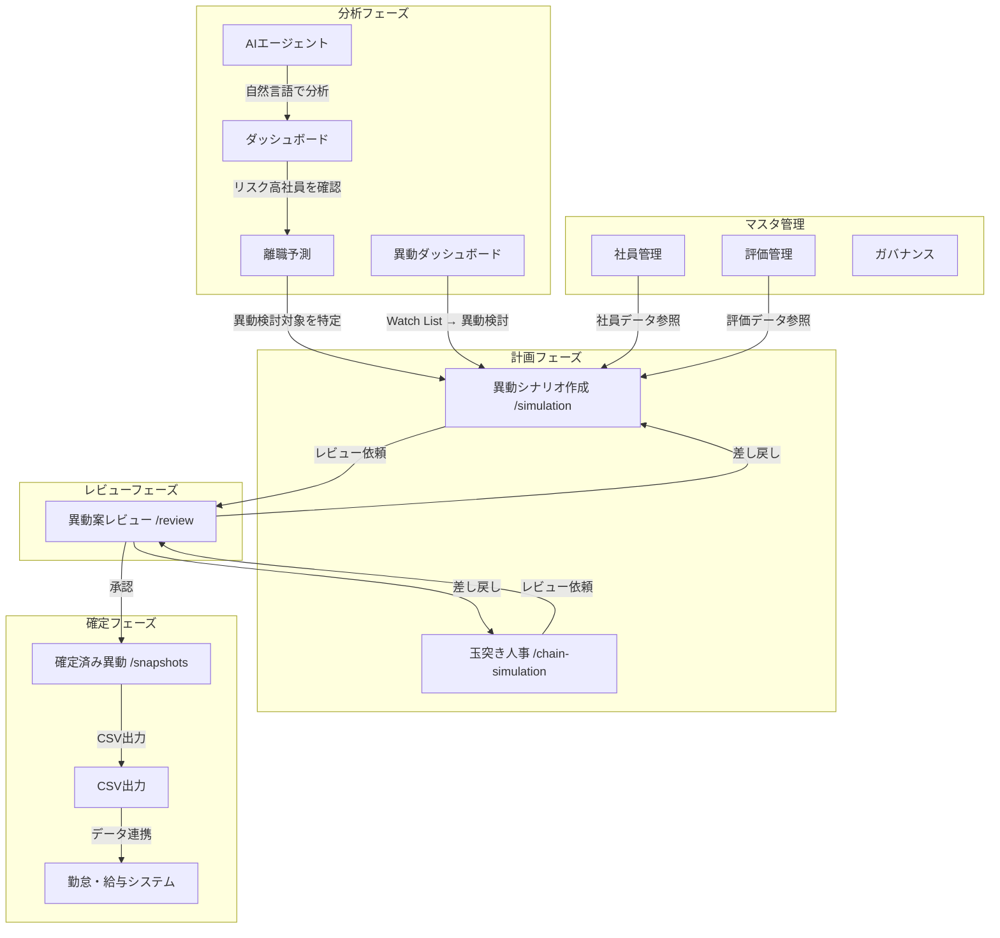
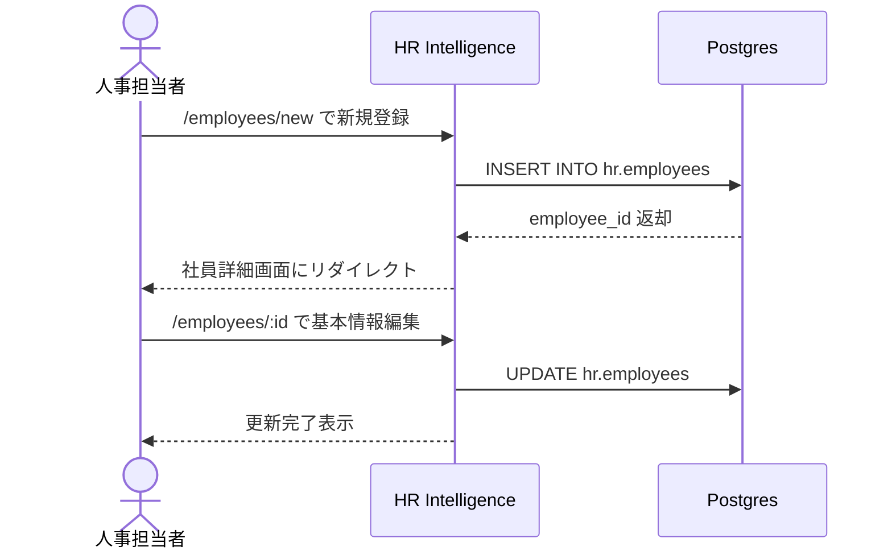
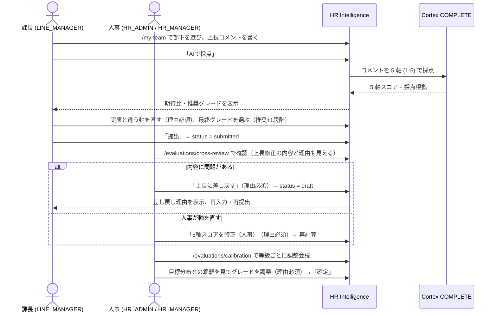
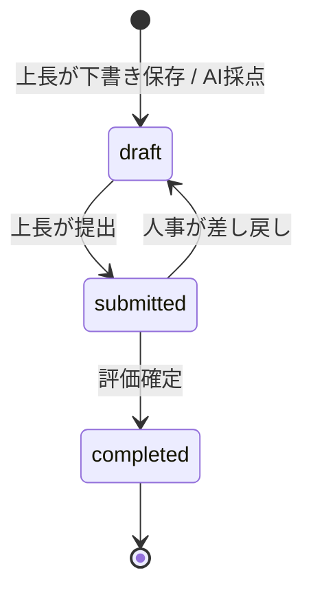
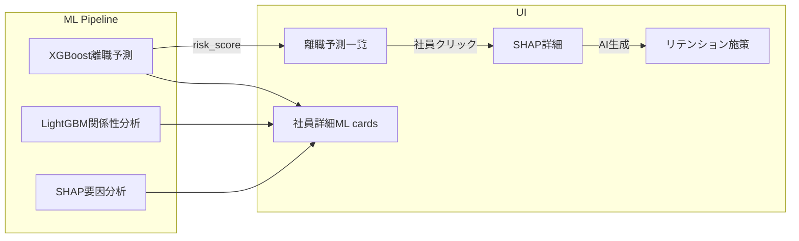
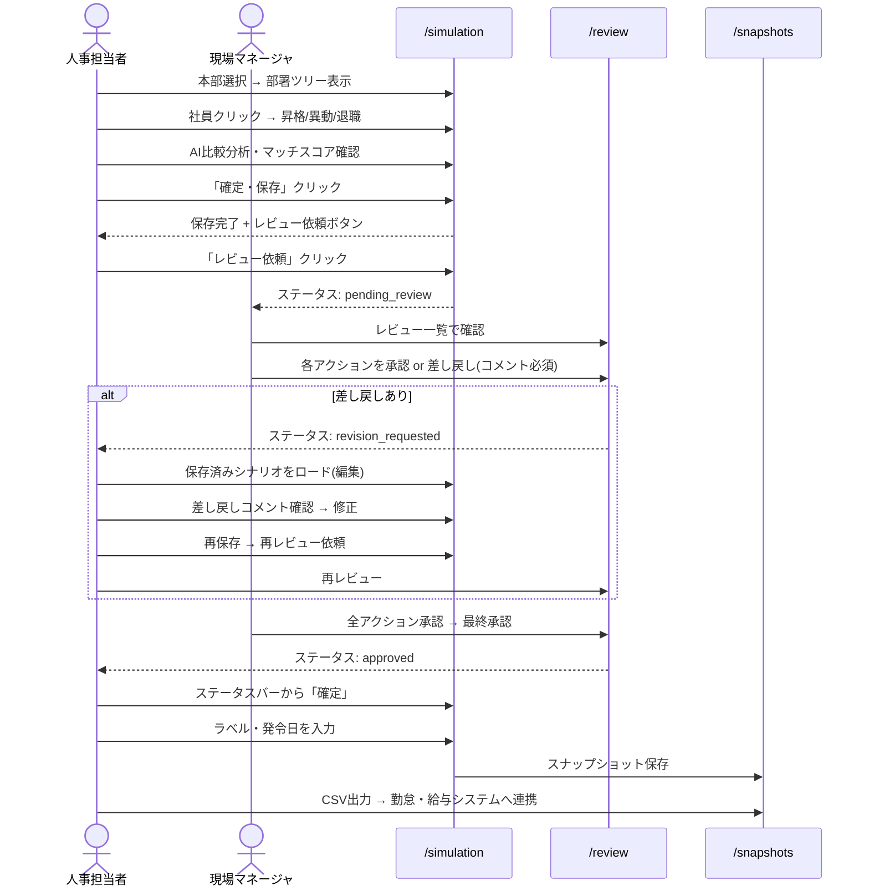
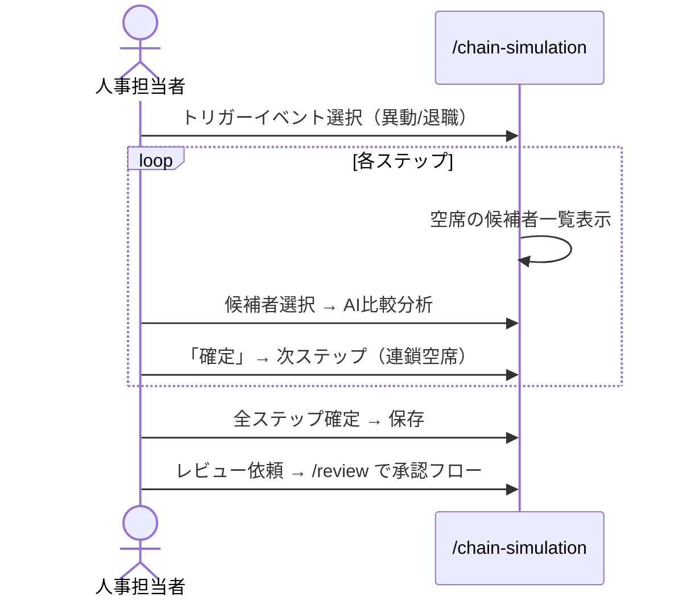
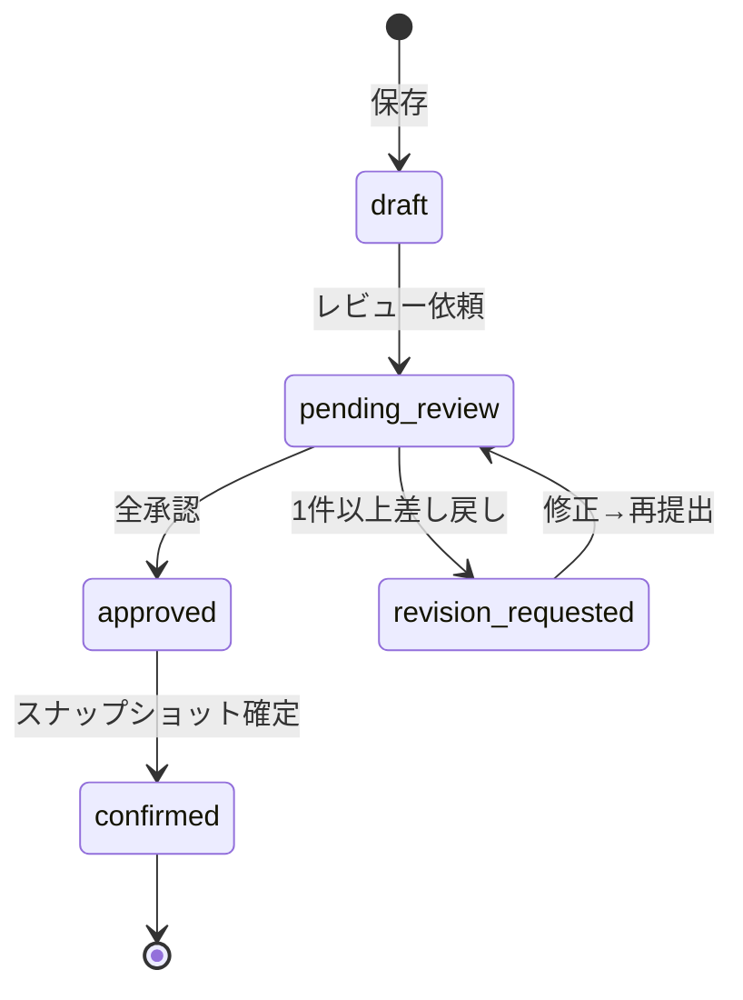
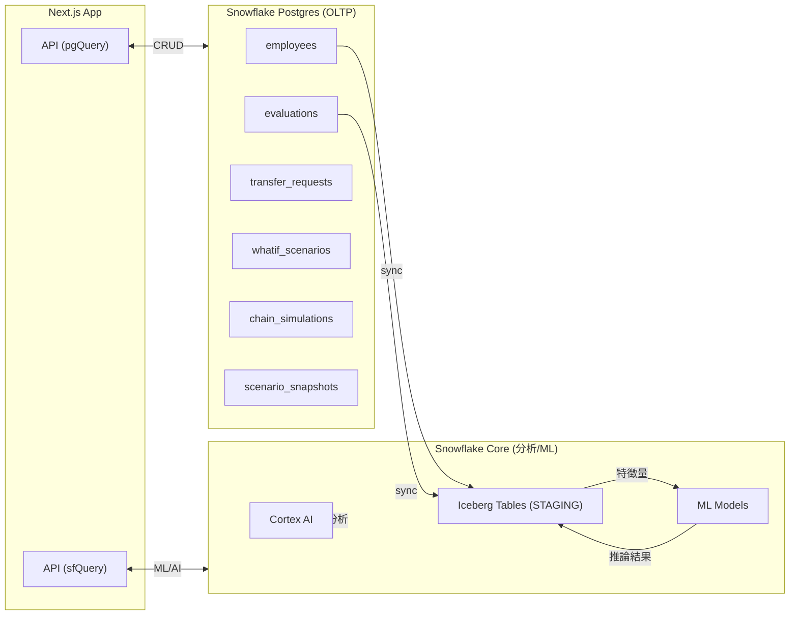

# HR Intelligence 業務フロー設計書

> 本文書はHR Intelligenceアプリの業務フローを定義する。画面の操作は `operation_guide.md` を参照。

## 1. アプリ全体の業務フローマップ



## 2. 社員情報管理フロー

### 2.1 社員登録・編集



### 2.2 スキル管理

- 社員詳細画面 → スキルタブ → `/employees/:id/skills`
- スキルマスタから選択して紐付け（1〜5段階）
- カテゴリ別にグルーピング表示

### 2.3 1on1メモ管理

- 社員詳細画面 → 1on1タブ → `/employees/:id/notes`
- カテゴリ: performance / career / motivation / concern / other
- プライベートフラグで閲覧制限

## 3. 評価管理フロー

### 3.1 上長（課長）の評価入力 → 人事レビュー → 調整会議



評価のステータス（`hr.evaluations.status`）:



- AI の元の値と修正後の値は `hr.eval_axis_overrides` に軸ごとに残る（誰が・なぜ直したか）
- 推奨グレードは、等級ごとの期待水準（`hr.grade_score_standards`）との差（期待比）で決まる
- 調整会議での変更は `hr.calibration_adjustments` に理由付きで残る

### 3.2 一括評価入力

1. 人事管理者が `/evaluations/batch` を開く
2. 本部・部署・期間を選択
3. 部署内全社員の評価をインライン編集
4. スコア入力 → 自動グレード算出 (4.5+=S, 4.0+=A, ...)
5. 「下書き保存」or「確定保存」

### 3.3 評価データの活用

- ダッシュボードの等級分布・評価分布チャート
- 離職予測MLモデルの特徴量 (`AVG_EVAL_SCORE`)
- 異動マッチスコアの評価スコア成分 (30%ウェイト)

## 4. 離職予測・リスク分析フロー



## 5. 異動管理フロー

異動案は 2 つの画面で作ります。

- **異動シナリオ作成（5.1）:** 定期異動など、複数の昇格・異動・退職をまとめて計画する。起点は自由に選び、空いた席の後任も同じ案の中で決める。
- **玉突き人事（5.2）:** 退職・休職・異動申請で突発的に空いた 1 つのポストを、後任 → その後任…と順に埋める。各ステップで AI の比較コメントが付く。

どちらの案も、同じレビュー（`/review`）と確定（`/snapshots`）の流れに乗ります。

### 5.1 シナリオ作成 → 保存 → 編集 → レビュー依頼



### 5.2 玉突きシミュレーション



### 5.3 ステータス遷移



### 5.4 スナップショット確定 → CSV出力

- 承認済みシナリオ/チェーンに「ラベル」と「発令日」を付けて確定
- `scenario_snapshots` テーブルにJSONBで全データ保管
- CSV出力フォーマット:

| カラム | 説明 |
|---|---|
| 発令日 | YYYY-MM-DD |
| 社員番号 | E001 etc. |
| 氏名 | 姓 名 |
| 異動種別 | 異動/昇格/退職 |
| 異動元部署コード | D010 etc. |
| 異動元部署名 | 営業1部 etc. |
| 異動先部署コード | D020 etc. |
| 異動先部署名 | 営業2部 etc. |
| 異動元等級 | M2 etc. |
| 異動先等級 | M2 etc. |
| 備考 | スナップショットラベル |

## 6. AI活用フロー

### 6.1 AIエージェント

- `/agent` で自然言語クエリ → Cortex Agent (claude-haiku-4-5)
- SQL生成 → 結果テーブル表示
- スレッド管理（保存/ロード/削除）

### 6.2 異動マッチスコア

```
matchScore = skillScore × 0.5 + evalScore × 0.3 + tenureScore × 0.2
```

- skillScore: 異動先部署の必須スキルとの一致率
- evalScore: 直近評価平均の正規化 (1-5 → 0-100)
- tenureScore: 在籍年数ベースの適性（3 年以上は `60 + 年数 × 3`（上限 100）、3 年未満は `年数 × 20`（下限 20））
- 計算は `hr-app-v2/src/app/api/simulation/match/route.ts` にある

### 6.3 AI比較分析

- `AI_COMPLETE` (Cortex) で候補者 vs 異動先同僚の比較レポート生成
- markdown形式でダイアログ内表示

## 7. ガバナンス・監査フロー

### 7.1 ロールベースマスキング

Snowflake 側のテーブルに付けたマスキングポリシー（`sql/setup_analytics.sql`）の動き:

| ロール | 給与 | メールアドレス | 評価スコア | 評価コメント |
|---|---|---|---|---|
| HR_ADMIN | 表示 | 表示 | 表示 | 表示 |
| HR_MANAGER | 非表示（NULL） | 部分マスク | 表示 | 表示 |
| HR_VIEWER | 非表示（NULL） | 部分マスク | 非表示（NULL） | `***` |

### 7.2 アクセス履歴

- Snowflake `ACCOUNT_USAGE.ACCESS_HISTORY` を表示
- クエリ実行者・テーブル・時刻

### 7.3 タイムトラベル

- Snowflake Time Travel でデータの過去状態を参照（デモ用）

## 8. データフロー概要


