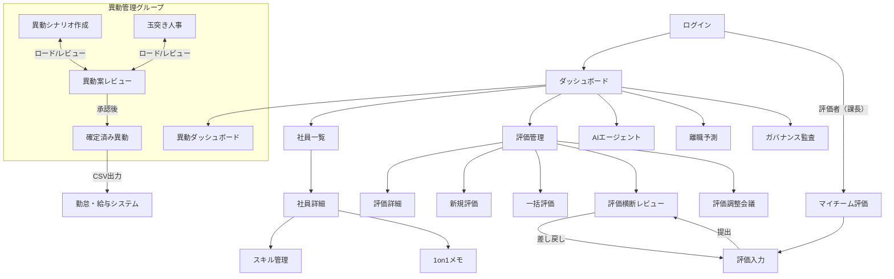

# HR Intelligence 操作マニュアル

> 本文書はHR Intelligenceアプリの操作手順をロール別に記載する。

**はじめに（デモ環境で最初にすること）**

1. `admin` でログインし、サイドバーのデータ経路を `snowflake-sdk` に切り替える（Cookie に保存される）。
2. 評価の画面では、評価期間に `2025-H2` を選ぶ。デモデータはこの期間に入っている。

## 1. ロール一覧と権限

| ロール | 説明 | 社員閲覧 | 社員編集 | 評価管理 | 異動シナリオ | レビュー | 確定 | ガバナンス |
|--------|------|---------|---------|---------|------------|---------|------|-----------|
| HR_ADMIN | 人事管理者 | 全て | 全て | 全て | 作成・編集 | 全て | 可 | 全て |
| HR_MANAGER | 部門マネージャー | 担当本部 | 担当本部 | 担当本部 | 作成・編集 | 担当本部 | 不可 | 制限あり |
| HR_VIEWER | 閲覧者 | 全て | 不可 | 閲覧のみ | 閲覧のみ | 不可 | 不可 | 制限あり |
| LINE_MANAGER | 評価者（課長） | 不可 | 不可 | 自分が評価者の部下のみ入力 | 不可 | 不可 | 不可 | 不可 |

**ロール切り替え方法:** サイドバー下部のユーザー情報エリア → 「ロール切替」ドロップダウン。LINE_MANAGER は切り替えられず、マイチーム評価の画面だけを使う。他のロールで使うには、ログアウトしてログイン画面で別のカードを選ぶ。

## 2. 人事管理者 (HR_ADMIN) 向け操作ガイド

**異動の 2 つの画面の使い分け**

| 画面 | 使う場面 | 起点 |
|---|---|---|
| 異動シナリオ作成（2.1） | 定期異動など、複数の昇格・異動・退職をまとめて計画する | 自由に選んだ社員。空いた席の後任も同じ画面で選べる |
| 玉突き人事（2.3） | 退職や異動申請で突発的に空いた 1 つのポストを、後任を順に決めて埋める | 退職・休職・異動申請の一覧。各ステップで AI の比較コメントが出る |

どちらで作った案も、同じ「異動案レビュー」で審査し、「確定済み異動」にまとまります。同じ社員を両方の案で確定しようとすると、確定時に重複として止められます。

### 2.1 異動シナリオの作成手順

1. サイドバー「異動管理」グループを展開 → 「異動シナリオ作成」をクリック
2. 画面上部の本部セレクタで対象本部を選択
3. 左パネルの部署ツリーで部署を選択 → 社員一覧が表示される
4. 社員カードをクリック → アクションダイアログが開く
   - **昇格**: 昇格先の等級を選択
   - **異動**: 異動先部署を選択 → マッチスコアが自動計算される。「AI比較分析を実行」で詳細分析
   - **退職**: 退職登録（空席が自動生成される）
5. 「追加」をクリック → シナリオにアクションが追加される
6. 必要なアクションを全て追加したら「確定・保存」をクリック

### 2.2 保存済みシナリオの編集

1. 「保存済みシナリオ」ボタンをクリック
2. 一覧から対象シナリオの「ロード」ボタンをクリック
3. アクションが復元され、ステータスバーが表示される
4. アクションの追加・削除を行い「確定・保存」で再保存

### 2.3 玉突き人事シミュレーション

1. サイドバー「異動管理」→「玉突き人事」
2. トリガーイベント（異動・退職）を選択
3. 空席に対する候補者が表示される → 候補者をクリックして比較
4. 「この候補者を選択」→「確定」で次ステップへ（連鎖的に空席が発生）
5. 全ステップ確定後、右サイドバーの「シミュレーション保存」をクリック

### 2.4 レビュー依頼の送り方

1. シナリオ/チェーン保存後に表示される「レビュー依頼」ボタンをクリック
2. ステータスが「レビュー待ち」に変わる
3. ステータスバーの「レビュー状況を見る →」リンクでレビュー画面に遷移

### 2.5 差し戻し対応

1. シナリオをロード → ステータスバーに差し戻しコメントが表示される
2. 差し戻されたアクションを確認し、修正
3. 再保存 → 「レビュー依頼」で再提出

### 2.6 確定データの作成とCSV出力

1. 承認済みシナリオのステータスバーで「確定（スナップショット保存）」をクリック
2. ラベル（例: "2026年4月 定期異動"）と発令日を入力
3. 「確定」をクリック → `確定済み異動` 画面で閲覧可能に
4. 確定済み異動画面で対象行の「CSV」ボタンをクリック → ダウンロード

### 2.7 過去データとの比較方法

1. サイドバー「異動管理」→「確定済み異動」
2. 比較したい2つのスナップショットのチェックボックスを選択
3. 「選択した2件を比較」をクリック
4. 左右並列で内容が表示される

### 2.8 評価の AI 定量化と横断レビュー（HR_ADMIN / HR_MANAGER）

1. サイドバー「評価」→「評価横断レビュー」→ 本部・期間を選ぶ
2. 「AI定量化」で、表示中の全員の評価コメントを AI が 5 軸（成長性・専門性・リーダーシップ・課題解決力・協調性）で 1–5 に採点する
   - 等級ごとの期待水準との差（**期待比**）で推奨グレードと部門内・等級内の順位が決まる
   - 上長が直した軸は、再採点しても上長の値が残る
3. 一覧のバッジで状況を確認する: 「上長未提出」「差し戻し中」「提出済」「上長修正 N」
4. 行をクリックすると詳細が開く
   - 「AI採点からの修正」: 軸ごとに AI の値 → 修正後の値、理由、修正者
   - 「5軸スコアを修正（人事）」: 1–5 のボタンで直す。AI と違う値にした軸は理由（5 文字以上）が必須。「5軸を保存して再計算」で期待比・推奨グレード・順位が更新される
   - 「上長に差し戻す」（提出済みのみ）: 理由を書いて差し戻すと、上長が再び編集できるようになる
5. 総合値・グレードだけを上書きしたい場合は、一覧の「手動上書」「手動G」を入力して「保存」

**評価管理から 1 人ずつ入力する場合:** 「評価管理」で行をクリックすると、同じ項目を詳細画面で扱えます。

- 「AIで採点」: その 1 件だけ AI 定量化する。採点後にコメントを直すと「再採点してください」と表示される
- 「5軸スコアを修正（人事）」: 横断レビューと同じ部品。AI と違う値にした軸は理由が必須
- 「編集」の最終グレード: AI 採点後は、推奨グレードの前後 1 段階まで。推奨から変えるときは理由が必須（上長の入力と同じルール）

順位と期待比は 5 軸のスコアから計算されるため、「スコア」欄を直しても変わりません。

### 2.9 評価調整会議（等級ごとに分布を揃える）

1. サイドバー「評価」→「評価調整会議」→「調整会議を作成」
2. 期間（例: 2025-H2）・対象部門・**対象等級**・目標比率（S/A/B/C/D）を指定する
   - 期待水準が等級ごとに違うため、等級を絞って開くのが基本。「全等級」は非推奨
3. 会議を開き「調整を開始」→ 目標分布との乖離を見ながら、対象者ごとに「グレードを調整」
   - 調整理由（5 文字以上）が必須。同じグレードへの変更はできない
   - 調整ダイアログには、上長による 5 軸の修正内容も表示される
4. 「確定」で会議を閉じる。確定後は変更できない

## 3. 部門マネージャー (HR_MANAGER) 向け操作ガイド

### 3.1 レビュー依頼の確認方法

- サイドバー「異動管理」グループ内の「異動案レビュー」に件数バッジが表示される
- バッジの数字は `pending_review` のシナリオ/チェーン数

### 3.2 異動案のレビュー手順

1. 「異動案レビュー」をクリック → レビュー一覧画面
2. 種別フィルタ（全て / シナリオ / 玉突き）で絞り込み
3. 対象をクリック → 詳細画面
4. 各アクション/ステップに対して:
   - **承認**: 「承認」ボタン → 確認ダイアログ → 「承認」
   - **差し戻し**: 「差し戻し」ボタン → コメント入力（必須） → 「差し戻し」
5. 全アクション承認後、「最終承認」ボタンが表示される → クリックで承認確定

### 3.3 社員詳細の確認方法

- レビュー詳細画面で社員名をクリック → 新タブで社員詳細画面が開く
- ML情報（離職リスク、関係性スコア、転職適性）を確認してレビュー判断に活用

### 3.4 差し戻しコメントの書き方ガイドライン

差し戻しコメントは人事担当者への具体的な指示として記載する:

| 良い例 | 悪い例 |
|--------|--------|
| 営業2部は現在大型プロジェクト進行中のため、Q3以降の異動を検討してください | この異動はダメ |
| 山田さんは直近評価がB+で異動先のM1には不十分。S1ポジションを再検討 | 再検討して |
| 技術部からの異動は部長承認が別途必要です。先に部長確認を取ってください | 確認して |

## 4. 閲覧者 (HR_VIEWER) 向け操作ガイド

### 4.1 ダッシュボードの見方

- 上部: KPIカード (人数, 性別比, 平均在籍年数, 離職リスク人数)
- 中部: 部署別人数 (棒グラフ、クリックでドリルダウン) / 評価分布 (円グラフ)
- 下部: 関係性ヒートマップ / 離職リスクアラート / 直近評価

### 4.2 社員検索・詳細表示

1. サイドバー「社員一覧」
2. 本部・部署フィルタ、テキスト検索で絞り込み
3. 社員名をクリック → 詳細画面 (プロフィール、ML分析、評価履歴、スキル)

### 4.3 評価データの閲覧

- サイドバー「評価」→「評価管理」
- 本部・期間・等級でフィルタ
- 社員名クリック → 評価詳細

### 4.4 離職リスクの確認

- サイドバー「評価」→「離職予測」
- リスクレベル別にフィルタ（高/中/低のカードをクリック）
- 社員名クリック → SHAP要因分析 + AI施策提案

## 5. 評価者（課長 / LINE_MANAGER）向け操作ガイド

ログイン画面で「評価者（課長）」を選ぶと、マイチーム評価の画面だけが使える。対象は自分が評価者になっている部下だけ。

### 5.1 部下一覧（マイチーム評価）

- 提出期限までの残り日数と、未着手・下書き・AI採点済み・差し戻し・提出済みの件数が出る
- 差し戻しや未着手など、急ぐものから順に並ぶ。行の「入力」で入力画面へ

### 5.2 評価の入力と提出

左側に本人の自己評価・前期の評価・等級の期待水準が出るので、参考にしながら右側を上から順に入力する。

1. **① 上長コメント**を書き（20 文字以上）、「AIで採点」を押す
2. **② 5軸スコア**を確認する。AI の値と採点根拠が出るので、実態と違う軸は 1–5 で直し、理由（5 文字以上）を書く
   - 直すと期待比と推奨グレードがその場で再計算される
3. **③ 最終グレード**を選ぶ。推奨から 1 段階まで変えられ、変えた場合は理由が必要
4. 「下書き保存」で途中保存、「提出」で人事へ提出する。提出後は編集できない

「提出」が押せないときは、画面下部に理由が出る（例: コメントを変えたのに再採点していない、修正理由が未入力）。コメントを書き換えた場合は「AIで再採点」が必要。

### 5.3 差し戻されたとき

- 一覧で「差し戻し」になり、入力画面の上部に人事からの理由が出る
- 内容を直して、もう一度「提出」する

## 6. トラブルシューティング

### 6.1 よくあるエラーと対処法

| 症状 | 原因 | 対処 |
|------|------|------|
| 画面が真っ白 | セッション切れ | ログインし直す |
| 「認証が必要です」エラー | セッション有効期限 (8時間) 超過 | 再ログイン |
| 保存ボタンが押せない | アクション0件 / 必須項目未入力 | アクション追加・入力確認 |
| レビュー依頼できない | ステータスが draft/revision_requested 以外 | 現在のステータスを確認 |
| 確定ボタンが表示されない | ステータスが approved でない | レビュー完了を待つ |
| ダッシュボードなどがエラーになる | データ経路が pg_lake のまま（デモの手順では pg_lake 用のデータを作らない） | サイドバーで `snowflake-sdk` に切り替える |
| 「評価データなし」と表示される | 評価期間が既定のまま | `2025-H2` を選ぶ |

### 6.2 データが表示されない場合

1. データ経路が `snowflake-sdk` になっているか、評価期間が `2025-H2` になっているかを確認
2. 本部セレクタが正しく選択されているか確認
3. 解決しなければ、ブラウザの開発者ツール（F12）のネットワークタブで API のエラー内容を確認し、アプリのログ（`snow app events`、`docs/setup_notes.md` 参照）も見る

### 6.3 ロール切り替え方法

1. サイドバー下部のユーザー情報エリア
2. 「ロール切替」ドロップダウンを開く
3. 切り替えたいロールをクリック

## 付録

### A. 画面遷移マップ

### B. ステータス一覧と遷移条件

| ステータス | 表示名 | 遷移元 | 遷移条件 |
|-----------|--------|--------|----------|
| `draft` | 下書き | (初期状態) | 保存時に自動設定 |
| `pending_review` | レビュー待ち | `draft`, `revision_requested` | 「レビュー依頼」実行 |
| `revision_requested` | 差し戻しあり | `pending_review` | 1件以上のアクションが差し戻し |
| `approved` | 承認済み | `pending_review` | 全アクション承認 + 最終承認 |
| `confirmed` | 確定済み | `approved` | スナップショット確定 |

### C. CSV出力フォーマット仕様

- **エンコーディング**: BOM付きUTF-8 (Excel互換)
- **区切り文字**: カンマ (,)
- **クォート**: 全フィールドダブルクォート囲み
- **改行コード**: LF

| # | カラム名 | 型 | 例 |
|---|---------|----|----|
| 1 | 発令日 | DATE | 2026-04-01 |
| 2 | 社員番号 | TEXT | E001 |
| 3 | 氏名 | TEXT | 山田 太郎 |
| 4 | 異動種別 | TEXT | 異動/昇格/退職 |
| 5 | 異動元部署コード | TEXT | D010 |
| 6 | 異動元部署名 | TEXT | 営業1部 |
| 7 | 異動先部署コード | TEXT | D020 |
| 8 | 異動先部署名 | TEXT | 営業2部 |
| 9 | 異動元等級 | TEXT | M2 |
| 10 | 異動先等級 | TEXT | M2 |
| 11 | 備考 | TEXT | 2026年4月 定期異動 |
