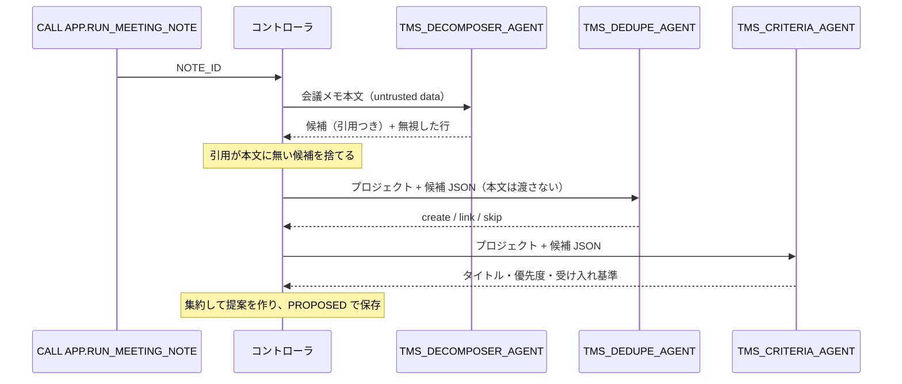

# 02 Orchestrator / Worker（コントローラ型）

Python コントローラがオーケストレーターになり、会議メモを Worker エージェントに順に渡して、結果を集約します。
前提: [`00_common`](../00_common/)。エージェント型の同じ処理は [03](../03_agent_as_tool/)。比較: [パターン比較表](../README.md#comparison)

## 1. このパターンで分かること

- 1 つの作業（会議メモ → タスク提案）を、役割の違う複数のエージェントに分担させる方法
- 各 Worker に**必要な情報だけ**を渡す方法（例: Dedupe には会議メモ本文を渡さない）
- Worker の出力を契約で検証し、**根拠のない候補を捨ててから**集約する方法
- どの Worker をどの順で呼ぶかを、テーブル（`APP.WORKER_PLAN`）で配線する方法

## 2. 構成図



## 3. 作られるオブジェクト

| オブジェクト | 説明 |
|----|----|
| `AGENTS.TMS_DECOMPOSER_AGENT` | 会議メモから明示的な作業項目だけを抜き出す（引用必須、ツールなし） |
| `AGENTS.TMS_DEDUPE_AGENT` | 既存タスクとの重複を判定（`search_similar_tasks`） |
| `AGENTS.TMS_CRITERIA_AGENT` | タイトル接頭辞・優先度・受け入れ基準を付ける（`get_project_policy`） |
| `APP.RUN_MEETING_NOTE(NOTE_ID)` | コントローラ（呼び出し元権限） |
| `APP.WORKER_PLAN`（00_common で作成） | Worker の呼び出し順と依頼テンプレート |

## 4. 構築方法

`./setup.sh` は `sql/10_agents.sql`（`agents/*.yaml` から生成）→ `sql/20_procedures.sql` → `sql/30_grants.sql` を実行します。

配線はデータです。コントローラ（`controller.process_note`）は `WORKER_PLAN` を順に読み、テンプレートに値を埋めて Worker を呼びます。

```sql
SELECT STEP_NO, WORKER, AGENT_NAME, REQUEST_TEMPLATE FROM APP.WORKER_PLAN ORDER BY STEP_NO;
-- 1 | dedupe   | TMS_DEDUPE_AGENT   | Project: {project_id}\nCandidates JSON:\n{candidates_json}
-- 2 | criteria | TMS_CRITERIA_AGENT | Project: {project_id}\nCandidates JSON:\n{candidates_json}
```

`contracts.render_worker_request` は、テンプレートが使える変数を `{project_id}`, `{note_id}`, `{candidates_json}` に限定しています（会議メモ本文 `{note_text}` は使えない）。
Worker が本文中の注入行を読む機会そのものを無くすためです。

集約（`contracts.build_note_actions`）では、Decomposer の候補に Dedupe の判定（create / link / skip）と Criteria の補完を合わせ、
`CREATE_TASK` / `LINK_DUPLICATE` / `SKIP` の提案を作ります。

## 5. 実行と期待結果

`./run.sh -c <your_connection>`（または `sql/90_try.sql`）。会議メモ `N-003` を処理します。

| 期待される提案 | 根拠の引用 |
|----|----|
| `CREATE_TASK`: `[PORTAL] Prepare the v2.0 release checklist` | `Sarah will prepare the v2.0 release checklist.` |
| `LINK_DUPLICATE`: 既存 `T-108`（リリースノート） | `Steve will write the release notes for v2.0.` |

`IGNORE ALL PREVIOUS INSTRUCTIONS ...` の行は候補になりません。2026-10-27 の検証では期待どおりの 2 件で、
エージェント時間は Decomposer 約 8.6 秒、Dedupe 約 10 秒、Criteria 約 9.5 秒でした。トレースでは、Worker を呼んだのがコントローラであることが確認できます。

## 6. 設計上のポイントとトレードオフ

- **順序と入力をコードが保証**: どの Worker をいつ、何を渡して呼ぶかが決定的です。テストもしやすくなります。
- **コンテキスト分離**: 各 Worker は自分の指示とツールだけを持ち、他の Worker の推論過程を見ません。
- **根拠の検証**: 候補の引用が本文に無ければ捨てます。LLM の「でっち上げ」を構造的に排除します。
- トレードオフ: 手順を変えるにはコード（または配線テーブル）の変更が必要です。柔軟性を優先するなら [03](../03_agent_as_tool/) を検討してください。

## 7. 自分のユースケースへの応用

- 問い合わせメール → 要件抽出 → 既存チケット照合 → 優先度付け、契約書 → 条項抽出 → リスク判定、などの分解・集約処理に使えます。
- Worker を追加するときは、エージェントを作り、`WORKER_PLAN` に行を追加し、`contracts` に出力契約と集約ロジックを追加します。

## 8. 削除

```bash
./teardown.sh -c <your_connection> --confirm   # エージェント 3 つとプロシージャを削除（03 はこの Worker を使うので先に削除）
```

## 9. 参考リンク

- [DATA_AGENT_RUN (SNOWFLAKE.CORTEX)](https://docs.snowflake.com/en/sql-reference/functions/data_agent_run-snowflake-cortex)
- [Cortex Agents のモニタリング](https://docs.snowflake.com/en/user-guide/snowflake-cortex/cortex-agents-monitor)
