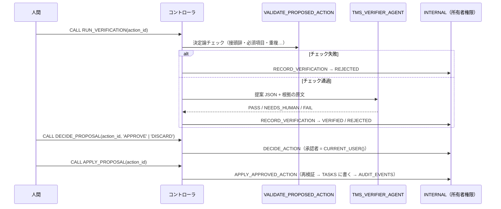

# 04 Verifier + 人間承認（Human in the Loop）

エージェントが作った書き込みの**提案**を、決定論チェックと独立した Verifier エージェントで検証し、人間が承認したものだけを
所有者権限プロシージャが適用・監査します。どのエージェントが作った提案でも、同じゲートを通ります。
前提: [`00_common`](../00_common/)（01 / 02 / 03 の提案もこのパターンで検証できますが、必須ではありません）。比較: [パターン比較表](../README.md#comparison)

## 1. このパターンで分かること

- エージェントに**書き込みをさせず**、提案 → 検証 → 承認 → 適用に分ける方法
- 安い決定論チェックを先に、LLM の検証を後に置く順番
- Verifier の出力が壊れていても **PASS にならない**（フェイルセーフ）設計
- 承認者と変更内容を監査ログに残し、再実行しても二重に適用されない設計

## 2. 構成図



## 3. 作られるオブジェクト

| オブジェクト | 説明 |
|----|----|
| `AGENTS.TMS_VERIFIER_AGENT` | 提案を独立に検証する。読み取り専用ツール（`validate_proposed_action`, `get_task`, `get_project_policy`）のみ |
| `APP.RUN_VERIFICATION(ACTION_ID)` | 決定論チェック → Verifier → 記録 |
| `APP.DECIDE_PROPOSAL(ACTION_ID, DECISION)` | 人間の承認（`APPROVE`）または破棄（`DISCARD`） |
| `APP.APPLY_PROPOSAL(ACTION_ID)` | 承認済みの提案を適用 |

状態遷移と書き込みを行う `INTERNAL.RECORD_VERIFICATION` / `DECIDE_ACTION` / `APPLY_APPROVED_ACTION` は 00_common にあります。

## 4. 構築方法

`./setup.sh` は Verifier エージェント（`agents/verifier.yaml` から生成）、3 つのコントローラプロシージャ、GRANT を作成します。

最終判定（`RECORD_VERIFICATION`）は決定論チェックと Verifier の結果を組み合わせます。

| 決定論チェック | Verifier | 最終 | 提案の状態 |
|----|----|----|----|
| 失敗 | （呼ばない） | FAIL | REJECTED |
| 通過 | PASS | PASS | VERIFIED |
| 通過 | NEEDS_HUMAN（例: HIGH リスク） | NEEDS_HUMAN | VERIFIED（人間が判断） |
| 通過 | FAIL | FAIL | REJECTED |
| 通過 | 解析できない出力 | NEEDS_HUMAN | VERIFIED（PASS にはしない） |

`APPLY_APPROVED_ACTION` は、適用直前にもう一度 `VALIDATE_PROPOSED_ACTION` を実行し、`APPROVED` 以外は拒否します。適用済みなら何もしません。

## 5. 実行と期待結果

`./run.sh -c <your_connection>`（または `sql/90_try.sql`）。他パターンに依存しないよう、提案 2 件を `INSERT` で直接作ります（エージェントの提案と同じ形式）。

| 手順 | 期待結果 |
|----|----|
| 承認前に `APPLY_PROPOSAL` | `ok = false`（`only APPROVED actions can be applied`） |
| 良い提案（CREATE_TASK）を検証 | 決定論チェック通過、Verifier `PASS`、状態 `VERIFIED` |
| 承認 → 適用 | 新しいタスク（`T-1001` など）が作られる |
| もう一度適用 | `action was already applied`（何も起きない） |
| HIGH リスクの変更（T-106 の優先度）を検証 | `NEEDS_HUMAN`（`HIGH_RISK_ACTION`）→ 人間が破棄 |
| 監査ログ | `VERIFIED`（Verifier）→ `APPROVED`（承認者）→ `TASK_CREATED`（承認者） |

2026-10-27 の検証では、すべて期待どおりでした。

01〜03 で作った提案は `APP.V_REVIEW_QUEUE` で `STATUS = 'PROPOSED'` を探し、同じ手順で検証できます。

## 6. 設計上のポイントとトレードオフ

- **人間が最終責任者**: システムは承認も適用も自分ではしません。`RUN_*` プロシージャは `DECIDE` / `APPLY` を呼ばないことをテストで確認しています。
- **最小権限**: 実行ロールは `APP.TASKS` を変更できません。変更できるのは所有者権限プロシージャだけで、その入口は承認済みの提案だけです。
- **独立した検証者**: Verifier は提案を作ったエージェントとは別のエージェントで、根拠の原文と照らして確認します。
- トレードオフ: 人間の操作が必要なぶん、完全自動化より遅くなります。LOW リスクだけ自動承認するなどの緩和は、`DECIDE_ACTION` の前に業務ルールとして実装します。

## 7. 自分のユースケースへの応用

- チケット更新、マスタ変更、メール送信、外部 API 呼び出しなど、副作用のある操作すべてに使えます。`APPLY_APPROVED_ACTION` の中身を自分の書き込み処理に置き換えます。
- 決定論チェック（`VALIDATE_PROPOSED_ACTION`）には、業務ルールで判定できることをできるだけ寄せてください。

## 8. 削除

```bash
./teardown.sh -c <your_connection> --confirm   # Verifier とプロシージャ 3 つを削除
```

## 9. 参考リンク

- [Cortex Agents](https://docs.snowflake.com/en/user-guide/snowflake-cortex/cortex-agents)
- [Cortex Agents のアクセス制御](https://docs.snowflake.com/en/user-guide/snowflake-cortex/cortex-agents-setup)
