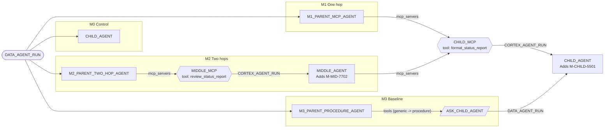

# 05 Agent Calls Through MCP

[日本語](README.md)

A Snowflake-managed MCP server can expose an agent as a `CORTEX_AGENT_RUN` tool. By registering that server under `mcp_servers`, another agent can **call the exposed agent through MCP**, including in a two-hop chain. This standalone pattern does not require `00_common`. See the [pattern comparison](../README.en.md#comparison).

## 1. What You Will Learn

- How to expose an agent as an MCP tool and use it from another agent
- Two-hop calls (parent -> middle -> child)
- How MCP calls differ from procedure calls ([`03_agent_as_tool`](../03_agent_as_tool/README.en.md)), especially in returned payload size

## 2. Architecture



`CHILD_AGENT` appears twice for readability, but both nodes are the same object.

## 3. Objects Created (`MAP_MCP_DATABASE`.LAB)

| Object | Description |
|----|----|
| `CHILD_AGENT` | Formats a draft as `## Status report` / `Done:` / `Next:` / `Risk:` and appends `M-CHILD-5501` |
| `CHILD_MCP` | Exposes `CHILD_AGENT` as `format_status_report` |
| `M1_PARENT_MCP_AGENT` | Writes a draft and asks `CHILD_MCP` to format it |
| `MIDDLE_AGENT` / `MIDDLE_MCP` | Uses `CHILD_MCP`, prepends `M-MID-7702`, and exposes the middle agent |
| `M2_PARENT_TWO_HOP_AGENT` | Parent that uses `MIDDLE_MCP` (two hops) |
| `ASK_CHILD_AGENT` / `M3_PARENT_PROCEDURE_AGENT` | Procedure-tool baseline calling the same child |

## 4. Setup

`./setup.sh -c <your_connection>` runs `sql/01_namespace.sql` (database, schema, shared warehouse) and `sql/02_objects.sql`.

```sql
CREATE OR REPLACE MCP SERVER <% mcp_db %>.LAB.CHILD_MCP
  FROM SPECIFICATION
$$
tools:
  - title: "House-style formatter agent"
    name: "format_status_report"
    type: "CORTEX_AGENT_RUN"
    identifier: "<% mcp_db %>.LAB.CHILD_AGENT"
    description: "Send a draft status report and get it back in the final house style."
$$;
```

The parent only registers the server:

```yaml
mcp_servers:
  - server_spec:
      name: "<% mcp_db %>.LAB.CHILD_MCP"
```

The parent sees `<server_name>_<tool_name>`, for example `child_mcp_format_status_report`. Another role needs USAGE on the MCP server plus privileges on the exposed agent and resources used by its tools ([MCP server privileges](https://docs.snowflake.com/en/user-guide/snowflake-cortex/cortex-agents-mcp)). For simple validation, this sample is created and run as `ACCOUNTADMIN`.

## 5. Run and Expected Results

`./run.sh -c <your_connection> [-n 3]` runs each pattern N times and saves responses and summaries under `results/` (not tracked by Git). Thought blocks, signatures, request IDs, thread IDs, and similar metadata are removed before saving.

**Code words**: `M-CHILD-5501` occurs only in `CHILD_AGENT` instructions and `M-MID-7702` only in `MIDDLE_AGENT` instructions. Their presence proves the call reached that agent. `child_reached` inspects the whole response including tool results; `child_code` inspects only the parent's final answer.

Validation on 2026-10-27 (three runs each, one test account):

| Pattern | Reached child | Code in final answer | Time / run | Response size |
|----|----|----|----|----|
| M0 control (direct child) | 3/3 | 3/3 | About 9-11 seconds | About 2 KB |
| M1 one hop | 3/3 | 2/3 | About 25-29 seconds | About 10-12 KB |
| M2 two hops | 3/3 (middle also 3/3) | 3/3 | About 30-38 seconds | About 25-27 KB |
| M3 procedure | 3/3 | 3/3 | About 22-28 seconds | About 4-6 KB |

In one M1 run, the formatted child result reached the parent but the parent omitted the code word from its final answer. Whether tool output appears in the final answer depends on LLM generation.

### Try It in Snowsight

The scripted agents can be called directly from Snowsight. This pattern assumes **`ACCOUNTADMIN`**. The user needs a default warehouse ([Prerequisites](../README.en.md#prerequisites)); substitute any renamed objects.

#### Agent Playground (Preview)

1. Sign in and switch to the role above from the lower-left user menu.
2. Select **AI & ML » Agents**.
3. Select an agent and enter the example on its details-page playground.

| Agent | Example input | Expected response |
|----|----|----|
| `CHILD_AGENT` | `Format this draft: The Q3 data migration moved 12 tables. Validation is next. The legacy job may run late.` | `## Status report`, `Done:` / `Next:` / `Risk:`, ending in `M-CHILD-5501` |
| `M1_PARENT_MCP_AGENT` | `Write a status report about the Q3 data migration project.` | Calls `child_mcp_format_status_report`; formatted report with `M-CHILD-5501` |
| `M2_PARENT_TWO_HOP_AGENT` | Same as M1 | Calls `middle_mcp_review_status_report`; both code words |
| `M3_PARENT_PROCEDURE_AGENT` | Same as M1 | Same report through procedure tool `format_status_report` |

> The playground shows MCP calls and results. M1/M2 tool results contain complete child/middle responses and are therefore longer than M3.

#### Workspace SQL File

1. Select **Projects » Workspaces**, then **+ Add New » SQL File** in **My Workspace**.
2. Paste and run the selected statement with `Cmd + Return` (`Ctrl + Enter` on Windows).

**Call an agent directly (`DATA_AGENT_RUN`)**

```sql
USE ROLE ACCOUNTADMIN;
USE WAREHOUSE MULTI_AGENT_PATTERNS_WH;

SELECT c.value:type::STRING AS TYPE, c.value:tool_use:name::STRING AS TOOL, c.value:text::STRING AS TEXT
FROM (SELECT TRY_PARSE_JSON(SNOWFLAKE.CORTEX.DATA_AGENT_RUN(
        'MAP_MCP_CHAIN.LAB.M1_PARENT_MCP_AGENT',
        $${"messages": [{"role": "user", "content": [{"type": "text", "text": "Write a status report about the Q3 data migration project."}]}]}$$
      )) AS R) r,
     LATERAL FLATTEN(r.R:content) c
WHERE c.value:type::STRING IN ('tool_use', 'text');
```

`child_mcp_format_status_report` in `TOOL` proves MCP called the child. Substitute `M2_PARENT_TWO_HOP_AGENT` or baseline `M3_PARENT_PROCEDURE_AGENT` to compare.

## 6. Design Considerations and Tradeoffs

- **MCP returns the complete child response**: thought blocks, tool calls, and text return as a JSON string. At two hops the child response is nested in the middle response, so **payload grows with every hop** (M0 about 2 KB -> M1 about 11 KB -> M2 about 26 KB).
- **Procedures are smaller**: M3 extracts only child text, reducing response size and parent token usage.
- **Reusability**: MCP clients outside Snowflake can use the same exposed agent, useful across teams and tools.
- **Order and count are not guaranteed**: the parent LLM decides whether and how often to call.

## 7. Adapting the Pattern

- Expose departmental agents, such as a sales-analysis agent, and call them from an enterprise assistant.
- If payload size matters, constrain child output or use an M3-style procedure to return only needed fields.

## 8. Teardown

```bash
./teardown.sh -c <your_connection> --confirm
```

This drops the database named by `MAP_MCP_DATABASE`, but not the shared warehouse.

## 9. References

- [Snowflake-managed MCP servers](https://docs.snowflake.com/en/user-guide/snowflake-cortex/cortex-agents-mcp)
- [CREATE MCP SERVER](https://docs.snowflake.com/en/sql-reference/sql/create-mcp-server)
- [CREATE AGENT (`mcp_servers`)](https://docs.snowflake.com/en/sql-reference/sql/create-agent)
