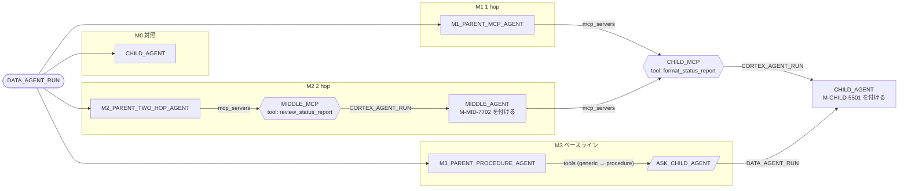

# 05 MCP 経由のエージェント呼び出し

Snowflake マネージド MCP サーバーは、エージェントを `CORTEX_AGENT_RUN` ツールとして公開できます。
別のエージェントがその MCP サーバーを `mcp_servers` に登録すると、**エージェントから MCP 経由で別のエージェントを呼べます**（2 hop も可能）。
単独で動きます（00_common 不要）。比較: [パターン比較表](../README.md#comparison)

## 1. このパターンで分かること

- MCP サーバーでエージェントをツールとして公開する方法と、それを別のエージェントから使う方法
- 2 段（親 → 中間 → 子）の呼び出し
- MCP 経由とプロシージャ経由（[03](../03_agent_as_tool/) の方法）の違い。特に**返ってくるペイロードの大きさ**

## 2. 構成図



`CHILD_AGENT` は見やすさのため 2 回描いていますが、同じオブジェクトです。

## 3. 作られるオブジェクト（`MAP_MCP_DATABASE`.LAB）

| オブジェクト | 説明 |
|----|----|
| `CHILD_AGENT` | 下書きを決まった書式（`## Status report` / `Done:` / `Next:` / `Risk:`）に整え、最後に `M-CHILD-5501` を付ける |
| `CHILD_MCP` | `CHILD_AGENT` を `format_status_report` ツールとして公開する MCP サーバー |
| `M1_PARENT_MCP_AGENT` | 下書きを書き、`CHILD_MCP` で整形させる |
| `MIDDLE_AGENT` / `MIDDLE_MCP` | `CHILD_MCP` を使い、先頭に `M-MID-7702` を付ける中間エージェントと、それを公開する MCP サーバー |
| `M2_PARENT_TWO_HOP_AGENT` | `MIDDLE_MCP` を使う親（2 hop） |
| `ASK_CHILD_AGENT` / `M3_PARENT_PROCEDURE_AGENT` | 同じ子をプロシージャツール経由で呼ぶベースライン |

## 4. 構築方法

`./setup.sh -c <your_connection>` は `sql/01_namespace.sql`（DB・スキーマ、共通ウェアハウス）と `sql/02_objects.sql` を実行します。

MCP サーバーでエージェントを公開します。

```sql
CREATE OR REPLACE MCP SERVER <% mcp_db %>.LAB.CHILD_MCP
  FROM SPECIFICATION
$$
tools:
  - title: "House-style formatter agent"
    name: "format_status_report"
    type: "CORTEX_AGENT_RUN"
    identifier: "<% mcp_db %>.LAB.CHILD_AGENT"
    description: "Send a draft status report and get it back in the final house style."
$$;
```

親エージェントは `mcp_servers` で MCP サーバーを登録するだけです。

```yaml
mcp_servers:
  - server_spec:
      name: "<% mcp_db %>.LAB.CHILD_MCP"
```

親から見たツール名は `<サーバー名>_<ツール名>`（例: `child_mcp_format_status_report`）になります。

他のロールに使わせる場合は、MCP サーバーの USAGE に加えて、公開するエージェントやそのツールが使うリソースへの権限も必要です（[MCP サーバーの権限](https://docs.snowflake.com/en/user-guide/snowflake-cortex/cortex-agents-mcp)）。
このサンプルは検証を簡単にするため `ACCOUNTADMIN` で作成・実行します。

## 5. 実行と期待結果

`./run.sh -c <your_connection> [-n 3]` が各パターンを N 回実行し、`results/`（git 管理外）に応答と要約を保存します。
保存時に、思考ブロック・署名・リクエスト ID・スレッド ID などは取り除きます。

**コードワードの意味**: `M-CHILD-5501` は `CHILD_AGENT` の指示にだけ、`M-MID-7702` は `MIDDLE_AGENT` の指示にだけ書かれています。
親の応答にこれがあれば、呼び出しがそのエージェントまで届いた証拠です。`child_reached` はツール結果を含む応答全体、`child_code` は親の最終回答を見ています。

2026-10-27 の検証結果（各 3 回、1 つのテストアカウント）:

| パターン | 子に到達 | 最終回答にコード | 時間 / 回 | 応答サイズ |
|----|----|----|----|----|
| M0 対照（子を直接） | 3/3 | 3/3 | 約 9〜11 秒 | 約 2 KB |
| M1 1 hop | 3/3 | 2/3 | 約 25〜29 秒 | 約 10〜12 KB |
| M2 2 hop | 3/3（中間も 3/3） | 3/3 | 約 30〜38 秒 | 約 25〜27 KB |
| M3 プロシージャ | 3/3 | 3/3 | 約 22〜28 秒 | 約 4〜6 KB |

M1 の 1 回は、子の整形結果は届いていましたが、親が最終回答からコードワードを落としていました。届いた内容をどう使うかは親の LLM 次第です。

### Snowsight で試す

スクリプトで構築したエージェントには、Snowsight からも直接リクエストできます。このパターンは **`ACCOUNTADMIN`** で作成・実行する前提です。
ユーザーに既定ウェアハウスが設定されている必要があります（[前提条件](../README.md#前提条件)）。オブジェクト名を変えた場合は、以下の名前を読み替えてください。

#### エージェントのプレイグラウンド（Preview）で試す

1. Snowsight にサインインし、左下のユーザーメニューで上記のロールに切り替えます。
2. ナビゲーションメニューで **AI & ML » Agents** を選びます。
3. 一覧から下表のエージェントを選び、エージェントの詳細ページにあるプレイグラウンドにメッセージを入力します。

| エージェント | 入力例 | 期待される応答 |
|----|----|----|
| `CHILD_AGENT` | `Format this draft: The Q3 data migration moved 12 tables. Validation is next. The legacy job may run late.` | `## Status report` と `Done:` / `Next:` / `Risk:`、最後に `M-CHILD-5501` |
| `M1_PARENT_MCP_AGENT` | `Write a status report about the Q3 data migration project.` | MCP ツール `child_mcp_format_status_report` を呼び、整形済みの報告（`M-CHILD-5501` 付き） |
| `M2_PARENT_TWO_HOP_AGENT` | （M1 と同じ） | `middle_mcp_review_status_report` を呼び、`M-MID-7702` と `M-CHILD-5501` の両方を含む報告 |
| `M3_PARENT_PROCEDURE_AGENT` | （M1 と同じ） | プロシージャツール `format_status_report` 経由で同じ報告 |

> プレイグラウンドでは、親エージェントが呼んだ MCP ツールとその結果を応答の中で確認できます。M1 / M2 のツール結果には子（と中間）エージェントの応答全体が入るため、M3 より長くなります。

#### Workspaces の SQL ファイルで試す

1. ナビゲーションメニューで **Projects » Workspaces** を選び、**My Workspace** で **+ Add New » SQL File** を選んで SQL ファイルを作ります。
2. 次の SQL を貼り付け、文を選択して `Cmd + Return`（Windows は `Ctrl + Enter`）で実行します。

**エージェントを直接呼ぶ（`DATA_AGENT_RUN`）**

`SNOWFLAKE.CORTEX.DATA_AGENT_RUN` の応答（JSON）を展開し、ツール呼び出しと最終テキストを 1 行ずつ表示します。

```sql
USE ROLE ACCOUNTADMIN;
USE WAREHOUSE MULTI_AGENT_PATTERNS_WH;

SELECT c.value:type::STRING AS TYPE, c.value:tool_use:name::STRING AS TOOL, c.value:text::STRING AS TEXT
FROM (SELECT TRY_PARSE_JSON(SNOWFLAKE.CORTEX.DATA_AGENT_RUN(
        'MAP_MCP_CHAIN.LAB.M1_PARENT_MCP_AGENT',
        $${"messages": [{"role": "user", "content": [{"type": "text", "text": "Write a status report about the Q3 data migration project."}]}]}$$
      )) AS R) r,
     LATERAL FLATTEN(r.R:content) c
WHERE c.value:type::STRING IN ('tool_use', 'text');
```

`TOOL` 列に `child_mcp_format_status_report` が出れば、MCP サーバー経由で子エージェントが呼ばれています。M2 は `M2_PARENT_TWO_HOP_AGENT`、ベースラインは `M3_PARENT_PROCEDURE_AGENT` に置き換えて比較してください。

## 6. 設計上のポイントとトレードオフ

- **MCP ツールの結果は子の応答全体**: 子の思考ブロック、ツール呼び出し、テキストが JSON 文字列として親に返ります。2 hop では、中間の応答の中に子の応答がまるごと入れ子になります。そのため、**hop ごとにペイロードが増えます**（M0 約 2 KB → M1 約 11 KB → M2 約 26 KB）。
- **プロシージャ経由は小さい**: M3 のプロシージャは子のテキストだけを取り出して返すので、応答が小さくなります（親のトークン消費も小さい）。
- **再利用性**: MCP サーバーは、Snowflake の外の MCP クライアントからも同じエージェントを使えます。複数のチーム・ツールでエージェントを共有したい場合に向きます。
- **順序や回数は保証されない**: 呼ぶかどうか、何回呼ぶかは親の LLM が決めます。

## 7. 自分のユースケースへの応用

- 部門ごとに作ったエージェント（例: 売上分析エージェント）を MCP サーバーで公開し、全社のアシスタントエージェントから呼ぶ構成に使えます。
- ペイロードが問題になる場合は、子の応答を短くする（指示で出力を絞る）か、M3 のようにプロシージャで必要な部分だけを返してください。

## 8. 削除

```bash
./teardown.sh -c <your_connection> --confirm   # MAP_MCP_DATABASE を削除（共通ウェアハウスは残る）
```

## 9. 参考リンク

- [Snowflake マネージド MCP サーバー](https://docs.snowflake.com/en/user-guide/snowflake-cortex/cortex-agents-mcp)
- [CREATE MCP SERVER](https://docs.snowflake.com/en/sql-reference/sql/create-mcp-server)
- [CREATE AGENT（mcp_servers）](https://docs.snowflake.com/en/sql-reference/sql/create-agent)
