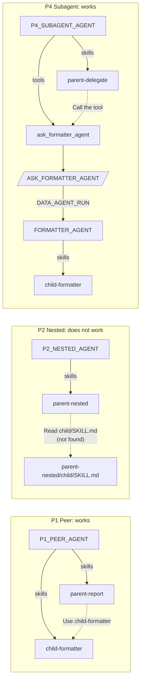

# 06 Skill and Subskill Composition

[日本語](README.md)

This pattern compares delegation from a Cortex Agent **skill** (a staged `SKILL.md`) to another skill or subagent. Registering parent and child as peer skills on one agent is recommended; a nested `SKILL.md` is not loaded. This standalone pattern does not require `00_common`. See the [pattern comparison](../README.en.md#comparison).

## 1. What You Will Learn

- Skill registration with a `STAGE` path under `skills:`
- Correct subskill placement (peer registration) and nonfunctional placement (nesting)
- Delegation to a separate subagent instead of a skill

## 2. Architecture

Solid lines are registrations in `sql/02_agents.sql`; dashed lines are runtime actions directed by skill text.



The sample also includes a subskill-only control (P0) and one combined skill containing both sets of instructions (P3).

## 3. Objects Created (`MAP_SKILL_DATABASE`.LAB)

| Object | Description |
|----|----|
| `SKILL_STAGE` | Stage containing `skills/<name>/SKILL.md`; `setup.sh` uploads `skills/` |
| `P0_CONTROL_AGENT` | `child-formatter` only |
| `P1_PEER_AGENT` | `parent-report` and `child-formatter` registered as peers |
| `P2_NESTED_AGENT` | `parent-nested` only; child is at `parent-nested/child/SKILL.md` |
| `P3_COMBINED_AGENT` | `combined-report`, with both sets of instructions in one skill |
| `P4_SUBAGENT_AGENT` / `FORMATTER_AGENT` / `ASK_FORMATTER_AGENT` | Parent skill + procedure tool -> separate agent with `child-formatter` |

## 4. Setup

`./setup.sh -c <your_connection>` creates the namespace and stage, uploads `skills/` while preserving its directories, and creates agents.

```yaml
# P1_PEER_AGENT specification excerpt: register both parent and child skills.
skills:
  - name: parent-report
    source: {type: STAGE, path: "@<% skill_db %>.LAB.SKILL_STAGE/skills/parent-report"}
  - name: child-formatter
    source: {type: STAGE, path: "@<% skill_db %>.LAB.SKILL_STAGE/skills/child-formatter"}
```

`parent-report` only says to draft a report and format it with `child-formatter`; the format definition exists only in `child-formatter`.

## 5. Run and Expected Results

Run `./run.sh -c <your_connection> [-n 3]`; results go to untracked `results/`.

**Code words**: `P-ALPHA-3141` exists only in the parent body and `C-BRAVO-2718` only in the child format body, not descriptions. Their appearance proves the body was loaded.

Validation on 2026-10-27 (three runs each, one test account):

| Pattern | Parent skill | Subskill | Result | Time / run |
|----|----|----|----|----|
| P0 control | - | 3/3 | Skill loads | About 10 seconds |
| P1 peer | 3/3 | 3/3 | **Works** (`server_skill` called twice) | About 14-17 seconds |
| P2 nested | 3/3 | 0/3 | **Does not work** (`child/SKILL.md` not found; parent answers alone) | About 18-22 seconds |
| P3 combined | 3/3 | 3/3 | Works (baseline) | About 12-13 seconds |
| P4 subagent | 3/3 | 3/3 | Works (separate formatting agent) | About 29-34 seconds |

P2 matches the documented constraint that skill subdirectories are not searched ([Agent skills limitations](https://docs.snowflake.com/en/user-guide/snowflake-cortex/cortex-agents-skills)).

### Try It in Snowsight

The scripted agents can be called directly. This pattern assumes **`ACCOUNTADMIN`** and a default warehouse ([Prerequisites](../README.en.md#prerequisites)). Substitute renamed objects.

#### Agent Playground (Preview)

1. Sign in and switch role from the lower-left user menu.
2. Select **AI & ML » Agents**.
3. Select an agent and enter a message in its playground.

| Agent | Example input | Expected response |
|----|----|----|
| `P0_CONTROL_AGENT` | `Format this draft status report: The Q3 data migration moved 12 tables. Validation is next. The legacy job may run late.` | `## Status report` with `C-BRAVO-2718` |
| `P1_PEER_AGENT` | `Write a status report about the Q3 data migration project.` | Both code words; skills read twice |
| `P2_NESTED_AGENT` | Same as P1 | Only `P-ALPHA-3141`; child unread and format unapplied |
| `P3_COMBINED_AGENT` | Same as P1 | Both code words |
| `P4_SUBAGENT_AGENT` | Same as P1 | Calls `ask_formatter_agent`; both code words |

> The response shows which skills were loaded as skill calls.

#### Workspace SQL File

1. Select **Projects » Workspaces**, then **+ Add New » SQL File** in **My Workspace**.
2. Paste and run the selected statement with `Cmd + Return` (`Ctrl + Enter` on Windows).

**Call an agent directly (`DATA_AGENT_RUN`)**

```sql
USE ROLE ACCOUNTADMIN;
USE WAREHOUSE MULTI_AGENT_PATTERNS_WH;

SELECT c.value:type::STRING AS TYPE, c.value:tool_use:name::STRING AS TOOL, c.value:text::STRING AS TEXT
FROM (SELECT TRY_PARSE_JSON(SNOWFLAKE.CORTEX.DATA_AGENT_RUN(
        'MAP_SKILL_COMPOSITION.LAB.P1_PEER_AGENT',
        $${"messages": [{"role": "user", "content": [{"type": "text", "text": "Write a status report about the Q3 data migration project."}]}]}$$
      )) AS R) r,
     LATERAL FLATTEN(r.R:content) c
WHERE c.value:type::STRING IN ('tool_use', 'text');
```

Two `server_skill` rows in `TOOL` (parent and child) show the peer child was used. Substitute `P2_NESTED_AGENT` to confirm nesting fails.

## 6. Design Considerations and Tradeoffs

| Approach | Advantages | Disadvantages |
|----|----|----|
| P1 peer | Reuses procedure and format separately; no extra call | Shared context; model chooses skills |
| P3 combined | Simplest and fastest | Format cannot be shared |
| P4 subagent | Independent context, instructions, and budget; clearest isolation | One extra, slower agent call |
| P2 nested | - | **Not read**; do not use |

## 7. Adapting the Pattern

- Extract document formats, review criteria, or SQL conventions into reusable peer skills.
- Choose P4 for separate tools, privileges, or context. Like [`03_agent_as_tool`](../03_agent_as_tool/README.en.md), it calls through a procedure; compare [`05_mcp_agent_chaining`](../05_mcp_agent_chaining/README.en.md) when external MCP clients need access.

## 8. Teardown

```bash
./teardown.sh -c <your_connection> --confirm
```

This drops `MAP_SKILL_DATABASE` (default `MAP_SKILL_COMPOSITION`) together with its stage and skills.

## 9. References

- [Agent skills](https://docs.snowflake.com/en/user-guide/snowflake-cortex/cortex-agents-skills)
- [CREATE AGENT (`skills`)](https://docs.snowflake.com/en/sql-reference/sql/create-agent)
