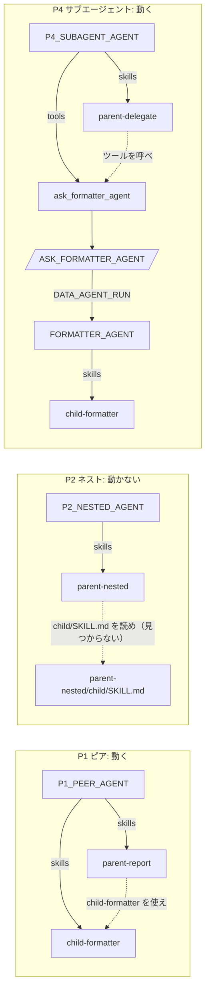

# 06 スキル / サブスキル構成

Cortex Agents の**スキル**（ステージ上の `SKILL.md`）から、別のスキル（サブスキル）やサブエージェントへ処理を渡す方法を比較します。
結論: **サブスキルは同じエージェントに別スキルとして登録すれば使えます。スキルのサブフォルダに置いたサブスキルは読まれません。**
単独で動きます（00_common 不要）。比較: [パターン比較表](../README.md#comparison)

## 1. このパターンで分かること

- スキルの登録方法（`skills:` に `STAGE` のパスを書く）
- 親スキルからサブスキルを使わせる正しい置き方（ピア登録）と、うまくいかない置き方（ネスト）
- スキルではなく、サブエージェント（別エージェント）に処理を委譲する方法

## 2. 構成図

実線は仕様（`sql/02_agents.sql`）で登録したもの、破線は実行時にスキル本文の指示で起きることです。



ほかに、サブスキルだけを登録した対照（P0）と、親とサブスキルを 1 つにまとめた統合スキル（P3）があります。

## 3. 作られるオブジェクト（`MAP_SKILL_DATABASE`.LAB）

| オブジェクト | 説明 |
|----|----|
| `SKILL_STAGE` | `skills/<name>/SKILL.md` を置くステージ（setup.sh が `skills/` をアップロード） |
| `P0_CONTROL_AGENT` | `child-formatter` だけ |
| `P1_PEER_AGENT` | `parent-report` と `child-formatter` をピアとして登録 |
| `P2_NESTED_AGENT` | `parent-nested` だけ（サブスキルは `parent-nested/child/SKILL.md`） |
| `P3_COMBINED_AGENT` | `combined-report`（両方の手順を 1 つに） |
| `P4_SUBAGENT_AGENT` / `FORMATTER_AGENT` / `ASK_FORMATTER_AGENT` | 親スキル + プロシージャツール → `child-formatter` を持つ別エージェント |

## 4. 構築方法

`./setup.sh -c <your_connection>` は名前空間とステージを作り、`skills/` 以下の `SKILL.md` を同じフォルダ構成でステージにアップロードしてから、エージェントを作ります。

```yaml
# P1_PEER_AGENT の仕様（抜粋）: 親とサブスキルを両方登録する
skills:
  - name: parent-report
    source: {type: STAGE, path: "@<% skill_db %>.LAB.SKILL_STAGE/skills/parent-report"}
  - name: child-formatter
    source: {type: STAGE, path: "@<% skill_db %>.LAB.SKILL_STAGE/skills/child-formatter"}
```

親スキル `parent-report` の本文は「下書きを書き、`child-formatter` という別のスキルで整形せよ」と指示するだけです。書式の定義は `child-formatter` にしかありません。

## 5. 実行と期待結果

`./run.sh -c <your_connection> [-n 3]`。結果は `results/`（git 管理外）に保存されます。

**コードワードの意味**: `P-ALPHA-3141` は親スキルの本文だけ、`C-BRAVO-2718` はサブスキル（書式）の本文だけにあります。description には含まれないので、
回答にコードがあれば、そのスキル本文を実際に読み込んだ証拠です。

2026-10-27 の検証結果（各 3 回、1 つのテストアカウント）:

| パターン | 親スキル | サブスキル | 結果 | 時間 / 回 |
|----|----|----|----|----|
| P0 対照 | – | 3/3 | スキルは読み込まれる | 約 10 秒 |
| P1 ピア | 3/3 | 3/3 | **動く**（`server_skill` が 2 回呼ばれる） | 約 14〜17 秒 |
| P2 ネスト | 3/3 | 0/3 | **動かない**（`child/SKILL.md` が見つからず、親だけで回答） | 約 18〜22 秒 |
| P3 統合 | 3/3 | 3/3 | 動く（基準） | 約 12〜13 秒 |
| P4 サブエージェント | 3/3 | 3/3 | 動く（別エージェントで整形） | 約 29〜34 秒 |

P2 の結果は、公式ドキュメントの制約（スキルフォルダのサブディレクトリは探索されない）と一致します（[Agent skills の Limitations](https://docs.snowflake.com/en/user-guide/snowflake-cortex/cortex-agents-skills)）。

## 6. 設計上のポイントとトレードオフ

| 方式 | 長所 | 短所 |
|----|----|----|
| P1 ピア登録 | 手順と書式を別々に再利用できる。追加の呼び出しが不要 | 親とサブスキルが同じコンテキストを共有する。どのスキルを読むかはモデルが決める |
| P3 統合 | 最も単純で速い | 書式を他のスキルと共有できない |
| P4 サブエージェント | サブスキルが独立したコンテキスト・指示・予算で動く。分離が最も明確 | エージェント呼び出しが 1 回増えて遅い |
| P2 ネスト | — | **読まれない**。使わないこと |

## 7. 自分のユースケースへの応用

- 社内の文書書式、レビュー観点、SQL の書き方などを「書式スキル」として切り出し、複数のエージェントにピア登録して共有できます。
- サブスキルに別のツールや権限が必要な場合、あるいは親のコンテキストを汚したくない場合は、P4（サブエージェント）を選んでください。

## 8. 削除

```bash
./teardown.sh -c <your_connection> --confirm   # MAP_SKILL_DATABASE（ステージとスキルを含む）を削除
```

## 9. 参考リンク

- [Agent skills](https://docs.snowflake.com/en/user-guide/snowflake-cortex/cortex-agents-skills)
- [CREATE AGENT（skills）](https://docs.snowflake.com/en/sql-reference/sql/create-agent)
