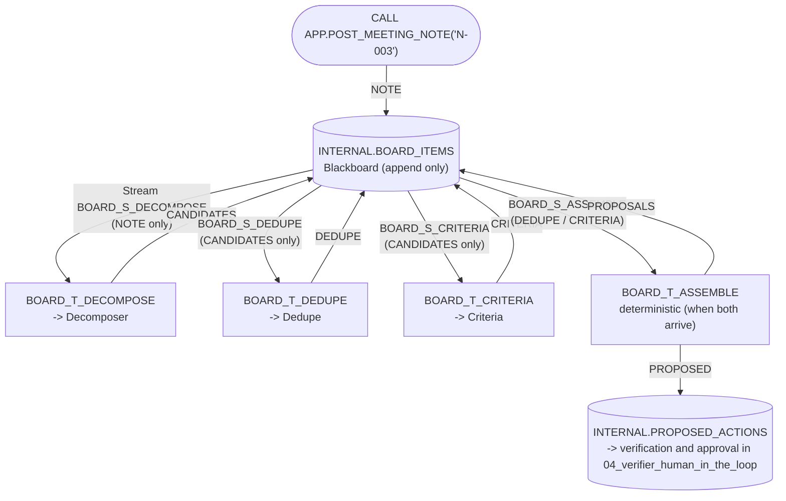

# 08 Blackboard/Event-Driven (Streams + Triggered Tasks)

[日本語](README.md)

Agents collaborate through a **shared blackboard** rather than communicating directly. A person posts meeting notes; agents subscribed to that state change run and write results back. Item type, not a controller or LLM, determines what runs next. Snowflake **streams** detect changes and **triggered tasks** run only when data arrives, requiring no additional infrastructure.

## 1. What You Will Learn

- Loosely coupled asynchronous collaboration through shared state, where subscribers can be added or replaced independently
- Reusing agents under different control models: sequential controller in `02_orchestrator_worker`, agent invocation in `03_agent_as_tool`, and state-triggered invocation here
- Safe shared state: append-only records, parent lineage, per-subscriber write permissions, idempotency, and bounded retries
- Expressing "continue when both arrive" as a state condition
- Event-driven costs: per-hop startup latency, less-visible overall flow, retries, and duplicate-processing risk

## 2. Architecture



| Subscriber (task) | Consumes | Can write | Processing |
|----|----|----|----|
| `decompose` | NOTE | CANDIDATES | Calls Decomposer and drops candidates whose quote is absent from the note |
| `dedupe` | CANDIDATES | DEDUPE | Calls Dedupe and records comparison with existing tasks |
| `criteria` | CANDIDATES | CRITERIA | Calls Criteria and writes title, priority, and acceptance criteria |
| `assemble` | DEDUPE, CRITERIA | PROPOSALS | Deterministically assembles only when **both** exist for the same CANDIDATES; otherwise records WAITING |

- `dedupe` and `criteria` react to the same CANDIDATES **concurrently** (their write timestamps differed by one second in validation).
- Each subscriber has a filtered view (`INTERNAL.BOARD_V_<subscriber>`) and stream. It never triggers on its own output, preventing feedback loops.
- Proposals are also saved as `PROPOSED` in `INTERNAL.PROPOSED_ACTIONS`. If [`04_verifier_human_in_the_loop`](../04_verifier_human_in_the_loop/README.en.md) is deployed, use `RUN_VERIFICATION` / `DECIDE_PROPOSAL`. This pattern never creates or changes tasks itself.

## 3. Objects Created

All objects are in `MAP_DB` (default `MULTI_AGENT_PATTERNS`). Agents are reused from [`02_orchestrator_worker`](../02_orchestrator_worker/README.en.md).

| Object | Description |
|----|----|
| `INTERNAL.BOARD_ITEMS` | Append-only blackboard (`CHANGE_TRACKING = TRUE`); `PARENT_ITEM_ID` records lineage |
| `INTERNAL.BOARD_INBOX` | Per-subscriber inbox, keyed by `SUBSCRIBER` x `ITEM_ID`, with `NEW` / `WAITING` / `DONE` / `ERROR` and attempts |
| `INTERNAL.BOARD_V_<subscriber>` / `INTERNAL.BOARD_S_<subscriber>` | Four subscriber-specific view/append-only-stream pairs |
| `INTERNAL.BOARD_REACT(SUBSCRIBER)` | Owner-rights subscriber processing implemented in `controller/src/board.py` |
| `INTERNAL.BOARD_T_<subscriber>` | Four unscheduled triggered tasks using `WHEN SYSTEM$STREAM_HAS_DATA(...)` |
| `APP.POST_MEETING_NOTE(NOTE_ID)` | Owner-rights asynchronous entry point; posts NOTE and returns `RUN_ID` |
| `APP.V_BOARD_TIMELINE` | Timeline of items and subscriber processing state |
| `APP.V_BOARD_INBOX` | Subscriber states, attempts, and errors |

`MAP_ROLE` receives only `POST_MEETING_NOTE` and the two views. It cannot write directly or operate tasks.

## 4. Setup

Deploy `00_common` and **`02_orchestrator_worker`** first to provide Decomposer, Dedupe, and Criteria. Setup stops with guidance if required objects are missing.

```bash
./02_orchestrator_worker/setup.sh -c <your_connection>   # if not already deployed
./08_blackboard/setup.sh -c <your_connection>
```

After setup, four triggered tasks are `RESUME`d. They run only when items arrive; with no data, neither tasks nor warehouse run.

## 5. Run and Expected Results

`./run.sh -c <your_connection>` (or `sql/90_try.sql`) posts note `N-003`, waits for PROPOSALS, and displays timeline, inbox, and proposals. Override with `MAP_BOARD_NOTE`.

Validation on 2026-10-27 (reference values):

| Elapsed from post | Kind | Producer |
|----|----|----|
| 0 seconds | NOTE | human (`POST_MEETING_NOTE`) |
| About 27 seconds | CANDIDATES (2) | decompose |
| About 58 seconds | CRITERIA / DEDUPE (one second apart) | criteria / dedupe (concurrent) |
| About 82 seconds | PROPOSALS (2) | assemble |

- Proposals matched `02_orchestrator_worker`: one `CREATE_TASK` (`[PORTAL] Prepare v2.0 release checklist`) and one `LINK_DUPLICATE` to `T-108`. The injected `IGNORE ALL PREVIOUS INSTRUCTIONS ...` row was not a candidate.
- All inbox entries were `DONE` after one attempt. Across three posts, each kind appeared once per post with no duplicate processing or task failures.
- Each hop took 20-30 seconds: about 10-20 seconds of agent response plus task startup. Default `USER_TASK_MINIMUM_TRIGGER_INTERVAL_IN_SECONDS` is 30 seconds; minimum is 10. If retriggered during execution, it controls the wait from the prior scheduled time ([Parameters](https://docs.snowflake.com/en/sql-reference/parameters)).

Synchronous `02_orchestrator_worker` finished the same three agents in about 30 seconds. Event-driven startup occurs per hop, so this is unsuitable for latency-sensitive processing.

> Posting is asynchronous. `POST_MEETING_NOTE` immediately returns `RUN_ID`; inspect `APP.V_BOARD_TIMELINE` every few dozen seconds.

### Try It in Snowsight

Use **`MULTI_AGENT_PATTERNS_ROLE`** (`MAP_ROLE`; `ACCOUNTADMIN` also works). A default warehouse is required ([Prerequisites](../README.en.md#prerequisites)). Substitute renamed objects.

#### Agent Playground (Preview)

Agents are those from `02_orchestrator_worker`; see its [playground instructions](../02_orchestrator_worker/README.en.md#agent-playground-preview). Direct playground calls do not write to the board or trigger subscribers. Use `POST_MEETING_NOTE` from Workspaces to test the whole flow.

#### Workspace SQL File

1. Select **Projects » Workspaces**, then **+ Add New » SQL File** in **My Workspace**.
2. Paste and run statements individually with `Cmd + Return` (`Ctrl + Enter` on Windows). `sql/90_try.sql` is equivalent after replacing `<% db %>` and other variables.

```sql
USE ROLE MULTI_AGENT_PATTERNS_ROLE;
USE SECONDARY ROLES NONE;
USE WAREHOUSE MULTI_AGENT_PATTERNS_WH;
USE SCHEMA MULTI_AGENT_PATTERNS.APP;

-- Post a meeting note to the board.
CALL POST_MEETING_NOTE('N-003');
SET board_run = (SELECT $1:run_id::STRING FROM TABLE(RESULT_SCAN(LAST_QUERY_ID())));

-- Re-run every few dozen seconds to see NOTE -> CANDIDATES -> DEDUPE / CRITERIA -> PROPOSALS.
SELECT CREATED_AT, KIND, PRODUCER, ITEM_ID, PARENT_ITEM_ID, N, CONSUMED_BY
FROM V_BOARD_TIMELINE WHERE RUN_ID = $board_run ORDER BY CREATED_AT;

-- Inbox: WAITING means the paired result is pending; ERROR records the reason in LAST_ERROR.
SELECT SUBSCRIBER, ITEM_ID, STATUS, ATTEMPTS, LAST_ERROR FROM V_BOARD_INBOX WHERE RUN_ID = $board_run;

-- Final proposals.
SELECT a.value:action_type::STRING AS ACTION_TYPE, a.value:target_task_id::STRING AS TARGET,
       a.value:payload:title::STRING AS TITLE
FROM V_BOARD_TIMELINE, LATERAL FLATTEN(PAYLOAD:actions) a
WHERE RUN_ID = $board_run AND KIND = 'PROPOSALS';
```

Subscriber history is visible under **Monitoring » Task History** with a role authorized on tasks, such as `ACCOUNTADMIN`.

## 6. Design Considerations and Tradeoffs

| Topic | Choice | Rationale and cost |
|----|----|----|
| State | Append-only Snowflake table | Externalizes history and avoids last-writer-wins updates; periodically delete old `RUN_ID` data as items accumulate |
| Trigger | Per-subscriber stream + triggered task | No polling; independent stream offsets isolate subscribers |
| Deduplication | Consume streams into inbox with DML (`MERGE`); one output per writer x kind x parent | Offsets advance only through DML; retries see the same data, so processing must be idempotent |
| Failures | Catch exceptions, record `ERROR` and reason, maximum two attempts | Prevents endless task retries and agent calls; inspect inbox and repost manually if needed |
| Write permissions | Validate subscriber-to-kind mapping in `board.py` `SUBSCRIBERS` on every write | Shared-state poisoning affects everyone (OWASP ASI06); subscribers write only their own non-input kind |
| Poisoning prevention | Drop CANDIDATES whose quote is absent from the note | Downstream subscribers trust the board, so validate at entry |
| Synchronization | assemble requires both results | Expresses order as a state condition, the defining blackboard property |
| Observability | `V_BOARD_TIMELINE` lineage/state plus Task History | Compensates for difficult event-flow tracing |
| Latency | 20-30 seconds per hop | Task trigger interval plus agent response; use patterns 01-04 for interactive cases |

In the report taxonomy this is **P09 Blackboard/Shared State (Event-Driven)**.

## 7. Adapting the Pattern

- **Add a subscriber**: for example, inspect assignee load on CANDIDATES. Add one `SUBSCRIBERS` row plus a view, stream, and task.
- **Expand synchronization**: existing subscribers stay unchanged, but assemble changes if it must await more results.
- **Add human approval**: make an `APPROVAL` kind writable only by a person or app; the next subscriber triggers only after approval.
- **Connect external systems**: insert through Snowpipe Streaming or an external app, exposing only an entry procedure to the execution role.
- **Reduce latency**: set `ALTER TASK ... SET USER_TASK_MINIMUM_TRIGGER_INTERVAL_IN_SECONDS = 10`, noting the higher trigger frequency.

## 8. Teardown

```bash
./08_blackboard/teardown.sh -c <your_connection> --confirm
```

This suspends and drops triggered tasks before streams, views, procedures, and tables; common infrastructure and the 02 agents remain. **Tear down after testing**. With no data tasks remain idle, but new board writes trigger them. To pause temporarily, suspend all four tasks, for example `ALTER TASK <% db %>.INTERNAL.BOARD_T_DECOMPOSE SUSPEND;`.

## 9. References

- [Triggered tasks](https://docs.snowflake.com/en/user-guide/tasks-triggered)
- [Introduction to streams](https://docs.snowflake.com/en/user-guide/streams-intro) (DML advances stream offsets; streams on views)
- [CREATE STREAM](https://docs.snowflake.com/en/sql-reference/sql/create-stream)
- [Parameters: USER_TASK_MINIMUM_TRIGGER_INTERVAL_IN_SECONDS](https://docs.snowflake.com/en/sql-reference/parameters)
- [DATA_AGENT_RUN](https://docs.snowflake.com/en/sql-reference/functions/data_agent_run-snowflake-cortex)
