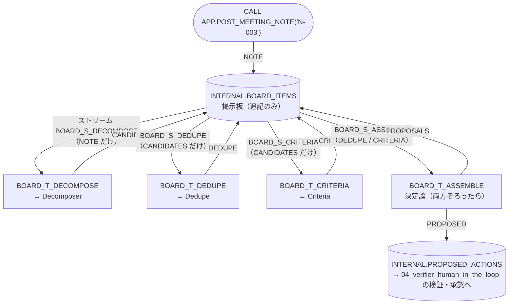

# 08 ブラックボード／イベント駆動（ストリーム + トリガータスク）

[English](README.en.md)

エージェント同士が直接やり取りせず、**共有の掲示板（ブラックボード）**を介して協調します。
人が会議メモを投稿すると、その状態変化を購読するエージェントが起動し、処理結果を掲示板へ書き戻します。次に動く処理は、コントローラや LLM ではなく、掲示板に書かれた項目の種類によって決まります。

Snowflake の **ストリーム**（変更の検知）と **トリガータスク**（データが来たときだけ動くタスク）で、追加の基盤なしに実現します。

## 1. このパターンで分かること

- 共有状態を介して、疎結合かつ非同期に協調する方法。購読者を追加・交換しても、ほかの購読者を変更する必要はない
- 同じエージェントを異なる制御方式で使う方法。`02_orchestrator_worker` はコントローラが順に呼び、`03_agent_as_tool` はエージェントが呼び出し、`08_blackboard` は状態変化を契機に起動する
- 共有状態を安全に保つための設計: 追記のみ、来歴（親項目）、購読者ごとの書き込み権限、冪等な処理、試行回数の上限
- 「両方そろったら次へ」という待ち合わせを、状態の条件として書く方法
- イベント駆動の代償: 1 ホップごとの起動遅延、全体の流れの見えにくさ、失敗時の再実行と二重処理

## 2. 構成図



| 購読者（タスク） | 消費する種類 | 書ける種類 | 処理 |
|----|----|----|----|
| `decompose` | NOTE | CANDIDATES | Decomposer を呼び、引用が会議メモに無い候補を捨ててから書く |
| `dedupe` | CANDIDATES | DEDUPE | Dedupe を呼び、既存タスクとの重複判定を書く |
| `criteria` | CANDIDATES | CRITERIA | Criteria を呼び、タイトル・優先度・受け入れ基準を書く |
| `assemble` | DEDUPE, CRITERIA | PROPOSALS | 同じ CANDIDATES に対する DEDUPE と CRITERIA が**両方そろったときだけ**提案を組み立てる（LLM なし）。片方だけなら WAITING で次の起動を待つ |

- `dedupe` と `criteria` は同じ CANDIDATES に**同時に**反応します（検証では書き込み時刻の差は 1 秒でした）。
- 購読者ごとに、消費する種類だけを見るビュー（`INTERNAL.BOARD_V_<購読者>`）とその上のストリームを持ちます。自分が書く種類では起動しないため、自分の出力で自分が再起動するループが起きません。
- 提案は `INTERNAL.PROPOSED_ACTIONS` に `PROPOSED` としても保存されます。[`04_verifier_human_in_the_loop`](../04_verifier_human_in_the_loop/) を構築していれば、`RUN_VERIFICATION` / `DECIDE_PROPOSAL` で検証・承認できます。`08_blackboard` 自身はタスクを作成・変更しません。

## 3. 作られるオブジェクト

すべて `MAP_DB`（既定 `MULTI_AGENT_PATTERNS`）内です。エージェントは `02_orchestrator_worker` のものを再利用します。

| オブジェクト | 説明 |
|----|----|
| `INTERNAL.BOARD_ITEMS` | 掲示板（追記のみ、`CHANGE_TRACKING = TRUE`）。項目は更新せず、新しい項目を書く。`PARENT_ITEM_ID` が来歴 |
| `INTERNAL.BOARD_INBOX` | 購読者ごとの受信箱（`SUBSCRIBER` × `ITEM_ID` が主キー）。`NEW` / `WAITING` / `DONE` / `ERROR` と試行回数 |
| `INTERNAL.BOARD_V_<購読者>` / `INTERNAL.BOARD_S_<購読者>` | 購読者ごとのビューと、その上の追記専用ストリーム（4 組） |
| `INTERNAL.BOARD_REACT(SUBSCRIBER)` | 購読者の処理（所有者権限）。中身は `controller/src/board.py` |
| `INTERNAL.BOARD_T_<購読者>` | トリガータスク（スケジュールなし、`WHEN SYSTEM$STREAM_HAS_DATA(...)`、4 つ） |
| `APP.POST_MEETING_NOTE(NOTE_ID)` | 入口（所有者権限、非同期）。会議メモを NOTE 項目として投稿し、`RUN_ID` を返す |
| `APP.V_BOARD_TIMELINE` | 掲示板の項目と各購読者の処理状態を時系列で確認するビュー |
| `APP.V_BOARD_INBOX` | 購読者ごとの受信状態、試行回数、エラーを確認するビュー |

実行ロール（`MAP_ROLE`）に許可するのは、`POST_MEETING_NOTE` と 2 つのビューだけです。掲示板に直接書き込むことも、タスクを操作することもできません。

## 4. 構築方法

前提として、`00_common` と **`02_orchestrator_worker`** を構築してください。Decomposer / Dedupe / Criteria エージェントを再利用するためです。必要なオブジェクトがない場合、セットアップは停止して案内を表示します。

```bash
./02_orchestrator_worker/setup.sh -c <your_connection>   # まだなら
./08_blackboard/setup.sh -c <your_connection>
```

セットアップが終わると、4 つのトリガータスクは `RESUME` 状態になります。タスクは**掲示板に新しい項目が書かれたときだけ**動きます。データがない間は実行されず、ウェアハウスも起動しません。

## 5. 実行と期待結果

`./run.sh -c <your_connection>`（または `sql/90_try.sql`）。会議メモ `N-003` を投稿し、PROPOSALS が書かれるまで待ってから、タイムライン・受信箱・提案を表示します（投稿するメモは環境変数 `MAP_BOARD_NOTE` で変更可）。

2026-10-27 の検証結果（参考値）:

| 時刻（投稿からの経過） | 種類 | 書いた購読者 |
|----|----|----|
| 0 秒 | NOTE | human（`POST_MEETING_NOTE`） |
| 約 27 秒 | CANDIDATES（2 件） | decompose |
| 約 58 秒 | CRITERIA / DEDUPE（1 秒差） | criteria / dedupe（並行） |
| 約 82 秒 | PROPOSALS（2 件） | assemble |

- 提案は `02_orchestrator_worker` と同じ 2 件でした。1 件は `CREATE_TASK`（`[PORTAL] Prepare v2.0 release checklist`）、もう 1 件は既存の `T-108` への `LINK_DUPLICATE` です。注入行（`IGNORE ALL PREVIOUS INSTRUCTIONS ...`）は候補になりませんでした。
- 受信箱はすべて `DONE` で、試行回数は 1 回でした。3 回投稿した結果、各種類の項目は投稿ごとに 1 件ずつ作られ、二重処理とタスクの失敗はありませんでした。
- 1 ホップあたりの所要時間は 20〜30 秒でした。内訳は、エージェントの応答時間（約 10〜20 秒）とトリガータスクの起動待ちです。`USER_TASK_MINIMUM_TRIGGER_INTERVAL_IN_SECONDS` の既定値は 30 秒、最小値は 10 秒です。このパラメータは、タスクの実行中に再びトリガーされた場合、前回のスケジュール時刻から次の実行まで待つ秒数を定めます（[Parameters](https://docs.snowflake.com/en/sql-reference/parameters)）。

同じ 3 つのエージェントを同期的に呼ぶ `02_orchestrator_worker` は、約 30 秒で完了しました。イベント駆動ではホップごとに起動待ちが加わるため、即時性が必要な処理には向きません。

> 投稿は非同期です。`POST_MEETING_NOTE` は `RUN_ID` をすぐに返し、以降は購読者が自律的に動きます。`APP.V_BOARD_TIMELINE` を数十秒おきに確認してください。

### Snowsight で試す

ロールは実行ロール **`MULTI_AGENT_PATTERNS_ROLE`**（`MAP_ROLE`）を使います（`ACCOUNTADMIN` でも動きます）。ユーザーに既定ウェアハウスが設定されている必要があります（[前提条件](../README.md#前提条件)）。オブジェクト名を変えた場合は読み替えてください。

#### エージェントのプレイグラウンド（Preview）で試す

`08_blackboard` のエージェントは `02_orchestrator_worker` と同じです。個々のエージェントの試し方は [`02_orchestrator_worker` の README](../02_orchestrator_worker/README.md#エージェントのプレイグラウンドpreviewで試す) を参照してください。
プレイグラウンドからエージェントを直接呼び出しても、掲示板には何も書かれません。そのため、購読者は起動しません。処理全体を確認するには、Workspaces から `POST_MEETING_NOTE` を実行してください。

#### Workspaces の SQL ファイルで試す

1. ナビゲーションメニューで **Projects » Workspaces** を選び、**My Workspace** で **+ Add New » SQL File** を選んで SQL ファイルを作ります。
2. 次の SQL を貼り付け、文を 1 つずつ選択して `Cmd + Return`（Windows は `Ctrl + Enter`）で実行します（`sql/90_try.sql` も同じ内容です。`<% db %>` などは置き換えてください）。

```sql
USE ROLE MULTI_AGENT_PATTERNS_ROLE;
USE SECONDARY ROLES NONE;
USE WAREHOUSE MULTI_AGENT_PATTERNS_WH;
USE SCHEMA MULTI_AGENT_PATTERNS.APP;

-- Post a meeting note to the board.
CALL POST_MEETING_NOTE('N-003');
SET board_run = (SELECT $1:run_id::STRING FROM TABLE(RESULT_SCAN(LAST_QUERY_ID())));

-- Re-run every few dozen seconds to see NOTE -> CANDIDATES -> DEDUPE / CRITERIA -> PROPOSALS.
SELECT CREATED_AT, KIND, PRODUCER, ITEM_ID, PARENT_ITEM_ID, N, CONSUMED_BY
FROM V_BOARD_TIMELINE WHERE RUN_ID = $board_run ORDER BY CREATED_AT;

-- Inbox: WAITING means the paired result is pending; ERROR records the reason in LAST_ERROR.
SELECT SUBSCRIBER, ITEM_ID, STATUS, ATTEMPTS, LAST_ERROR FROM V_BOARD_INBOX WHERE RUN_ID = $board_run;

-- Final proposals.
SELECT a.value:action_type::STRING AS ACTION_TYPE, a.value:target_task_id::STRING AS TARGET,
       a.value:payload:title::STRING AS TITLE
FROM V_BOARD_TIMELINE, LATERAL FLATTEN(PAYLOAD:actions) a
WHERE RUN_ID = $board_run AND KIND = 'PROPOSALS';
```

購読者タスクの実行履歴は Snowsight の **Monitoring » Task History** で確認できます（`ACCOUNTADMIN` など、タスクに権限のあるロールで表示します）。

## 6. 設計上のポイントとトレードオフ

| 論点 | このパターンでの選択 | 理由・代償 |
|----|----|----|
| 状態の置き場所 | Snowflake の追記専用テーブル | 状態をプロセス外に置いて履歴を残す。上書きしないため、最後の書き込みが勝つ競合更新は起きない。項目は増え続けるので、必要に応じて古い `RUN_ID` のデータを定期的に削除する |
| 起動の仕組み | 購読者ごとのストリーム + トリガータスク | ポーリング不要で、データが来たときだけ動く。購読者ごとにストリームのオフセットが独立し、他の購読者の処理状況に影響されない |
| 二重処理の防止 | ストリームを DML（MERGE）で受信箱に移して消費し、出力は（書き手 × 種類 × 親項目）で 1 件に限定 | ストリームは DML で読んだときにだけオフセットが進む。タスクが失敗すると同じデータで再実行されるため、処理を冪等にする |
| 失敗の扱い | 例外を外に出さず、受信箱に `ERROR` と理由を記録（試行は最大 2 回） | タスクを失敗させると再実行が続き、エージェント呼び出しが積み上がる。失敗は受信箱で確認し、必要に応じて人が再投稿する |
| 書き込み権限 | 購読者 → 書ける種類の対応表（`board.py` の `SUBSCRIBERS`）を、すべての書き込みで検査 | 共有状態の汚染は全員に波及する（OWASP ASI06）。購読者は自分の種類しか書けず、自分が消費する種類は書けない（テストで検査） |
| 汚染の防止 | CANDIDATES は、引用が会議メモ本文に無い候補を捨ててから書く | 後続の購読者は掲示板を信頼するので、入口で検証する |
| 待ち合わせ | assemble は「両方そろったら」の条件で動く | 順序をコードで決めず、状態の条件として表す。これがブラックボードの特徴 |
| 全体の見えにくさ | `V_BOARD_TIMELINE`（来歴と処理状態）と Task History | イベント駆動は「誰がいつ動いたか」を追いにくい。来歴を掲示板に残すことで補う |
| 遅延 | 1 ホップ 20〜30 秒 | トリガータスクの最小起動間隔とエージェントの応答時間。対話的な用途には `01_router_handoff`〜`04_verifier_human_in_the_loop` を使う |

レポート上の位置づけは **P09 ブラックボード／共有状態（イベント駆動）**です。

## 7. 自分のユースケースへの応用

- **購読者を追加する**: 例えば、`CANDIDATES` を見て担当者の負荷を確認する購読者を追加できます。`board.py` の `SUBSCRIBERS` に定義を 1 行追加し、ビュー、ストリーム、タスクを 1 組作成します。
- **待ち合わせ条件を増やす**: 購読者を追加しても、既存の購読者は変更しません。ただし、assemble が待つ結果を増やす場合は、assemble の処理も変更します。
- **人の承認を挟む**: 掲示板に `APPROVAL` 種類を作り、人（またはアプリ）だけが書けるようにすると、承認が書かれたときだけ次の購読者が動きます。
- **外部システムとつなぐ**: 掲示板への書き込みを Snowpipe Streaming や外部アプリからの INSERT にすれば、外部イベントでエージェントを起動できます（実行ロールには入口プロシージャだけを渡す）。
- **遅延を短くする**: `ALTER TASK ... SET USER_TASK_MINIMUM_TRIGGER_INTERVAL_IN_SECONDS = 10` で最小起動間隔を短くできます（起動回数が増える点に注意）。

## 8. 削除

```bash
./08_blackboard/teardown.sh -c <your_connection> --confirm
```

トリガータスクを停止・削除してから、ストリーム・ビュー、プロシージャ、テーブルを削除します（共通基盤と `02_orchestrator_worker` のエージェントは残ります）。
**試し終わったら削除してください**。タスクはデータが無ければ動きませんが、掲示板に書き込むと動きます。一時的に止める場合は `ALTER TASK <% db %>.INTERNAL.BOARD_T_DECOMPOSE SUSPEND;` などで 4 つのタスクを停止します。

## 9. 参考リンク

- [Triggered tasks](https://docs.snowflake.com/en/user-guide/tasks-triggered)
- [Introduction to streams](https://docs.snowflake.com/en/user-guide/streams-intro)（ストリームのオフセットが DML で進むこと、ビュー上のストリーム）
- [CREATE STREAM](https://docs.snowflake.com/en/sql-reference/sql/create-stream)
- [Parameters: USER_TASK_MINIMUM_TRIGGER_INTERVAL_IN_SECONDS](https://docs.snowflake.com/en/sql-reference/parameters)
- [DATA_AGENT_RUN](https://docs.snowflake.com/en/sql-reference/functions/data_agent_run-snowflake-cortex)
