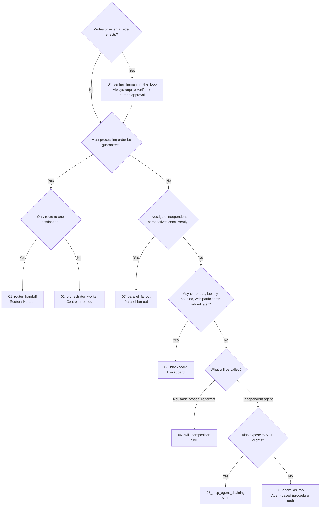

# Snowflake Multi-Agent Architecture Patterns

[日本語](README.md)

This collection introduces **eight multi-agent architectures** built with Snowflake Cortex Agents. Each pattern includes build scripts and explanations, so running the scripts reproduces the architecture in your account. Each README explains the scripts with SQL excerpts, design considerations, and ways to adapt the pattern to your use case.

> This is not a step-by-step build guide. First create a working architecture, then understand it by reading the code.

> **Note**: These patterns are based on Snowflake features and specifications **as of October 2026**. Available architectures and behavior may change as Cortex Agents, MCP servers, agent skills, and related features evolve. See the [official documentation](https://docs.snowflake.com/en/user-guide/snowflake-cortex/cortex-agents) for current information.

## Pattern List

| No. | Folder | Pattern | In Brief |
|----|----|----|----|
| 00 | [`00_common/`](00_common/README.en.md) | Common foundation | Fictitious task management system used by 01-04, 07, and 08 (data, tools, control tables, controllers) |
| 01 | [`01_router_handoff/`](01_router_handoff/README.en.md) | Router / Handoff | A router classifies a request and hands it to one specialist agent (or a human) |
| 02 | [`02_orchestrator_worker/`](02_orchestrator_worker/README.en.md) | Orchestrator / Worker (controller-based) | A Python controller calls Worker agents sequentially and aggregates results |
| 03 | [`03_agent_as_tool/`](03_agent_as_tool/README.en.md) | Orchestrator / Worker (agent-based) | An orchestrator **agent** calls Worker agents through procedure tools |
| 04 | [`04_verifier_human_in_the_loop/`](04_verifier_human_in_the_loop/README.en.md) | Verifier + human approval | Deterministic checks -> Verifier agent -> human approval -> application and audit |
| 05 | [`05_mcp_agent_chaining/`](05_mcp_agent_chaining/README.en.md) | Agent invocation through MCP | Calls another agent with a Snowflake-managed MCP server's `CORTEX_AGENT_RUN` tool (one hop / two hops) |
| 06 | [`06_skill_composition/`](06_skill_composition/README.en.md) | Skill / subskill composition | An agent skill delegates work to another skill (subskill) or subagent |
| 07 | [`07_parallel_fanout/`](07_parallel_fanout/README.en.md) | Parallel fan-out / fan-in | Runs three reviewer agents **concurrently** in a task graph and aggregates deterministically |
| 08 | [`08_blackboard/`](08_blackboard/README.en.md) | Blackboard / event-driven | Agents coordinate only through a shared blackboard; streams + triggered tasks react to state changes |

Mapping to common multi-agent architecture classifications (P01-P11):

| General Pattern | This Material |
|----|----|
| P01 Sequential (pipeline) | `02_orchestrator_worker` (calls sequentially according to the wiring table) |
| P02 Parallel fan-out / fan-in | **`07_parallel_fanout`** |
| P03 Router / handoff | `01_router_handoff` |
| P04 Orchestrator-worker | `02_orchestrator_worker` (code coordinates), `03_agent_as_tool` (agent coordinates), `05_mcp_agent_chaining` (calls through MCP) |
| P05 Hierarchical, P06 Swarm, P07 Group chat, P11 A2A | Not included (limited benefit with the small number of agents in this use case, or no native Snowflake mechanism) |
| P08 Verification (evaluation/optimization loop) | `04_verifier_human_in_the_loop` (verifier + human approval) |
| P09 Blackboard / shared state and event-driven | **`08_blackboard`** |
| P10 Graph / state machine | `07_parallel_fanout` task graph (extensible with conditional tasks) |

## Choosing a Pattern

<a id="comparison"></a>

| Consideration | `01_router_handoff` | `02_orchestrator_worker` | `03_agent_as_tool` | `04_verifier_human_in_the_loop` | `05_mcp_agent_chaining` | `06_skill_composition` | `07_parallel_fanout` | `08_blackboard` |
|----|----|----|----|----|----|----|----|----|
| Coordination determined by | Code (validates router output) | Code (wiring table) | Orchestrator LLM | Code (fixed verification procedure) | Parent-agent LLM | Parent-agent LLM (skill-body instructions) | Code (task graph) | Blackboard state (subscription conditions) |
| Final response owner | Selected specialist / human | Controller (aggregation) -> human | Orchestrator (controller validates) | Human (approver) | Parent agent | Parent agent | Aggregation procedure (deterministic) | Blackboard `PROPOSALS` item -> human |
| Context isolation | Independent per agent | Independent per agent | Workers independent (called with one tool input) | Independent | Children independent, but full child response returns to parent | Peer/integrated skills share context; subagent independent | Independent (only perspective-specific columns passed) | Independent (reads blackboard items only) |
| Invocation order guaranteed | Yes | Yes | No (instructions possible; LLM decides order) | Yes | No | No | Unordered (concurrent); aggregation always last | Dependencies only (state conditions decide) |
| Payload | Small | Small (required fields only) | Medium | Small | **Grows per hop** | Small-medium | Small | Small (per item) |
| Trace | `V_RUN_TRACE` (one row per step) | `V_RUN_TRACE` | Orchestrator record + each agent's Monitoring | `V_RUN_TRACE` + `AUDIT_EVENTS` | Nested in parent response JSON | Parent response (`server_skill` call) | `V_REVIEW_WORKERS` + Task History | `V_BOARD_TIMELINE` (provenance) + Task History |
| Writes | Proposals only | Proposals only | Proposals only | After approval, only owner's rights procedure executes | None (read-only) | None (read-only) | None (report only) | Proposals only |
| Suitable for | Front-door routing | Fixed decomposition/aggregation | Flexible decomposition/aggregation order | Workflows with writes | Reusing another team's agents; sharing with external MCP clients | Reusing procedures/formats; modular agents | Comprehensive review from independent perspectives | Loosely coupled asynchronous long-running work; adding/replacing subscribers |

Selection guide:



## Prerequisites

- Snowflake account and user able to use `ACCOUNTADMIN` (to create roles, warehouse, and databases)
- Region supporting Cortex Agents, or account with cross-region inference (`CORTEX_ENABLED_CROSS_REGION`) enabled
- User default warehouse (`DEFAULT_WAREHOUSE`) configured (required for agent execution)
- [Snowflake CLI](https://docs.snowflake.com/en/developer-guide/snowflake-cli/installation/installation) 3.x (`snow`) and an account connection (`snow connection add`)
- Python 3.11+ (for `05_mcp_agent_chaining` / `06_skill_composition` run scripts and tests). For tests: `pip install -r tests/requirements.txt`

## Quick Start

```bash
cd handson/multi-agent-patterns
cp .env.example .env                 # Set MAP_CONNECTION=<your_connection> (.env is not tracked by Git)
snow connection list                 # Check connection name

scripts/setup_all.sh                 # Create 00_common through 08_blackboard (-c <your_connection> also supported)
./01_router_handoff/run.sh           # Try each pattern (run.sh or sql/90_try.sql)
scripts/teardown_all.sh --confirm    # Remove all (patterns, then common foundation; without --confirm nothing is removed)
```

For one pattern, observe dependencies. `01_router_handoff`-`04_verifier_human_in_the_loop` require `00_common`; `03_agent_as_tool` also uses `02_orchestrator_worker` Workers.

```bash
./00_common/setup.sh -c <your_connection>
./02_orchestrator_worker/setup.sh -c <your_connection>
./02_orchestrator_worker/run.sh -c <your_connection>
```

`05_mcp_agent_chaining` and `06_skill_composition` run independently (`./05_mcp_agent_chaining/setup.sh` -> `run.sh`). `07_parallel_fanout` requires only `00_common`; `08_blackboard` requires `00_common` and `02_orchestrator_worker`.

## Objects Created

All names are configurable by environment variables ([`.env.example`](.env.example)). Dedicated namespaces are used without touching existing objects.

| Variable | Default | Purpose |
|----|----|----|
| `MAP_DATABASE` | `MULTI_AGENT_PATTERNS` | `00_common`-`04_verifier_human_in_the_loop`, `07_parallel_fanout`, `08_blackboard` (schemas `APP` / `AGENTS` / `INTERNAL`) |
| `MAP_MCP_DATABASE` | `MAP_MCP_CHAIN` | `05_mcp_agent_chaining` (schema `LAB`) |
| `MAP_SKILL_DATABASE` | `MAP_SKILL_COMPOSITION` | `06_skill_composition` (schema `LAB`) |
| `MAP_WAREHOUSE` | `MULTI_AGENT_PATTERNS_WH` | All patterns (XSMALL, 60-second auto-suspend) |
| `MAP_ROLE` | `MULTI_AGENT_PATTERNS_ROLE` | Least-privilege execution for 01-04, 07, and 08 |
| `MAP_ENABLE_CROSS_REGION` | `false` | Only if `true` and currently disabled, enable account cross-region inference |

### Removal (Teardown)

| Script | Removes |
|----|----|
| `scripts/teardown_all.sh --confirm` | All patterns and common foundation in reverse dependency order; skips absent patterns, so it is repeatable |
| `<pattern>/teardown.sh --confirm` | Only that pattern's objects: agents/procedures for 01-04; additionally tasks/streams/tables for 07/08; each database for 05/06 |
| `00_common/teardown.sh --confirm` | Common DB (including 01-04, 07, 08), warehouse, and role. If 05/06 remain, their shared warehouse is also removed |

Removal order: `08_blackboard` -> `07_parallel_fanout` -> `04_verifier_human_in_the_loop` -> `03_agent_as_tool` -> `02_orchestrator_worker` -> `01_router_handoff` -> `06_skill_composition` -> `05_mcp_agent_chaining` -> `00_common`.

Because every pattern shares the warehouse, 05/06 teardown does not remove it. Even after trying only those two, run `scripts/teardown_all.sh --confirm`. Teardown does not revert account settings (cross-region inference).

Account settings change only with `MAP_ENABLE_CROSS_REGION=true`. User settings (including default warehouse) are not changed; guidance is displayed if required.

## Cost Guidance

- Warehouse: XSMALL, 60-second auto-suspend.
- One agent call takes seconds to tens of seconds (reference values below). Calls per `run.sh`: 01: 8 (router 5 + specialist 3); 02: 3; 03: 4 (orchestrator 1 + Workers 3); 04: 2; 07: 6 (parallel 3 + sequential baseline 3); 08: 3. 05 has 12 parent calls + nested calls; 06 has 15 calls + P4 subagent calls (default 3 runs x pattern count, configurable with `-n`).
- 07/08 use tasks on `MAP_WAREHOUSE`. 08 triggered tasks execute only for new blackboard items (no charge while waiting). Teardown after use.
- Cortex Agents pricing depends on model and token count. See Snowflake's Service Consumption Table for current rates.

## Reference Measurements (Behavior During Validation)

Results from running each pattern in one test account on 2026-10-27. Model behavior can change; these are not guaranteed.

| Pattern | Result |
|----|----|
| `01_router_handoff` | Five requests routed as expected: status / intake / change / human / human. Router 5-9 seconds; Status about 12 seconds |
| `02_orchestrator_worker` | Meeting note N-003 produced one CREATE_TASK and one LINK_DUPLICATE (T-108); injected row ignored; agents totaled about 28 seconds |
| `03_agent_as_tool` | Same two as 02; one orchestrator call about 42 seconds; Worker order differed from instructions (Criteria -> Dedupe) |
| `04_verifier_human_in_the_loop` | Pre-approval application rejected; PASS -> approval -> application (T-1001 created); reapplication no-op; HIGH-risk change NEEDS_HUMAN |
| `05_mcp_agent_chaining` | Child reached in M1 3/3, M2 3/3, M3 3/3; response sizes M0 ~2 KB, M1 ~11 KB, M2 ~26 KB, M3 ~5 KB |
| `06_skill_composition` | Peer registration (P1) 3/3; nested placement (P2) 0/3 (not read); integration (P3) 3/3; subagent (P4) 3/3 |
| `07_parallel_fanout` | Parallel ~21-23 sec (three reviewers started simultaneously), sequential ~39-41 sec; both found same 5 tasks (HIGH 2, MEDIUM 3); one failed Worker yields PARTIAL report |
| `08_blackboard` | N-003 post to PROPOSALS ~82-86 sec (20-30 sec/hop; Dedupe and Criteria parallel); same two proposals as 02; no duplicate processing |

## Folder Structure

```text
multi-agent-patterns/
|-- README.md               This file (pattern comparison and selection)
|-- .env.example            Example connection/object-name settings
|-- scripts/                Common shell functions, complete setup/teardown, publication checks, agent SQL generation
|-- controller/             Python controllers (src/) and JSON contracts (schemas/) for 01-04, 07, and 08
|-- 00_common/ .. 08_*/     Patterns (README.md, setup.sh, run.sh, teardown.sh, sql/, agents/, etc.)
|-- docs/troubleshooting.md Common errors and remedies
`-- tests/                  Offline static tests (python3 -m pytest tests -q)
```

## For Developers

- Each pattern's `agents/*.yaml` is the source of truth. After editing, regenerate `sql/10_agents.sql` with `python3 scripts/build_agents_sql.py`.
- Before committing, run `scripts/check_public.sh`. It checks public files for strings in `.env`'s `MAP_DENYLIST` (such as your account name) and runs static tests.

## Troubleshooting

See [docs/troubleshooting.md](docs/troubleshooting.md).

## References

- [Cortex Agents](https://docs.snowflake.com/en/user-guide/snowflake-cortex/cortex-agents)
- [CREATE AGENT](https://docs.snowflake.com/en/sql-reference/sql/create-agent)
- [DATA_AGENT_RUN (SNOWFLAKE.CORTEX)](https://docs.snowflake.com/en/sql-reference/functions/data_agent_run-snowflake-cortex)
- [Cortex Agents access control](https://docs.snowflake.com/en/user-guide/snowflake-cortex/cortex-agents-setup)
- [Snowflake-managed MCP servers](https://docs.snowflake.com/en/user-guide/snowflake-cortex/cortex-agents-mcp)
- [CREATE MCP SERVER](https://docs.snowflake.com/en/sql-reference/sql/create-mcp-server)
- [Agent skills](https://docs.snowflake.com/en/user-guide/snowflake-cortex/cortex-agents-skills)
- [Monitoring Cortex Agents](https://docs.snowflake.com/en/user-guide/snowflake-cortex/cortex-agents-monitor)

## Data and License

All sample data (projects, tasks, meeting notes, and names) is fictitious and created for this material. No external datasets are used.

## Author

- Author: <github_account>
- Created: 2026-10
- Last updated: 2026-10
