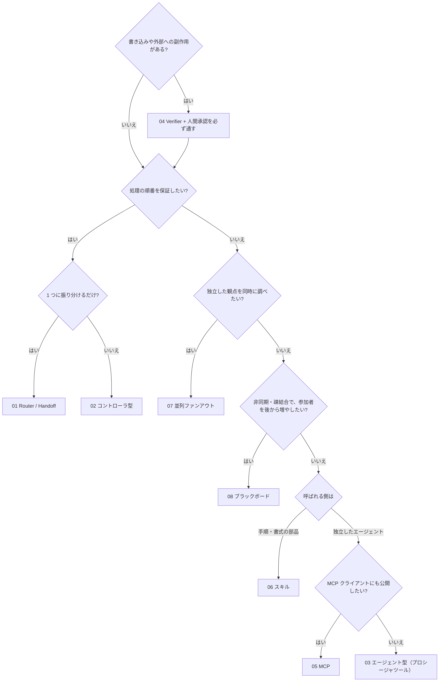

# Snowflake マルチエージェント構成パターン集

Snowflake Cortex Agents を組み合わせた **マルチエージェント構成の 8 パターン** を、
構築スクリプトと解説のセットで提供します。スクリプトを実行すると、自分のアカウントに各パターンが構築されます。
各 README には、スクリプトが何をしているか（SQL の抜粋つき）、設計上のポイント、自分のユースケースへの応用方法をまとめています。

> 手順書に沿って 1 ステップずつ作るハンズオンではありません。「動く構成」を最初に作り、コードを読んで仕組みを理解する形式です。

> **注意**: 本資材のマルチエージェント構成パターンは **2026 年 10 月時点** の Snowflake の機能・仕様に基づいています。
> Cortex Agents、MCP サーバー、エージェントスキルなどは今後の機能追加や仕様変更により、利用できる構成や挙動が変わる可能性があります。
> 最新の情報は [公式ドキュメント](https://docs.snowflake.com/en/user-guide/snowflake-cortex/cortex-agents) を確認してください。

## パターン一覧

| No. | フォルダ | パターン | 一言でいうと |
|----|----|----|----|
| 00 | [`00_common/`](00_common/) | 共通基盤 | 01〜04・07・08 が使う架空のタスク管理システム（データ、ツール、制御テーブル、コントローラ） |
| 01 | [`01_router_handoff/`](01_router_handoff/) | Router / Handoff | ルーターが依頼を分類し、専門エージェント 1 つ（または人間）に渡す |
| 02 | [`02_orchestrator_worker/`](02_orchestrator_worker/) | Orchestrator / Worker（コントローラ型） | Python コントローラが Worker エージェントを順に呼んで結果を集約する |
| 03 | [`03_agent_as_tool/`](03_agent_as_tool/) | Orchestrator / Worker（エージェント型） | オーケストレーター**エージェント**がプロシージャツール経由で Worker エージェントを呼ぶ |
| 04 | [`04_verifier_human_in_the_loop/`](04_verifier_human_in_the_loop/) | Verifier + 人間承認 | 決定論チェック → Verifier エージェント → 人間承認 → 適用・監査 |
| 05 | [`05_mcp_agent_chaining/`](05_mcp_agent_chaining/) | MCP 経由のエージェント呼び出し | Snowflake マネージド MCP サーバーの `CORTEX_AGENT_RUN` ツールで別エージェントを呼ぶ（1 hop / 2 hop） |
| 06 | [`06_skill_composition/`](06_skill_composition/) | スキル / サブスキル構成 | エージェントスキルから別スキル（サブスキル）やサブエージェントへ処理を渡す |
| 07 | [`07_parallel_fanout/`](07_parallel_fanout/) | 並列ファンアウト／ファンイン | タスクグラフで 3 つのレビュアーエージェントを**同時に**動かし、決定論的に集約する |
| 08 | [`08_blackboard/`](08_blackboard/) | ブラックボード／イベント駆動 | エージェントは共有の掲示板だけを介して協調。ストリーム + トリガータスクで、状態の変化に反応して動く |

マルチエージェントアーキテクチャの一般的な分類（P01〜P11）との対応:

| 一般的なパターン | 本資材 |
|----|----|
| P01 シーケンシャル（パイプライン） | 02（配線テーブルどおりに順に呼ぶ） |
| P02 並列ファンアウト／ファンイン | **07** |
| P03 ルーター／ハンドオフ | 01 |
| P04 オーケストレーター・ワーカー | 02（コードが調整役）、03（エージェントが調整役）、05（MCP 経由で呼ぶ） |
| P08 検証（評価・最適化ループ） | 04（検証役 + 人間承認） |
| P09 ブラックボード／共有状態・イベント駆動 | **08** |
| P10 グラフ／状態機械 | 07 のタスクグラフ（条件付きタスクで拡張可能） |
| P05 階層型、P06 スウォーム、P07 グループチャット、P11 A2A | 収録なし（エージェント数が少ない本ユースケースでは利点が小さい、または Snowflake にネイティブの仕組みが無いため） |

## どのパターンを選ぶか

<a id="comparison"></a>

| 観点 | 01 Router | 02 コントローラ型 | 03 エージェント型 | 04 Verifier | 05 MCP | 06 スキル | 07 並列 | 08 ブラックボード |
|----|----|----|----|----|----|----|----|----|
| 連携を決めるのは | コード（ルーターの出力をコードが検証） | コード（配線テーブル） | オーケストレーターの LLM | コード（固定の検証手順） | 親エージェントの LLM | 親エージェントの LLM（スキル本文の指示） |コード（タスクグラフ） | 掲示板の状態（購読者の条件） |
| 最終応答の所有者 | 選ばれた専門エージェント／人間 | コントローラ（集約）→ 人間 | オーケストレーター → コントローラが検証 | 人間（承認者） | 親エージェント | 親エージェント |集約プロシージャ（決定論） | 掲示板（PROPOSALS 項目）→ 人間 |
| コンテキスト分離 | エージェントごとに独立 | エージェントごとに独立 | Worker は独立（呼び出しは 1 本のツール入力） | 独立 | 子は独立。ただし子の全応答が親に返る | ピア／統合スキルは同一コンテキスト、サブエージェントは独立 |独立（観点ごとに必要な列だけ渡す） | 独立（掲示板の項目だけを読む） |
| 呼び出し順の保証 | あり | あり | なし（指示はできるが LLM 次第） | あり | なし | なし |順序なし（同時に実行）。集約は必ず最後 | 依存関係だけ（状態の条件で決まる） |
| ペイロード | 小 | 小（必要な項目だけ渡す） | 中 | 小 | **hop ごとに増える** | 小〜中 |小 | 小（項目単位） |
| トレース | `V_RUN_TRACE`（1 ステップ 1 行） | `V_RUN_TRACE` | オーケストレーターの 1 ステップ + 各エージェントの Monitoring | `V_RUN_TRACE` + `AUDIT_EVENTS` | 親の応答 JSON に入れ子で入る | 親の応答（`server_skill` 呼び出し） |`V_REVIEW_WORKERS` + Task History | `V_BOARD_TIMELINE`（来歴）+ Task History |
| 副作用（書き込み） | 提案のみ | 提案のみ | 提案のみ | 承認後に所有者権限プロシージャだけが書く | なし（参照用） | なし（参照用） |なし（レポートのみ） | 提案のみ |
| 向いている用途 | 窓口の振り分け | 手順が決まった分解・集約 | 手順を柔軟にしたい分解・集約 | 書き込みを伴う業務 | 別チームのエージェントを再利用、外部 MCP クライアントとの共用 | 手順や書式の再利用、エージェントの部品化 |独立した観点の網羅的な調査・レビュー | 疎結合・非同期・長時間の処理、購読者の追加・交換 |

選び方の目安:



## 前提条件

- Snowflake アカウントと、`ACCOUNTADMIN` ロールを使えるユーザー（ロール・ウェアハウス・データベースを作るため）
- Cortex Agents が使えるリージョン、またはクロスリージョン推論（`CORTEX_ENABLED_CROSS_REGION`）が有効なアカウント
- ユーザーに既定ウェアハウス（`DEFAULT_WAREHOUSE`）が設定されていること（エージェント実行に必要）
- [Snowflake CLI](https://docs.snowflake.com/en/developer-guide/snowflake-cli/installation/installation) 3.x（`snow`）と、自分のアカウントへの接続（`snow connection add`）
- Python 3.11 以上（05 / 06 の実行スクリプトとテスト用）。テストを動かす場合は `pip install -r tests/requirements.txt`

## クイックスタート

```bash
cd handson/multi-agent-patterns
cp .env.example .env                 # MAP_CONNECTION=<your_connection> を設定（.env は git 管理外）
snow connection list                 # 接続名を確認

scripts/setup_all.sh                 # 00〜08 をすべて作成（-c <your_connection> でも指定可）
./01_router_handoff/run.sh           # 各パターンを試す（run.sh または sql/90_try.sql）
scripts/teardown_all.sh --confirm    # すべて削除（各パターン → 共通基盤の順。--confirm なしでは何も削除しない）
```

1 パターンだけ試す場合（01〜04 は `00_common` が前提、03 は 02 の Worker を使います）:

```bash
./00_common/setup.sh -c <your_connection>
./02_orchestrator_worker/setup.sh -c <your_connection>
./02_orchestrator_worker/run.sh -c <your_connection>
```

05 と 06 は単独で動きます（`./05_mcp_agent_chaining/setup.sh` → `run.sh`）。07 は 00_common だけ、08 は 00_common と 02 が前提です。

## 作成されるオブジェクト

名前はすべて環境変数で変更できます（[`.env.example`](.env.example)）。既存のオブジェクトには触れず、専用の名前空間に作ります。

| 変数 | 既定値 | 用途 |
|----|----|----|
| `MAP_DATABASE` | `MULTI_AGENT_PATTERNS` | 00〜04・07・08（スキーマ `APP` / `AGENTS` / `INTERNAL`） |
| `MAP_MCP_DATABASE` | `MAP_MCP_CHAIN` | 05（スキーマ `LAB`） |
| `MAP_SKILL_DATABASE` | `MAP_SKILL_COMPOSITION` | 06（スキーマ `LAB`） |
| `MAP_WAREHOUSE` | `MULTI_AGENT_PATTERNS_WH` | 全パターン共通（XSMALL、60 秒で自動停止） |
| `MAP_ROLE` | `MULTI_AGENT_PATTERNS_ROLE` | 01〜04・07・08 を最小権限で実行するロール |
| `MAP_ENABLE_CROSS_REGION` | `false` | `true` かつ無効な場合だけ、アカウントのクロスリージョン推論を有効化 |

### 削除（teardown）

| スクリプト | 削除するもの |
|----|----|
| `scripts/teardown_all.sh --confirm` | **すべて**。08 → 07 → 04 → 03 → 02 → 01（共通 DB 内のタスク・エージェント・プロシージャ）→ 06 → 05（各 DB）→ 00_common（共通 DB・ウェアハウス・ロール）の順に、各パターンの teardown を実行する。存在しないパターンは飛ばすので、何度実行してもよい |
| `<パターン>/teardown.sh --confirm` | そのパターンが作ったものだけ。01〜04 はエージェントとプロシージャ、07 / 08 はさらにタスク・ストリーム・テーブル、05 / 06 は各 DB |
| `00_common/teardown.sh --confirm` | 共通 DB（01〜04・07・08 を含む）、共通ウェアハウス、ロール。05 / 06 を残したまま実行すると、05 / 06 が使うウェアハウスも消える |

ウェアハウスは全パターン共通のため、05 / 06 の teardown では削除しません。05 / 06 だけを試した場合も、最後は `scripts/teardown_all.sh --confirm` で片付けてください。
アカウントレベルの設定（クロスリージョン推論）は teardown でも元に戻しません。

アカウントレベルの設定は、`MAP_ENABLE_CROSS_REGION=true` を指定したときしか変更しません。ユーザー設定（既定ウェアハウスなど）は変更せず、必要な場合は案内を表示するだけです。

## コストの目安

- ウェアハウスは XSMALL で、60 秒で自動停止します。
- エージェント 1 回の呼び出しは数秒〜数十秒です（下記の参考値）。`run.sh` 1 回あたりのエージェント呼び出しは、01 が 8 回（ルーター 5 + 専門 3）、02 が 3 回、03 が 4 回（オーケストレーター 1 + Worker 3）、04 が 2 回、07 が 6 回（並列 3 + 逐次ベースライン 3）、08 が 3 回です。05 は親 12 回 + 入れ子の呼び出し、06 は 15 回 + P4 のサブエージェント呼び出しです（既定 3 回 × パターン数、`-n` で変更可）。
- 07 / 08 はタスクを使います。タスクはウェアハウス `MAP_WAREHOUSE` で動き、08 のトリガータスクは掲示板に新しい項目が来たときだけ実行されます（待機中は課金されません）。試し終わったら teardown してください。
- Cortex Agents の料金はモデルとトークン数で決まります。最新の単価は Snowflake の Service Consumption Table を参照してください。

## 参考値（検証時の挙動）

2026-10-27 に、1 つのテストアカウントで各パターンを実行した結果です。モデルの挙動は変わることがあるため、保証値ではありません。

| パターン | 結果 |
|----|----|
| 01 | 5 件の依頼が期待どおり status / intake / change / human / human に振り分けられた。ルーター 5〜9 秒、Status 約 12 秒 |
| 02 | 会議メモ N-003 から CREATE_TASK 1 件と LINK_DUPLICATE（T-108）1 件。注入行は無視された。エージェント合計約 28 秒 |
| 03 | 02 と同じ 2 件。オーケストレーター 1 回の呼び出しで約 42 秒。Worker の呼び出し順は指示と異なった（Criteria → Dedupe） |
| 04 | 承認前の適用は拒否、PASS → 承認 → 適用（T-1001 作成）、再適用は no-op、HIGH リスク変更は NEEDS_HUMAN |
| 05 | 3 回中、子への到達は M1 3/3・M2 3/3・M3 3/3。応答サイズは M0 約 2 KB、M1 約 11 KB、M2 約 26 KB、M3 約 5 KB |
| 06 | ピア登録（P1）3/3 で成功、ネスト配置（P2）0/3（読まれない）、統合（P3）3/3、サブエージェント（P4）3/3 |
| 07 | 並列 約 21〜23 秒（3 レビュアーが同時刻に開始）、逐次ベースライン 約 39〜41 秒。どちらも同じ 5 タスク（HIGH 2、MEDIUM 3）を指摘。1 ワーカーを失敗させると PARTIAL のレポート |
| 08 | N-003 の投稿から PROPOSALS まで約 82〜86 秒（1 ホップ 20〜30 秒、Dedupe と Criteria は並行）。提案は 02 と同じ 2 件、二重処理なし |

## フォルダ構成

```text
multi-agent-patterns/
|-- README.md               このファイル（パターン比較・選び方）
|-- .env.example            接続名・オブジェクト名の設定例
|-- scripts/                共通シェル関数、全体の setup / teardown、公開前チェック、エージェント SQL の生成
|-- controller/             01〜04・07・08 が使う Python コントローラ（src/）と JSON 契約（schemas/）
|-- 00_common/ .. 08_*/     各パターン（README.md, setup.sh, run.sh, teardown.sh, sql/, agents/ など）
|-- docs/troubleshooting.md よくあるエラーと対処
`-- tests/                  オフラインの静的テスト（python3 -m pytest tests -q）
```

## 開発者向け

- エージェント仕様の正本は各パターンの `agents/*.yaml` です。編集したら `python3 scripts/build_agents_sql.py` で `sql/10_agents.sql` を再生成してください。
- コミット前に `scripts/check_public.sh` を実行してください。`.env` の `MAP_DENYLIST` に書いた文字列（自分のアカウント名など）が公開ファイルに含まれていないか、静的テストが通るかを確認します。

## トラブルシューティング

[docs/troubleshooting.md](docs/troubleshooting.md) を参照してください。

## 参考リンク

- [Cortex Agents](https://docs.snowflake.com/en/user-guide/snowflake-cortex/cortex-agents)
- [CREATE AGENT](https://docs.snowflake.com/en/sql-reference/sql/create-agent)
- [DATA_AGENT_RUN (SNOWFLAKE.CORTEX)](https://docs.snowflake.com/en/sql-reference/functions/data_agent_run-snowflake-cortex)
- [Cortex Agents のアクセス制御](https://docs.snowflake.com/en/user-guide/snowflake-cortex/cortex-agents-setup)
- [Snowflake マネージド MCP サーバー](https://docs.snowflake.com/en/user-guide/snowflake-cortex/cortex-agents-mcp)
- [CREATE MCP SERVER](https://docs.snowflake.com/en/sql-reference/sql/create-mcp-server)
- [Agent skills](https://docs.snowflake.com/en/user-guide/snowflake-cortex/cortex-agents-skills)
- [Cortex Agents のモニタリング](https://docs.snowflake.com/en/user-guide/snowflake-cortex/cortex-agents-monitor)

## データとライセンス

サンプルデータ（プロジェクト・タスク・会議メモ・人名）はすべて架空で、本資材のために作成したものです。外部のデータセットは使用していません。

## 作成者 / Author

- 作成者: <github_account>
- 作成日: 2026-10
- 最終更新: 2026-10
