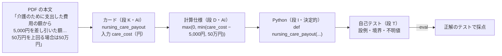
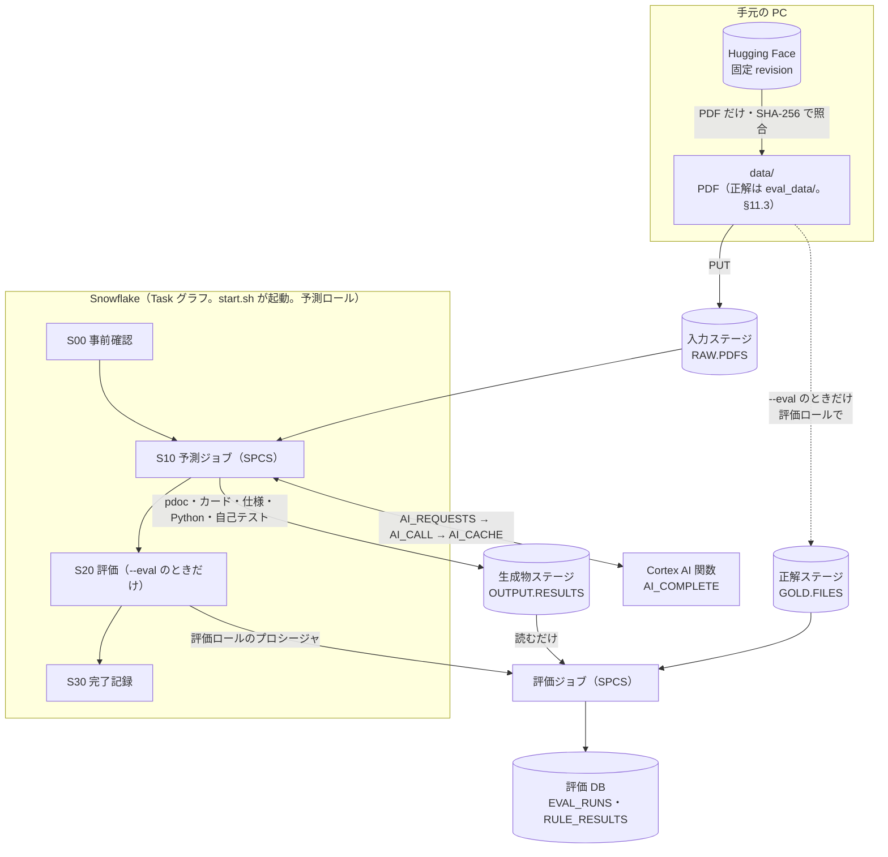
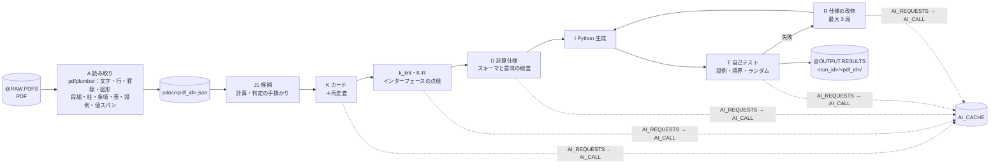

# 日本語の文書から計算・判定のプログラムを作るハンズオン

このハンズオンでは、日本語の保険約款 PDF から、金額・日数・期限・支払可否などを決める**計算・判定の規定**を抽出し、Python 関数に変換します。
処理には Snowflake の Cortex AI 関数、Task、Snowpark Container Services（SPCS）を使います。生成した関数を文書由来のテストで自己検証した後、データセット付属の正解テストで採点し、取りこぼした段を特定します。

- 作成者：[sfc-gh-yshibui](https://github.com/sfc-gh-yshibui)
- 対象者：Cortex AI 関数・Task・SPCS を組み合わせたい開発者。LLM の出力を中間表現、決定的なコード生成、テストで制御する方法を学びたい開発者
- 所要時間：約 50 分（待ち時間を含む。任意の pilot を除く。内訳は「[所要時間と費用の目安](#35-所要時間と費用の目安)」）
- 費用の目安：必須手順（§4〜§8、§10）で約 2.5 クレジット。任意の pilot（§9、4 PDF）を加えると約 5.5 クレジット（AI 関数、ウェアハウス、コンピュートプールの合計。内訳は「[所要時間と費用の目安](#35-所要時間と費用の目安)」）

## Disclaimer / 免責事項

This application is not part of the Snowflake Service and is governed by the terms in LICENSE, unless expressly agreed to in writing. You use this application at your own risk, and Snowflake has no obligation to support your use of this application.

（参考訳）本アプリケーションは Snowflake Service の一部ではなく、書面による明示的な合意がない限り LICENSE の条件に従います。本アプリケーションの利用はご自身の責任で行うものとし、Snowflake は本アプリケーションの利用に関していかなるサポート義務も負いません。※ この日本語訳は参考であり、必ず上記英文を確認してください。

[Read more](https://github.com/Snowflake-Labs/sf-samples-jp/blob/main/LEGAL.md)

> **このハンズオンで扱う「計算・判定」は、約款の法的な解釈を保証するものではありません。** 完全に架空の合成データを使い、文書の読み取り、プログラムの生成、検証の流れを学ぶための教材です。保険・法律の助言には使えません。

## 目次

1. [このハンズオンで学ぶこと](#1-このハンズオンで学ぶこと)
2. [全体像](#2-全体像)
3. [準備](#3-準備)
4. [ステップ 1：環境を作る（setup）](#4-ステップ-1環境を作るsetup)
5. [ステップ 2：保険約款から関数を作る（start）](#5-ステップ-2保険約款から関数を作るstart)
6. [ステップ 3：生成物を見る](#6-ステップ-3生成物を見る)
7. [ステップ 4：精度を確かめる（--eval）](#7-ステップ-4精度を確かめる--eval)
8. [ステップ 5：失敗と再開を体験する](#8-ステップ-5失敗と再開を体験する)
9. [ステップ 6（任意）：pilot で精度を確かめる](#9-ステップ-6任意pilot-で精度を確かめる)
10. [ステップ 7：後片付け（teardown）](#10-ステップ-7後片付けteardown)
11. [技術の解説](#11-技術の解説)
12. [エッジケースの対応](#12-エッジケースの対応)
13. [発展：対象を増やす・設定を変える](#13-発展対象を増やす設定を変える)
14. [困ったとき](#14-困ったとき)
15. [既知の限界と注意事項](#15-既知の限界と注意事項)
16. [出典とライセンス](#16-出典とライセンス)

---

## 1. このハンズオンで学ぶこと

### 課題：計算の規定は、本文・表・算式・図に散らばっている

保険約款には「入院の日数に応じて 1 日につき 7,500 円」「書類が到達した日の翌日から起算して 6 営業日以内」「50 万円を上回る場合は 50 万円」のような計算・判定の規定が含まれます。

- 規定の値や条件は、本文だけでなく、表・算式・脚注・別表・フローチャートに分かれて書かれています。
- 数値の表記は `25日`・`２５日`・`二十五日`・`1万円`・`3割` のようにばらばらです。
- 1 つの規定が、ほかの規定の金額（「前項の規定により算出した額」）や除外事由（「次の場合は支払わない」）を参照します。
- 比較が「以上」か「超える」か、入力が不明なときにどう扱うかで、結果が変わります。

LLM に文書を渡して Python の生成だけを依頼すると、コードは得られても、数値の出典や境界条件、不明な入力の扱いを追跡できません。

### このハンズオンのやり方

AI と決定的な処理を分けます。PDF の読み取り、候補検出、Python の生成は規則で行います。AI は、関数のインターフェースと計算仕様（JSON の式の木）を作ります。生成コードは、文書の設例と仕様から作ったケースで自己検証します。`--eval` を付けた場合だけ、隔離した正解データで採点します。

### 具体例：保険約款の 1 項から関数へ

次は、保険約款 PDF（`group-0006-c2--grp-a4-1col-mincho`）から介護一時金の関数を作る流れです。AI の出力は実行ごとに変わるため、関数名や関数の分け方が異なることがあります。



> ② 介護一時金の額は、介護のために支出した費用の額から5,000円を差し引いた額とします。この額が50万円を上回る場合は、50万円をもって介護一時金の額とします。算出は次の算式によります。
> 介護のために支出した費用の額－5,000円＝介護一時金の額
> ③ 前項の規定により算出した額が0円を下回る場合には、介護一時金を支払いません。

```python
def nursing_care_payout(*, care_cost: int | None = None) -> int | None:
    diff = t_sub(care_cost, P_V003)  # 5,000円を差し引く
    limited = t_min(diff, P_V007)  # 50万円を上限にする
    return _norm(t_max(0, limited))  # 0円を下限にする
```

5,000 円と 50 万円は、PDF に印字された値の位置と解釈を持つ「値スパン」から定数になります。AI は数値ではなく値スパンの ID を選びます。Python は検査済みの仕様から規則で生成するため、同じ仕様からは同じコードになります。この関数は、参考実行の正解テスト 24 件すべてに合格しました（§7）。

### 学べること

- PDF の読み取りを決定的な処理にし、AI を「規定の発見・呼び出し口の設計・仕様化・設例の構造化・改修」に限る分け方
- AI の出力を JSON の中間表現にして、スキーマと意味の検査を通してからコードを生成する方法
- AI の呼び出しを SQL のプロシージャに集め、キャッシュ・失敗の記録・課金の宣言で管理する方法
- Task グラフと SPCS のジョブを組み合わせ、失敗した PDF だけをやり直す再開の仕組み
- 正解データを予測の経路に漏らさない作り方（入力口・コードの検査・ステージのマウント・ロールの分離）
- 生成した関数を、名前の違う正解のテストで採点するための対応付け

---

## 2. 全体像



このハンズオンで作成する Snowflake オブジェクトには、すべて `JA_DOC_CALC_` という接頭辞が付きます（`configs/deploy.env` の接頭辞から組み立てます）。

| 種類 | 名前 | 役割 |
|---|---|---|
| データベース | `JA_DOC_CALC_DB` | 予測側。入力 PDF・生成物・台帳・AI のキャッシュ・プロシージャ・Task |
| データベース | `JA_DOC_CALC_EVAL_DB` | 評価側。正解と評価結果。**予測のロールからは見えない** |
| ロール | `JA_DOC_CALC_ADMIN`・`JA_DOC_CALC_PREDICT`・`JA_DOC_CALC_EVAL_ROLE` | 管理・予測・評価 |
| ウェアハウス | `JA_DOC_CALC_WH`（XSMALL・自動停止 60 秒） | SQL・AI 関数・Task |
| コンピュートプール | `JA_DOC_CALC_POOL`（CPU_X64_XS・1 ノード・自動停止 5 分） | 予測ジョブと評価ジョブ |
| ステージ | `RAW.PDFS`・`OUTPUT.RESULTS`・`APP.SPECS`・`GOLD.FILES` | PDF・生成物・ジョブ仕様・正解（スキーマは `JA_DOC_CALC_RAW` などの接頭辞つき） |
| イメージリポジトリ | `JA_DOC_CALC_DB.JA_DOC_CALC_APP.IMAGES` | ジョブのイメージ（日時タグ） |
| Task | `T_S00`→`T_S10`→`T_S20`→`T_S30`、`T_FINALIZE` | パイプラインの制御 |

アカウントのパラメータ（クロスリージョン推論の設定など）は変更しません。後片付けでは、この接頭辞を持つオブジェクトだけを名前で指定して削除します。


### 実行前に知っておく用語

| 用語 | 意味 |
|---|---|
| DEV・HOLDOUT | データの分け方。DEV は開発に使ってよい側、HOLDOUT は最終確認のために取り分けた側 |
| base | 公開索引の `split_group` が表す、分割と除外の単位。同じ内容の組版違いなど、似た文書が DEV と HOLDOUT、または手本と実行対象の両方に入らないように使う |
| pilot | DEV から選んだ、各コーパス 4 PDF の小さな対象（`configs/pipeline.yaml` の `slices`） |
| 手本（few-shot、設定名 `shots`） | AI のプロンプトに添える例。各コーパスの DEV から選んだ 2 PDF の正解を使い、setup が機械的に作る。pilot とは base を共有しない |
| run | start の 1 回の実行。run_id で台帳に記録され、同じ run_id で再開できる |

---

## 3. 準備

### 3.1 Snowflake アカウントの要件

このハンズオンでは Cortex AI 関数と Snowpark Container Services（SPCS）を使います。実行先の Snowflake アカウントが、次の要件を満たすことを確認してください。

| 項目 | 要件 | 補足 |
|---|---|---|
| Edition | **Standard Edition 以上** | このハンズオン自体は Enterprise Edition 固有の機能を使用しません。ただし、SPCS と `AI_COMPLETE` が利用可能なアカウントとリージョンである必要があります |
| Trial / Non-trial | **有償の Non-trial アカウント** | Snowflake の公式 SPCS チュートリアルでは Trial アカウントはサポート対象外です |
| クラウドとリージョン | SPCS が利用可能 | 既定のモデル `claude-sonnet-5` を使えること（次の行と表の下を参照） |
| クロスリージョン推論 | 既定のモデル `claude-sonnet-5` を使えること | `claude-sonnet-5` は[クロスリージョン推論](https://docs.snowflake.com/en/user-guide/snowflake-cortex/cross-region-inference)でのみ提供されています。**日本の AWS リージョンでは、そのままでは使えないことがあります**（表の下）。setup も最初に確かめます |
| 権限 | setup に使用する接続で `ACCOUNTADMIN` を使用できること | ロール・DB・ウェアハウス・プール・イメージリポジトリ・Task を作り、アカウント権限を付与します（次の表）。共有アカウントでは事前に管理者の承認を得てください |
| 利用枠と費用 | ウェアハウス・SPCS・Cortex AI 関数を実行できるクレジット | 目安は「[所要時間と費用の目安](#35-所要時間と費用の目安)」 |

**クロスリージョン推論の設定を確かめてください。** アカウントのパラメータ `CORTEX_ENABLED_CROSS_REGION` が、`claude-sonnet-5` を提供している範囲を含む必要があります（2026-11-04 時点の[リージョン別の提供状況](https://docs.snowflake.com/en/user-guide/snowflake-cortex/aisql-regional-availability)）。

| 値 | `claude-sonnet-5` |
|---|---|
| `ANY_REGION`・`AWS_US`・`AWS_EU`・`AWS_APJ`・`AWS_AU` | 使える（提供状況の表に載っている） |
| `AWS_GLOBAL` | 使える（このハンズオンの実行で確かめた） |
| `AWS_JP` だけ・`DISABLED` | **使えない** |

AWS の東京・大阪リージョンにある既存のアカウントでは、このパラメータを設定していなければ既定値は `AWS_JP` です（2026-03-09 より後に作った組織では `ANY_REGION`）。今の値は次の文で確かめます（`value` の列）。

```sql
SHOW PARAMETERS LIKE 'CORTEX_ENABLED_CROSS_REGION' IN ACCOUNT;
```

クロスリージョン推論では、入力と出力が一時的に別のリージョンで処理されます。データは保存されず、課金はアカウントのリージョンで行われます。
有効化の可否と対象範囲は、データ管理の方針に関わります。アカウント管理者が判断してください。このハンズオンのスクリプトは、アカウントの設定を変更しません。

管理者が範囲を変更するときの SQL は次のとおりです。値は組織の方針に合わせて選びます。

```sql
ALTER ACCOUNT SET CORTEX_ENABLED_CROSS_REGION = 'AWS_APJ';
```

範囲を変更できない場合は、`configs/pipeline.yaml` の `llm.model` に、自分のアカウントで利用できるモデルを指定します。`AWS_JP` では `claude-sonnet-4-6` などを利用できます。ただし、このハンズオンの精度と費用は `claude-sonnet-5` で測定しており、ほかのモデルでは検証していません。

setup は `ACCOUNTADMIN` で、次の権限を付けます（`sql/setup/00_roles.sql`。teardown で 3 つのロールを消すと、付けた権限も消えます）。

| 付ける権限 | 付ける先 | 理由 |
|---|---|---|
| `JA_DOC_CALC_ADMIN` ロール | `SYSADMIN` ロール | 作ったオブジェクトを、アカウントの通常の管理の階層から見えるようにする |
| `JA_DOC_CALC_PREDICT`・`JA_DOC_CALC_EVAL_ROLE` ロール | `JA_DOC_CALC_ADMIN` ロール | 管理ロールが、予測・評価のロールのオブジェクトを作り、権限を付ける |
| 3 つのロール（管理・予測・評価） | setup を実行した利用者 | start、評価、teardown を同じ利用者で実行する。**別の利用者が teardown を実行すると、評価記録を退避できないため停止します** |
| アカウントの `CREATE DATABASE`・`CREATE WAREHOUSE`・`CREATE COMPUTE POOL`・`EXECUTE TASK` | `JA_DOC_CALC_ADMIN` ロール | 専用の DB・ウェアハウス・プールを作り、Task を動かす |
| アカウントの `EXECUTE TASK` | `JA_DOC_CALC_PREDICT` ロール | 予測ロールが Task グラフを起動する |
| データベースロール `SNOWFLAKE.CORTEX_USER` | `JA_DOC_CALC_PREDICT` ロール | 予測ロールが `AI_COMPLETE` を呼ぶ |

関連資料：[Snowflake editions](https://docs.snowflake.com/en/user-guide/intro-editions)、[Snowpark Container Services](https://docs.snowflake.com/en/developer-guide/snowpark-container-services/overview)、[`AI_COMPLETE`](https://docs.snowflake.com/en/sql-reference/functions/ai_complete)、[Task グラフ](https://docs.snowflake.com/en/user-guide/tasks-graphs)

### 3.2 ローカル環境に必要なもの

| もの | 確認のしかた | 補足 |
|---|---|---|
| Snowflake アカウントと、ACCOUNTADMIN を使える接続 | `snow connection list` | setup でオブジェクトを作り、イメージリポジトリにログインします |
| [Snowflake CLI](https://docs.snowflake.com/en/developer-guide/snowflake-cli/index)（`snow`） | `snow --version` | 接続の設定は CLI のドキュメントを参照 |
| [uv](https://docs.astral.sh/uv/) | `uv --version` | Python 3.11 と依存を自動で用意します |
| Docker（buildx） | `docker info` | ジョブのイメージ（linux/amd64）を作ります。**ハンズオンの前に Docker を起動しておいてください**（Docker Desktop はサインインが要ることがあります） |
| git | `git --version` | |
| huggingface.co への HTTPS 接続 | `curl -sI https://huggingface.co` | データセットを匿名で取得します。アカウントとトークンは不要です |

### 3.3 リポジトリを取得して、接続名を設定する

```bash
git clone <このリポジトリの URL>
cd sf-samples-jp/handson/read-calculation-from-document

# ローカル設定を作る（git 管理外）
cp configs/deploy.env.example configs/deploy.local.env
```

`configs/deploy.local.env` の `CONNECTION_NAME=<your_connection>` を、`snow connection list` に表示される接続名に書き換えます。変更するのはこの 1 行だけです。
接続名は、`SNOWFLAKE_CONNECTION_NAME` 環境変数、`configs/deploy.local.env` の順で探します。どちらにもなければ、処理を始めずに終了します。
接続名・アカウント識別子・ユーザー名は、リポジトリのほかのファイルに書かないでください。

### 3.4 依存関係をインストールし、テストを実行する

```bash
uv sync
scripts/start.sh --test        # lint・format・設定の検査・正解漏れのガード・単体テスト
```

最後に `ローカル検査はすべて通った` と表示されれば、準備は完了です。
`scripts/*.sh` が出す行の先頭には、UTC の時刻（`[07:12:22Z]` など）が付きます。この README の出力の例では、時刻と一部の行を省いています。
単体テストは合成した最小の PDF・文書を使うので、データセットの取得も Snowflake への接続もしません。
この時点では公開索引を作っていないため、索引を使う一部のテストは理由を表示してスキップされます（setup の後は通ります）。

### 3.5 所要時間と費用の目安

以下は、空のアカウントと空のキャッシュで、保険約款の手順を 1 回実行したときの参考値です。任意の §9 も同じ一連の実行に含めています。課金を伴う操作の前に確認してください。所要時間は、ネットワーク、Docker キャッシュ、Snowflake の稼働状況によって変わります。

| 手順 | 時間 | 新しく発生した AI の要求 |
|---|---|---|
| `start.sh --test` | 約 20 秒 | なし |
| `setup.sh --yes`（ビルド込み） | 約 2 分（Docker のビルドキャッシュがある状態） | 1（モデルの確認） |
| ステップ 2（§5）：保険約款 1 PDF（初回） | 約 15 分 | 約 11 |
| ステップ 4（§7）：同じ PDF を `--eval` で | 約 3〜5 分（推定） | 0（キャッシュ） |
| ステップ 5（§8）：故障注入 → 再開 → `--from P` → `--from E --eval` | 約 2 分 → 約 15 分 → 約 2 分 → 約 2.5 分 | 再開で 8（初めて処理する 1 PDF 分）。ほかは 0 |
| ステップ 6（任意・§9）：pilot 4 PDF を `--eval` で | 約 42 分 | 14（§5・§8 で処理した 2 PDF はキャッシュを利用） |
| `teardown.sh --yes` | 約 30 秒（評価記録の退避を含む） | なし |

参考実行では、1 PDF の予測と評価を合わせて約 16.5 分かかりました。必須手順の合計は約 2.5 クレジット、任意の pilot まで含めると約 5.5 クレジットです。これは `ACCOUNT_USAGE` の実績から求めた目安で、請求額ではありません。

start の実行中は XSMALL ウェアハウスが継続して動きます。コンピュートプールは CPU_X64_XS・1 ノードで、未使用時は 5 分で自動停止します。実際の消費量はアカウントの使用量画面で確認してください。

---

## 4. ステップ 1：環境を作る（setup）

```bash
scripts/setup.sh --corpus yakkan             # 取得と検査まで行い、Snowflake のオブジェクトを作る前に止まる
scripts/setup.sh --corpus yakkan --yes       # オブジェクトを作り、イメージを push する
```

`--yes` を付けない場合は、取得と検査だけを行い、作成予定の SQL 文の末尾 5 行を表示して終了します。全文は `uv run python -m jpcalc setup` で確認できます。
`--yes` を付けると、次の順に処理します。問題があれば、その時点で実行を停止します。

1. 道具（uv・Docker・snow）と接続名を確認する
2. 保険約款コーパスの公開索引を作り、DEV/HOLDOUT の分割が記録と一致することを確かめる
3. pilot と手本用の PDF を Hugging Face の固定 revision から取得し、SHA-256 で照合する。**照合できなければ停止します**
4. ローカル検査（`scripts/start.sh --test` と同じ）。通るまで DDL・PUT・AI の呼び出しをしません
5. ロール・DB・ウェアハウス・プール・ステージ・表・プロシージャ・Task を作る（`ACCOUNTADMIN`）
6. ロール分離を検証する（予測ロールが評価 DB や正解のステージを読めないことなど 18 件。各件で `USE SECONDARY ROLES NONE` を実行）
7. 既定のモデルを予測ロールで 1 回呼び、使えることを確かめる（数トークン）。**使えなければ、イメージをビルドする前に停止します**（§3.1）
8. ジョブのイメージを linux/amd64・非 root でビルドし、日時のタグで push する
9. 手本（few-shot）を、DEV の手本用 PDF の正解から機械的に作る（pilot と base を共有しない PDF だけ）
   - このために、手本用と pilot の文書の**正解を手元の `eval_data/` に取得します**。pilot の正解は、手本の関数名が pilot の正解の関数名と重ならないように置き換えるためだけに使います。
   - 正解は予測の経路（入力ステージ・予測ジョブ）には渡しません（§11.3）。

処理には約 2〜5 分かかります。`verify-roles: 18 件すべて期待どおり`、`check-model: claude-sonnet-5 を使える`、`setup が完了した` と表示されれば成功です。

setup を再実行しても、既存データやほかのオブジェクトは削除されません。2 回目以降は `--skip-build` や `--skip-fetch` で処理を省略できます。
ただし、`--skip-build` を付けずに再実行すると、使用するイメージが新しいタグに変わります。以前のイメージを使った run は `--resume` できません。

> Hugging Face から「unauthenticated requests」という警告が出ることがあります。公開データセットを匿名で取得しているためで、問題ありません。

---

## 5. ステップ 2：保険約款から関数を作る（start）

保険約款を 1 PDF 処理します。保険約款は、2 段組、表、算式、設例の囲みが多い文書です。まず `--yes` を付けずに実行し、見込みを確認します。

```bash
scripts/start.sh --corpus yakkan --docs group-0006-c2--grp-a4-1col-mincho --input pdf --cards auto
```

対象 PDF 数、ページ数、AI リクエスト数、クレジットの見込みが表示され、処理を開始せずに終了します。見込みは請求額ではありません。内容を確認したら、課金の宣言を付けて実行します。

```bash
scripts/start.sh --corpus yakkan --docs group-0006-c2--grp-a4-1col-mincho --input pdf --cards auto \
  --run-id yakkan-1 --declare "保険約款 1 PDF・AI 約 10 要求・約 1.0 クレジット" --yes
```

**初回は `--declare` が必要です。** `--declare` には、画面に表示された要求数と費用の見込みを書きます。次の場合にも指定が必要です。

- AI キャッシュが空の場合
- `--no-cache` を使う場合
- HOLDOUT、または pilot より多い PDF を処理する場合
- モデルまたはプロンプトを変更した後の初回

宣言した内容は、台帳 `RUNS` の `config:declaration` に残ります。

対象は、`--docs id1,id2`（カンマ区切り）、`--docs-file <ファイル>`（1 行 1 PDF）、`--slice pilot` のいずれかで指定します。未知の ID や HOLDOUT の PDF を指定すると、実行前に停止します。
予測ジョブには約 15 分かかります。`run: SUCCEEDED・1 / 1 modules` と表示されれば完了です。続いて段ごとの状態と AI リクエスト数が表示されます。`P` の `誤り` は、自己テストに合格しなかった関数の数です。該当する関数も生成物に残ります。

**表示された `run_id` を控えてください。** 次のステップで生成物を取り出すときに使います。`--run-id` を付けなければ、run_id は「コーパス-UTC の日時」になります。

### 5.1 1 PDF の処理の流れ

予測ジョブ（S10）の中で、1 つの PDF は次のように処理されます。
AI 関数を呼ぶのは K・K-R・D・T（設例と検算）・R だけで、どれも要求を `AI_REQUESTS` 表に書き、プロシージャ `AI_CALL` がキャッシュに無いものだけを `AI_COMPLETE` で処理します。



| 段 | 何をするか | 書き出す先 | AI |
|---|---|---|---|
| A 読み取り | テキスト層と罫線・図形から、条・項・号・表・算式・設例の囲み・数値の位置を持つ pdoc を作る | `pdoc/<pdf_id>.json` | — |
| J1 候補 | 計算・判定の手掛かりのある単位を候補にする（設例だけ・参照だけの単位は除く） | （K の入力） | — |
| K カード | 候補と周辺の本文から規定を数え、関数のカードを作る。漏れた候補を再走査する | `cards.jsonl` | ✔ |
| k_lint・K-R | インターフェースを決定的に点検する（基礎量が無い、入力名が否定形など）。問題が見つかったカードだけを 1 回修正する | `k_lint.json` | K-R だけ |
| D 計算仕様 | カードと根拠から式の木を作り、スキーマと意味の検査を通す | `spec_iter<N>.json` | ✔ |
| I Python 生成 | 仕様から Python を決定的に生成する | `module_iter<N>.py` | — |
| T 自己テスト | 静的検査・文書の設例・仕様由来の境界とランダムのケース・独立検算（記録だけ） | `selftest_iter<N>.json`・`examples.json` | 設例と検算だけ |
| R 改修 | 自己テストの失敗から仕様を直す。失敗が最も少ない周回を最終版にする | `calc_<…>.py`・`summary.json` | ✔ |

AI の応答は、モデル、最大トークン数、プロンプトの版、プロンプトの SHA-256 をキーにキャッシュします。同じ PDF を別の run で処理しても、同じ要求では `AI_COMPLETE` を呼び直しません。
段の間では、ファイルとキャッシュ表だけを受け渡します。途中で失敗しても、成功済みの PDF を再利用して再開できます（§8）。予測処理（S10）は正解データを参照しません。詳しくは §11.3 を参照してください。

---

## 6. ステップ 3：生成物を見る

### 6.1 ファイル

生成物は予測の出力ステージ `@JA_DOC_CALC_DB.JA_DOC_CALC_OUTPUT.RESULTS` の `<corpus>/<revision>/runs/<run_id>/<pdf_id>/` に置かれます。

| ファイル | 中身 |
|---|---|
| `cards.jsonl` | 関数のカード（関数名・種別・題名・入力・出力・根拠の単位・根拠の本文） |
| `spec_iter<N>.json` | 周回 N の計算仕様（`params` 値スパン・`tables` 表・`rules` 関数ごとの式の木。このキーの rules は生成した関数を指し、§2 の「ルール」（正解）とは別） |
| `module_iter<N>.py`・`calc_<pdf_id の - を _ にした名前>.py` | 周回 N の Python と、最終版（自己テストの失敗が最少の周回）。例：`group-0006-c2--grp-a4-1col-mincho` なら `calc_group_0006_c2__grp_a4_1col_mincho.py` |
| `selftest_iter<N>.json` | 自己テストの結果（関数ごとの合否・失敗・統計） |
| `examples.json` | 文書の設例を構造化したもの |
| `k_lint.json` | インターフェースの点検結果 |
| `summary.json` | 1 PDF の要約（最終の周回・関数ごとの自己テスト・誤り） |

pdoc（読み取りの結果）は `<corpus>/<revision>/pdoc/<pdf_id>.json` です。

### 6.2 SQL で見る

照会例は `sql/examples/queries.sql` にあります。1〜4 は予測側、5〜6 は評価側の照会です。`<% … %>` は `configs/deploy.env` の値に、`:run_id` は §5 で控えた run_id に置き換えて実行します。

`sql/examples/queries.sql` の `<% … %>` を `configs/deploy.env` の値に、`:run_id` を §5 で控えた run_id に置き換えて実行します。1〜4 は予測側、5〜6 は評価側の照会です。

ジョブはマウントしたステージに直接書くので、ステージのディレクトリ表には現れません。一覧は `LIST @JA_DOC_CALC_DB.JA_DOC_CALC_OUTPUT.RESULTS PATTERN = '.*/runs/.*'` で見ます。
`queries.sql` の 2 には、「AI の要求とキャッシュ（この run で新しく呼んだ数・解析失敗）」の照会があります。

> `snow sql` で `--role` を指定しても、キャッシュされた認証のロールで実行されることがあります。上の例のように、文の先頭で `USE ROLE` を実行してください。`USE SECONDARY ROLES NONE` は、利用者に付いたほかのロールの権限を使わないようにする文です（予測ロールの権限だけで見ていることを確かめるため）。

### 6.3 生成した関数を手元で呼ぶ

```bash
mkdir -p tmp_out
snow sql -c <your_connection> -q "USE ROLE JA_DOC_CALC_PREDICT; GET '@JA_DOC_CALC_DB.JA_DOC_CALC_OUTPUT.RESULTS/yakkan/<revision>/runs/<run_id>/<pdf_id>/' 'file://$PWD/tmp_out/'"
uv run python -c "import runpy; m = runpy.run_path('tmp_out/calc_<pdf_id の - を _ にした名前>.py'); print(m['<関数名>'](<引数名>=1000000))"
```

`<revision>` はデータセットの固定 revision（保険約款は `f6d368a6bf84c7eb14a6fba158e8bfc504fe5366`。§16）、`<pdf_id>` は `group-0006-c2--grp-a4-1col-mincho` です。
ステージのパスは引用符で囲みます（PDF の ID に含まれる `--` を、SQL がコメントの始まりと読むため）。
生成した Python は、標準ライブラリだけを使う 1 ファイルです。関数名と引数名は `cards.jsonl` で確認します。これらは実行ごとに変わることがあります。§1 の関数なら、`m['nursing_care_payout'](care_cost=300000)` と呼び出します。

関数にはキーワード引数を渡します。金額は整数の円、日付は `datetime.date`、真偽は `True`・`False`・`None`（不明）です。詳しくは「[11.5 呼び出しの取り決め](#115-呼び出しの取り決め)」を参照してください。

このファイルは、AI が作った計算仕様から決定的に生成したコードです。ローカル実行では sandbox を通りません。信頼できない文書から生成したファイルは実行しないでください（§15）。

金額の引数に `None` を渡し、結果が `None`（不明）になることを確認します。次に `selftest_iter<N>.json` を開き、文書の設例（`examples.json`）から作ったケースに合格しているか確認します。

---

## 7. ステップ 4：精度を確かめる（--eval）

同じ PDF を `--eval` 付きで処理します。

```bash
scripts/start.sh --corpus yakkan --docs group-0006-c2--grp-a4-1col-mincho --input pdf --cards auto --eval \
  --run-id yakkan-eval-1 --yes
```

`--eval` を付けると、start は評価用ファイルを取得・照合し、評価ロールで正解ステージへ配置します。その後、予測処理に続いて評価ジョブを実行します。`--eval` のない run は正解を参照しません。正解データの扱いは §11.3 で説明します。

同じ PDF の 2 回目以降は AI の応答をキャッシュから取得するため、新しい AI クレジットは発生しません。予測と評価を合わせて数分で終了します。

終わると評価 ID、ルールとケースの合格数、エラー数、損失の内訳が表示されます。参考実行では、2 ルール・47 ケースすべてに合格しました（§7.2）。

### 7.1 指標の読み方

| 指標 | 意味 | 見方 |
|---|---|---|
| ルールの合格（主指標） | 正解のルール×PDF のうち、生成した関数と対応が付き、正解の**全**ケースに合格した数 | 大きいほどよい。対応が無い・モジュールが無いルールも分母に入ります |
| ケース | 正解のテストケースのうち合格した数 | ルールが不合格でも、部分的に合っているかが分かる |
| 損失 `not_found` | 対応する生成関数が無い | 規定を見落としたか、別の分け方をした |
| 損失 `interface` | 対応は付いたが、正解の引数に対応する生成側の引数が無い | 呼び出し口の設計（段 K）の違い |
| 損失 `interface_extra_args` | 生成側にだけ引数があり、正解のテストはそれを渡さない | 同上 |
| 損失 `calculation` | 呼び出し口は合っているが、計算か判定が違う | 計算仕様（段 D・R）の誤り |

生成関数と正解関数では、関数名や引数名が異なることがあります。評価側で両者を決定的に対応付け、正解側の呼び出しを生成関数へ変換するアダプタを介して採点します（「[11.4 採点](#114-採点対応付けと正解テスト)」）。
生成側にだけある引数に、評価側が値を補うことはしません（主指標）。補った場合の合格数は、診断の値として別に記録します。

ルールごとの結果は、評価ロールで `RULE_RESULTS` を確認します（`sql/examples/queries.sql` の 5・6）。`function` は正解関数、`matched_gen` は対応した生成関数です。生成関数名は実行ごとに変わる場合があります。

### 7.2 参考実行の評価の値

次の値は参考実行（§3.5）の評価の値です（データセットの revision は「[16. 出典とライセンス](#16-出典とライセンス)」、モデル `claude-sonnet-5`、プロンプトは `configs/prompts/*_p1.txt`）。AI の出力は呼び直すと変わることがあるので、1 回の値で優劣を判断しないでください。

| 手順 | 対象 | ルールの合格 | ケースの合格 | 損失の内訳 |
|---|---|---|---|---|
| §5・§7 | 保険約款 1 PDF（group-0006-c2） | 2 / 2 | 47 / 47 | なし |
| §9（任意） | 保険約款 pilot 4 PDF | 7 / 12 | 251 / 279 | interface 3・interface_extra_args 2 |

> 評価値は DEV（開発に使ってよい側）の文書のものです。HOLDOUT（最終確認のために取り分けた側）は、このハンズオンでは評価していません。

---

## 8. ステップ 5：失敗と再開を体験する

### 8.1 故障注入と再開

故障注入の引数を使って、処理の途中で失敗した場合の再開の手順を確認します。

```bash
D=group-0006-c2--grp-a4-1col-mincho,oneday-0009-c1--nl-a4-2col-mincho
# 2 PDF のうち 1 つを段 P で失敗させる（運用の試験用の引数）
scripts/start.sh --corpus yakkan --docs $D --input pdf --cards auto --run-id fault-1 \
  --fail P:oneday-0009-c1--nl-a4-2col-mincho --declare "2 PDF・新しい PDF 1 つ分 AI 約 10 要求・約 0.5 クレジット" --yes
```

1 回目は `FAILED` で終わり、失敗した PDF、理由、再開コマンドを表示します。終了コードは 1 です。

失敗した PDF だけをやり直します。

```bash
scripts/start.sh --corpus yakkan --docs $D --input pdf --cards auto --resume fault-1 --yes
```

`--resume` では、成功済みの PDF を飛ばし、失敗した PDF の段 P だけを再実行して `SUCCEEDED` になります。
`group-0006-c2` は §5・§7 で処理済みのため、AI の応答をキャッシュから取得します。`oneday-0009-c1` はここで初めて処理するため、`--resume` で約 8〜10 件の AI 要求が新しく発生し、10〜15 分かかります。

`STEP_RUNS` では、再実行した段 P の `attempt` が増えます。成功済みの PDF は再処理しません。

### 8.2 段を指定してやり直す（--from）

`--from` は `--resume <run_id>` と一緒に使い、指定した段以降をやり直します。

| 指定 | やり直す範囲 | 前提 |
|---|---|---|
| `--from A` | 読み取り（pdoc）から | — |
| `--from P` | カード〜自己テスト（pdoc は作り直さない） | 全 PDF の段 A が同じイメージで成功している |
| `--from E --eval` | 評価だけ（予測ジョブを起動しない） | 全 PDF の段 P が成功している |

```bash
scripts/start.sh --corpus yakkan --docs $D --input pdf --cards auto --resume fault-1 --from P --yes
scripts/start.sh --corpus yakkan --docs $D --input pdf --cards auto --resume fault-1 --from E --eval --yes
```

前提を満たさない場合は、データを削除せずに停止します。`--from P` と `--from E --eval` では、AI の応答をすべてキャッシュから取得します。それぞれ約 2 分、約 2.5 分で終了します。

---

## 9. ステップ 6（任意）：pilot で精度を確かめる

DEV から選んだ 4 PDF を `--eval` で処理し、複数 PDF での精度と損失の内訳を確認します。§5〜§8 で処理済みの 2 PDF にはキャッシュを使い、残りの 2 PDF では新しい AI 要求が発生します。

所要時間は約 42 分、費用は約 2.5〜3 クレジットです（§3.5）。表示された見込みを確認してから実行してください。

```bash
scripts/start.sh --corpus yakkan --slice pilot --input pdf --cards auto --eval --run-id pilot-yakkan-1
scripts/start.sh --corpus yakkan --slice pilot --input pdf --cards auto --eval --run-id pilot-yakkan-1 \
  --declare "保険約款 pilot 4 PDF・新しい 2 PDF 分 AI 約 20 要求・約 2 クレジット" --yes
```

```text
run: SUCCEEDED・4 / 4 modules
  …
run: AI 要求 33・この run_id で呼んだ累計 14（残りはキャッシュ）。再開：--resume pilot-yakkan-1
evaluate: run pilot-yakkan-1（eval …・image …）：ルールの合格 7/12・ケース 251/279・誤り 0・損失 {"interface":3,"interface_extra_args":2}
```

参考実行は、ルール 7/12、ケース 251/279 でした。不合格の 5 ルールは、すべてインターフェースの違い（`interface`・`interface_extra_args`）です。詳細は `sql/examples/queries.sql` で `RULE_RESULTS` を確認してください。

---

## 10. ステップ 7：後片付け（teardown）

```bash
scripts/teardown.sh          # 消す文を表示するだけ
scripts/teardown.sh --yes    # 評価記録を退避してから消す
```

1. 評価記録（`EVAL_RUNS`・`RULE_RESULTS`・`EVAL_JOBS`）を `results/<run_id>__<eval_run_id>/` に JSON Lines で退避し、表とファイルの行数を照合します。**照合できなければ、専用オブジェクトを削除せずに停止します**
2. Task を止め、コンピュートプールのサービスを止め、`configs/deploy.env` の名前から組み立てた DB・プール・ウェアハウス・ロールだけを `DROP` します（`SHOW` の結果やワイルドカードからは消しません）
3. 専用オブジェクトが残っていないことを名前で確かめます

`--keep-eval` を指定すると、評価結果を後から SQL で確認できるように、評価 DB、評価ロール、管理ロール、ウェアハウスを残します。保管中は費用が発生します。`--no-export` を指定すると、評価記録を退避しません。

teardown は、対象のオブジェクトがすでにない状態で再実行しても失敗しません。
**teardown では AI キャッシュも削除します。** setup 後にもう一度処理すると、AI のクレジットが再び発生します。

手元のファイルは teardown では消えません。不要になったら、次のように削除します。

```bash
rm -rf data eval_data out work results tmp_out   # 取得したデータ・正解・出力・作業物（手本を含む）・退避した評価記録（すべて git 管理外）
imgs=$(docker images --format '{{.Repository}}:{{.Tag}}' | grep -E '(^|/)jpcalc:[0-9]{14}$')
[ -z "$imgs" ] || docker rmi $imgs   # ビルドしたイメージ（ローカルの名前と push 用の別名の両方）
```

---

## 11. 技術の解説

### 11.1 段 A：PDF の決定的な読み取り（pdoc）

`pdfplumber` でテキスト層の文字・行・フォント・罫線・矩形・曲線を読み、段組・柱（ヘッダとフッタ）・条・項・号・表・算式・設例の囲み・フローチャートを決定的に組み立てます。
印字された数値は**値スパン**（`{const:v017}` のような ID と、原文「25日」・解釈 25・単位 DAY）にし、AI には ID だけを返させます。数値の解釈は決定的なパーサ（全角・万円・割・日・月・年）が行います。

- 値スパンにするのは、算用数字（全角を含む）の表記です。
- 漢数字の表記（「二十五日」など）は値スパンにせず、件数だけを記録します（pdoc の `n_kanji_values`）。
- 年月日の日付（「2026年4月1日」「令和8年度」など）も値スパンにせず、逐語で残します（`n_dates_kept`）。計算仕様の定数は整数だけなので、日付の「2026年」や「1日」を年数・日数と取り違えないためです。
読み取りの誤りや表・図の警告は `read_errors` などに隠さず記録します。

### 11.2 段 J1〜R：AI と決定的な処理の境界

各段の役割は「[5.1 1 PDF の処理の流れ](#51-1-pdf-の処理の流れ)」の表のとおりです。境界の要点は次のとおりです。

- AI が出すのは JSON（カード・計算仕様・設例の構造・改修の差分）だけです。Python は AI に書かせません。
- 計算仕様は、スキーマと意味を検査してから Python に変換します。未定義の参照、カードと入出力の名前や型が一致するか、未使用の入力、生成コードの識別子などを調べます。式中の日付と整数の取り違えなど、演算ごとの型は検査しません。
- 式に直接書いた整数のうち、構造上の数（0・1・100）でないものは `selftest_iter<N>.json` の `spec_warnings` に記録します。数値は値スパンを参照するのが原則です。ただし、月数の 12 や千円単位の 1000 なども必要になるため、警告だけで処理は続けます。
- 仕様中の文字列（題名、ステップの説明、定数の表記）は、Python のコメントと docstring にだけ埋め込みます。改行などの制御文字は空白へ置換されるため、コードとして実行されません。
- 生成した Python は、三値論理と厳密な算術の共通部品を使います。
- 独立検算（本文だけから期待値を求める）は記録だけで、改修と最終版の選択には使いません。

AI の要求はすべて `AI_REQUESTS` 表に記録します。プロシージャ `AI_CALL` は、キャッシュにない要求だけをまとめて `AI_COMPLETE` で処理します。キャッシュのキーは、モデル、最大トークン数、プロンプトの版、プロンプトの SHA-256 です。応答を JSON として解析できなければ 1 回だけ再実行し、失敗した応答はキャッシュしません。

### 11.3 正解の隔離

データセットには正解（関数のカード・仕様・テストケース・正解プログラム・テスト）が含まれています。予測がそれを見ないように、4 つの層で分けています。

1. **入力口**：予測の入力は PDF だけです。取得は PDF だけを許す一覧（allow-list）で行い、正解由来の列を含む索引はメモリ上でだけ読み、正解由来でない列だけを写した公開索引を使います。
2. **コードの検査**：予測側のコードから評価側のモジュールを import していないこと、正解のファイル名やディレクトリ名を文字列で参照していないことを AST で検査します（`jpcalc guard`）。イメージの中でも実行します。
3. **ステージのマウント**：予測ジョブは入力と生成物のステージだけをマウントし、評価ジョブは正解と生成物のステージだけをマウントします。
4. **ロールの分離**：予測ロールには評価 DB の権限を与えません。評価の起動は、評価ロールが所有するプロシージャ `S20_EVALUATE` を予測ロールが呼ぶだけで、戻り値は評価 ID と状態だけです。

**手元の正解の置き場所。** 正解は手元では `eval_data/` に置き、予測の入力の `data/` とは分けます。正解を手元に取得するのは次の 2 つの場合だけです。どちらも評価側のコマンド（`jpcalc fetch-gold`）が取得し、予測の入力ステージや予測ジョブには渡しません。

- setup（§4 の手順 9）：手本を作るために、手本用と pilot の文書の正解を取得する。
- `--eval` を付けた start（§7）：対象の文書の正解を取得し、評価ロールで正解のステージに置く。

`--eval` を付けない start は、正解を取得・配置・参照しません。

評価処理では、予測側の生成物を検証してから採点します。生成物ステージは予測側が書き込めるため、次の対策を取ります。

- 予測側が書いた Python は、そのまま採点しません。最終周回の計算仕様から Python を再生成し、予測側の Python と構文木（docstring を除く）が一致した場合だけ、再生成したコードを採点します。
- 正解のテストと同じプロセスで動かす前に、許可した import・属性・構文の外を禁じる静的検査を通します。
- `summary.json` が指すファイルは、生成物の置き場所の中の決まった名前に限ります。台帳の値（run_id・revision・PDF の ID）も、パスに使う前に形を確かめます。

### 11.4 採点：対応付けと正解テスト

- 関数の対応：種別と出力の型が同じものだけを候補にし、根拠の本文の文字 n-gram の重なり（0.6）と題名の類似（0.4）で点数を付け、高い順に 1 対 1 で対応させます。総合点と根拠の重なりには下限があります。
- 引数の対応：型と単位が同じものの中で、説明と名前が最も似たものを 1 対 1 で対応させます。
- 採点：データセットに付属する pytest を、テストもケースも変えずに隔離した別プロセスで実行し、JUnit の結果を集計します。
- 逆対照：正解プログラム自身・正解のカードを生成物として与えた場合に、対応付けが恒等になり全件合格することを確かめます（`uv run python -m jpcalc evaluate --corpus <name> --control`。手元の正解で動き、課金はありません）。

### 11.5 呼び出しの取り決め

`configs/conventions.yaml` に、文書に依存しない取り決めを置き、カード・仕様・生成・自己テストが同じものを参照します。

- キーワード引数で呼ぶ。金額は整数の円、日付は `datetime.date`、日数・月数・回数・等級などは整数
- 真偽は三値（`True`・`False`・`None`）。判定は三値論理（Kleene）で、ほかの条件で結論が決まれば確定した値を返す
- 除外事由（該当すれば支払わない事由）の引数は、渡されなければ「該当しない」、`None` が渡されれば不明とする
- 営業日を扱う関数は、予約引数 `holidays`（`frozenset[datetime.date]`）で祝日を受け取る。祝日をプログラムに書かない。採点では正解のテストが渡す暦を、受け取る関数にだけ渡します。ただし、計算仕様には営業日の加算の演算がまだ無いので、営業日の規定は表しきれないことがあります
- 単位の語彙は `JPY`・`DAY`・`MONTH`・`YEAR`・`HOUR`・`MIN`・`COUNT`・`GRADE`・`INDEX`。カードの入力の単位をこの語彙で検査します（値スパンの単位は `PERCENT`・`BUSINESS_DAY` など別の名前です）。種別は `calculation` と `decision`

### 11.6 Task グラフと SPCS

- **Task グラフ：** `start.sh` が run を台帳（`OPS.RUNS`）に登録し、ルートの Task を起動します。各 Task の本体は、プロシージャを呼ぶ 1 文の `CALL` です。
- **SPCS ジョブ：** `S10` と `S20` のプロシージャは `EXECUTE JOB SERVICE` でジョブを起動し、終わるまで待ってから、ログを台帳 `JOBS`（評価は `EVAL_JOBS`）に残します。
- **イメージ：** linux/amd64・非 root（uid 1000）で実行し、外部アクセス統合は付けません。依存は `uv.lock` で固定します。データ、正解、ローカル設定（接続名など）、資格情報、非公開の開発設定は含めません。公開している `configs/`（パイプライン設定、プロンプト、スキーマ）は含めます。
- **再開：** 台帳 `STEP_RUNS` に `(run_id, 段, PDF)` ごとの状態を記録します。成功済みの処理は再実行せず、AI の応答にはキャッシュを利用します。

### 11.7 コーパスの切り替え

このハンズオンの手順は保険約款（`yakkan`）で進めますが、パイプラインは契約書（`contract`）のコーパスにも同じコードで対応しています（`--corpus contract`）。コーパスの違い（取得元・ファイルの配置・正解のテストの呼び方）は、コードではなく設定で切り替えます。

---

## 12. エッジケースの対応

約款や契約書で読み取りや生成が崩れやすい箇所と、その対処をまとめます。根拠が十分でない場合は無理に埋めず、処理できなかった内容を記録に残す方針です。

| 課題 | 対処 |
|---|---|
| 2 段組、柱、ページ番号で本文が混ざる | 文字座標から段組を判定し、繰り返し行を本文から外す |
| 条番号や数値の表記がそろわない | 文書の体裁ごとに条を組み立て、算用数字は原文・値・単位を持つ値スパンにする。漢数字と日付は推測せず原文を残す |
| AI が数値を転記し間違える | AI には値スパン ID を返させる。根拠にない整数は警告として記録する |
| 設例、表、図を規定と取り違える | 設例は自己テストに回し、読めない表・図は `read_errors` に残して推測で埋めない |
| 境界（「以上」と「超える」）を取り違える | 仕様の中で比べられる定数の前後（`-1・0・+1`）を自己テストの境界のケースにする |
| 入力が不明なときの扱いがばらばら | 真偽は三値、算術は不明を伝える共通部品を使う。除外事由は「渡されなければ該当しない」に統一する |
| AI の応答・自己テストが失敗する | JSON 解析失敗は 1 回だけ再試行する。改修は最大 3 周で止め、失敗が最少の周回を残す |
| 生成コードが危険な処理をする | 静的検査後、ソケットを無効化し、時間を制限した別プロセスで実行する。完全な隔離ではない（§15） |
| 生成関数の名前・引数が正解と違う | 評価側で決定的に対応付け、アダプタを介して正解テストから呼ぶ |
| 壊れたデータを読む、再開で再課金する | 固定 revision と SHA-256 を照合し、失敗した PDF だけをキャッシュ付きで再開する |

---

## 13. 発展：対象を増やす・設定を変える

### 13.1 対象を増やす

- **pilot 全体**：`--slice pilot` を指定します。各コーパス 4 PDF です。
- **DEV 全体**：`--slice dev` を指定します。手本と同じ base の文書は除外されるため、対象は保険約款 104 PDF、契約書 40 PDF です（`configs/split.yaml` の DEV はそれぞれ 114 PDF、50 PDF）。除外された文書を `--docs` で指定しても、実行前に停止します。pilot より多いため `--declare` も必要です。
- **分割実行**：予測ジョブは 4 PDF ずつ処理し、その単位で台帳に記録します。DEV 全体は Task の制限時間（4 時間）を超える見込みです。`--docs-file` を使い、10 PDF 程度（約 110 分）ずつに分けて実行してください。時間切れになった場合は、`--resume` で続きから再開できます。
- **再開前の確認**：時間切れの後も予測ジョブが動いている場合があります。そのジョブが終了するまで、start は再開を受け付けません。「前の予測ジョブがまだ動いている」と表示されたら、`SHOW JOB SERVICES` で状態を確認してください。
- **費用**：ウェアハウスは start の終了まで稼働します。所要時間に応じた費用と、1 PDF あたりの AI 費用を見積もってください（「[所要時間と費用の目安](#35-所要時間と費用の目安)」）。
- **HOLDOUT**：最終確認用に取り分けたデータです。処理には `--allow-holdout` と `--declare` が必要です。結果を見てプロンプトや規則を調整すると、HOLDOUT による最終評価として使えなくなります。

### 13.2 設定を変える

| ファイル | キー | 既定値 | 意味 |
|---|---|---|---|
| `configs/pipeline.yaml` | `llm.model` | `claude-sonnet-5` | AI 関数のモデル |
| | `llm.temperature` | `0` | |
| | `llm.max_tokens.{k_cards,d_spec,t_examples,t_crosscheck,r_repair}` | 64000・64000・12000・24000・48000 | 段ごとの最大トークン |
| | `k.prompt`・`k.rescan_prompt`・`k.repair_prompt` | `k_cards_p1`・`k_rescan_p1`・`k_repair_p1` | 段 K のプロンプトの版（`configs/prompts/`） |
| | `k.rescan`・`k.repair` | `true` | 再走査・K-R を行うか |
| | `repair.max_iter` | `3` | 改修の周回の上限 |
| | `selftest.boundary_delta`・`random_cases`・`crosscheck_points` | `[-1, 0, 1]`・`200`・`4` | 自己テストの境界・乱数・検算の点数 |
| | `selftest.crosscheck_mode` | `report` | 検算は記録だけ（改修と最終版の選択に使わない） |
| | `sandbox.timeout_sec`・`per_call_timeout_sec` | `120`・`5` | 自己テストの 1 回の実行（全ケース）の上限・生成した関数の 1 回の呼び出しの上限（超えたケースだけが時間切れ） |
| | `run.chunk_pdfs` | `4` | 予測ジョブがまとめて処理し、台帳に記録する PDF の数（再開の単位） |
| | `slices.<corpus>.pilot`・`shots` | 各 4 PDF・各 2 PDF | pilot と手本の PDF（DEV から選択） |
| `configs/deploy.env` | `NAME_PREFIX` | `JA_DOC_CALC_` | オブジェクト名の接頭辞 |
| | `WAREHOUSE_SIZE`・`IMAGE_NAME`・`COMPUTE_POOL_FAMILY` | `XSMALL`・`jpcalc`・`CPU_X64_XS` | |
| `configs/deploy.local.env`（git 管理外） | `CONNECTION_NAME` | — | 接続名 |
| `configs/corpora/<name>.yaml` | `source.huggingface.revision` | 固定のコミット SHA | 取得元 |
| `configs/conventions.yaml` | — | — | 呼び出しの取り決め |

- **モデル・プロンプトを変える**：`llm.model` や `configs/prompts/` を変更すると、以前のキャッシュは使われません。変更後の初回は `--declare` が必要です。
- **キャッシュを使わない**：`--no-cache` を指定します。キャッシュキーに run_id を加えるため、同じ run の再開ではキャッシュを利用できます。
- **手元だけで採点する**：まず生成物ステージから、run 全体を `out/<corpus>/<revision>/runs/<run_id>/` へ GET します。続いて `uv run python -m jpcalc evaluate --corpus <name> --run-id <run_id>` を実行します。setup または `--eval` 付き start で取得済みの正解を使うため、AI の課金は発生しません。

### 13.3 開発者向け

```bash
uv run ruff check . && uv run ruff format --check .   # lint と format
uv run pytest                                          # 単体テスト（合成データ。Snowflake・Hugging Face に接続しない）
uv run python -m jpcalc guard                          # 正解漏れのガード（予測側が正解を参照していないか）
uv run python -m jpcalc check-config                   # 設定ファイルの検査
uv run python -m jpcalc evaluate --corpus yakkan --control   # 逆対照（手元の正解で対応付けと採点を確かめる）
```

```text
configs/    設定（パイプライン・コーパス・取り決め・ガード・プロンプト・スキーマ・オブジェクト名・ローカル設定のひな型）
scripts/    setup.sh・start.sh・teardown.sh・build_push.sh と共通処理
sql/        setup（DDL・権限）・procedures（段と AI の呼び出し・評価の起動）・tasks（Task グラフ）・verify（ロール分離）・examples（照会例）
container/  ジョブのイメージと SPCS のジョブ仕様
src/jpcalc/ fetch（取得と照合）・pdfread（読み取り）・predict（J1〜R）・eval（採点）・common（共通部品）・jobs・ops・cli
tests/      unit・guard・fixtures（合成データ）
```

各スクリプトは `--help`、`jpcalc` は `uv run python -m jpcalc <サブコマンド> --help` でオプションを確認できます。

---

## 14. 困ったとき

| 症状 | 対処 |
|---|---|
| `接続名が無い` | `configs/deploy.local.env` の `CONNECTION_NAME` を、`snow connection list` の名前にする |
| Docker が動いていない・サインインを求められる | Docker Desktop を起動してサインインし、setup をやり直す（`--yes` の前に止まっていれば何も作られていません） |
| `課金の宣言が要る（AI のキャッシュが空 …）` | 表示された理由を確かめ、`--declare "要求数・見込み"` を付けて実行する |
| `再開する run が無い` | `--resume` には既にある run_id を指定する。新しい run は `--run-id` |
| `run_id が既にある` | 別の `--run-id` にするか、`--resume <run_id>` で再開する |
| `--from P: 前の段 A の成果物が無いか、版が違う` | `--from A` からやり直す（イメージを入れ替えた後は、前の run の段 A は使えません） |
| setup が `docker push に 3 回失敗した` | ネットワークと `snow` のログインを確認し、`scripts/setup.sh --corpus yakkan --yes` を再実行する。2 回目は `--skip-fetch` で取得を省略できる。`build_push.sh` だけでは手本が作られないため、setup を実行する |
| setup が `○○.sql の N 文目で失敗した` | 表示された文と理由を確かめ、直してから再実行する（setup は何回でも流せます） |
| start が途中で失敗した | 表示された理由と台帳 `STEP_RUNS` の `error_text`、`JOBS` の `logs` を見て、`--resume <run_id> --yes` |
| setup が `check-model: … を使えない` で止まった | §3.1 のクロスリージョン推論の設定を確かめる。管理者が `CORTEX_ENABLED_CROSS_REGION` を設定するか、`configs/pipeline.yaml` の `llm.model` を自分のアカウントで使えるモデルに変える（精度と費用が変わる）。直したら setup を再実行する |
| `手本（shots）と同じ base の PDF が対象にある` | 手本はその文書の正解から作るので、手本を使う run の対象にできない。対象から外す |
| `snow sql --role …` で権限が無いと言われる | 認証情報に残ったロールで実行されることがある。SQL の先頭で `USE ROLE …;` を実行する |
| `GET` が構文エラーになる | ステージのパスを引用符で囲む（PDF の ID の `--` が SQL のコメントと読まれる） |
| teardown が退避で止まった | 評価記録の行数が合わない。原因を確かめるか、退避が要らなければ `--no-export` |

---

## 15. 既知の限界と注意事項

- **合成データです。** 完全に架空の約款・契約書で、保険数理・契約実務・法的妥当性の専門家のレビューを受けたものではありません。実在の約款・契約書・法令への適合を保証せず、保険・法律の助言には使えません。
- **電子生成の横書き PDF が前提です。** スキャンした PDF・OCR が要る文書・縦書き・手書き・画像だけの図は対象外です。読み取りの規則は、太字の見出し・罫線の表・ベクトルの図・設例の枠など、データセットの組版に依存しています。
- **外部の情報に接続しません。** 法令・税率・法定利率・外部の暦には自動で接続しません。営業日の祝日は関数の入力（`holidays`）として渡します。
- **AI の出力は揺れます。** temperature 0 でも呼び直すと結果が変わることがあります。キャッシュ・入力のハッシュ・プロンプトの版・イメージのタグが揃った結果だけを、同じ結果として扱ってください。
- **自己テストの限界：** 自己テストで確認できるのは、生成側が設計したインターフェース内の整合性です。インターフェース自体の誤りは見逃すことがあります。
- **採点の限界：** 関数の対応付けには一つの決定的な方式を使います。別の妥当な関数の分け方や引数設計を、正しく評価できないことがあります。
- **省略した引数の扱い：** 除外事由の引数を渡さない場合と `None` を渡した場合では、意味が異なります。この違いが採点結果に影響します。
- **根拠の重なり：** 対応付けでは、正解の根拠が生成側の根拠にどの程度含まれるかを使います。このため、生成側の根拠が長いほど点が高くなります。生成側から見た重なりも、`EVAL_RUNS.summary` の `diagnostics` に記録します。
- **数値の範囲：** 示した値は、特定のコーパス・revision・プロンプト・モデル・run・評価条件に限った値です。実物の文書での精度に読み替えないでください。
- **モデルとリージョン：** 既定モデルの `claude-sonnet-5` には、クロスリージョン推論が必要です。設定方法と代替モデルは §3.1 を参照してください。モデルを変更すると、精度、費用、キャッシュが変わります。ほかのモデルでの精度は検証していません。
- **セキュリティ上の前提：** 正解の隔離（§11.3）と生成コードの検査（§12.2）は、誤操作や意図しない漏えいを減らすためのものです。悪意のある PDF や、生成物ステージの改ざんには対応していません。
  - 評価は、予測側が書いた台帳（`RUNS`）と生成物を読みます。台帳の値はパスに使う前に形を確かめ、Python は計算仕様から作り直します。
  - sandbox はソケットを止めた別プロセスで、ファイルの読み取りや子プロセスは止めません。生成コードがそれらを使えないことは、静的検査で確かめます。
  - 信頼できない文書を処理したり、その生成物を手元で実行したりしないでください。
- **権限：** setup は ACCOUNTADMIN でロールとアカウント権限を作ります。共有のアカウントでは事前に管理者へ確認してください。
- **`--fail`** は運用の試験のための引数です。通常の実行では使いません。

---

## 16. 出典とライセンス

### データセット

次の 2 つのデータセットを、[Creative Commons Attribution 4.0 International（CC BY 4.0）](https://creativecommons.org/licenses/by/4.0/)に基づいて利用しています。作成者は Yusuke Shibui（shibuiwilliam）です。
ファイルは改変せず、実行時に Hugging Face から取得します。リポジトリには含めません。

| コーパス | データセット | データカード上の規模（2026-10-16 に固定版で確認） | revision（固定） |
|---|---|---|---|
| `yakkan` | [cvusk/japanese-insurance-document-understanding-calculation](https://huggingface.co/datasets/cvusk/japanese-insurance-document-understanding-calculation) | 架空の保険約款 100 文書・324 ルール・7,444 ケース | `f6d368a6bf84c7eb14a6fba158e8bfc504fe5366` |
| `contract` | [cvusk/japanese-contract-document-understanding-calculation](https://huggingface.co/datasets/cvusk/japanese-contract-document-understanding-calculation) | 架空のビジネス契約書 100 文書・558 ルール・16,689 ケース | `6630dbb56387fb502df8386238eb2c09ed17002a` |

- 固定版の [保険約款の README](https://huggingface.co/datasets/cvusk/japanese-insurance-document-understanding-calculation/raw/f6d368a6bf84c7eb14a6fba158e8bfc504fe5366/README.md)・[LICENSE](https://huggingface.co/datasets/cvusk/japanese-insurance-document-understanding-calculation/raw/f6d368a6bf84c7eb14a6fba158e8bfc504fe5366/LICENSE)、[契約書の README](https://huggingface.co/datasets/cvusk/japanese-contract-document-understanding-calculation/raw/6630dbb56387fb502df8386238eb2c09ed17002a/README.md)・[NOTICE.md](https://huggingface.co/datasets/cvusk/japanese-contract-document-understanding-calculation/raw/6630dbb56387fb502df8386238eb2c09ed17002a/NOTICE.md) を確認してください。正式な引用方法は各データカードを参照してください。
- **AI モデルの学習に使わないでください。** データカードは、本文・正解プログラム・テストケースを AI モデルの学習、微調整、蒸留などに使うことを禁じています。このハンズオンでは、データカードが認める評価、テスト、推論時の手本にだけ使います。
- 取得の revision は `configs/corpora/<name>.yaml` の `source.huggingface.revision` で固定しています。データセットが更新されても、入力は変わりません。

### フォント

データセットの PDF に埋め込まれたフォントのライセンスは、データセット本体のライセンスとは別です。

- 保険約款：Noto 系フォント（SIL Open Font License 1.1）、IPAex 系フォント（IPA フォントライセンス v1.0）
- 契約書：Noto Sans JP・Noto Serif JP 系フォント（SIL Open Font License 1.1）

### コード

このハンズオンのコードは、リポジトリのライセンス（Apache License 2.0）に従います。データセットとフォントは上記の第三者のライセンスに従います。
