# 日本語の構造化文書を Snowflake で読み取るハンズオン

日本語の PDF（保険約款・ビジネス契約書）を Snowflake に取り込み、Cortex AI 関数と規則を組み合わせて
「第３条第４項第１号には何が書いてあるか」「甲は誰か」を SQL で引ける形に読み取ります。
読み取った結果は、データセットに付いている正解で採点し、精度も確かめます。

- 作成者：[sfc-gh-yshibui](https://github.com/sfc-gh-yshibui)
- 対象者：Snowflake で日本語の非構造化文書（約款・契約書・規程など）を扱いたい開発者・データエンジニア
- 所要時間：約 30〜40 分（待ち時間を含む。内訳は「[所要時間と費用の目安](#所要時間と費用の目安)」）
- 費用の目安：AI 関数で約 0.8 クレジット（2 文書。実行時に見込みを表示します）＋ウェアハウスとコンピュートプールの稼働分

## 目次

1. [このハンズオンで学ぶこと](#1-このハンズオンで学ぶこと)
2. [全体像](#2-全体像)
3. [準備](#3-準備)
4. [ステップ 1：環境を作る（setup）](#4-ステップ-1環境を作るsetup)
5. [ステップ 2：契約書を読み取る（start）](#5-ステップ-2契約書を読み取るstart)
6. [ステップ 3：結果を SQL で引く](#6-ステップ-3結果を-sql-で引く)
7. [ステップ 4：精度を確かめる](#7-ステップ-4精度を確かめる)
8. [ステップ 5：保険約款を読み取る](#8-ステップ-5保険約款を読み取る)
9. [ステップ 6：失敗と再開を体験する](#9-ステップ-6失敗と再開を体験する)
10. [ステップ 7：後片付け（teardown）](#10-ステップ-7後片付けteardown)
11. [技術の解説](#11-技術の解説)
12. [発展：文書を増やす・設定を変える](#12-発展文書を増やす設定を変える)
13. [困ったとき](#13-困ったとき)
14. [既知の限界と注意事項](#14-既知の限界と注意事項)
15. [出典とライセンス](#15-出典とライセンス)

---

## 1. このハンズオンで学ぶこと

### 課題：日本語の約款・契約書は「文字を読めるだけ」では使えない

約款や契約書の質問に答えるには、文字列だけでなく**文書の構造**が要ります。

- **どこに書いてあるか**：「第３条第４項第１号」のような引用パスで条項を特定したい。番号は `第一条`・`第１条`・`１`・`（１）`・`①`・`ア` など字形がばらばらで、文書ごとに付け方も違います。
- **何を指しているか**：本文中の「前条」「第５条第２項に定める」「別表１」を、実際の条項にたどりたい。
- **誰が・何が**：契約書の「甲」「乙」が誰で、「本件業務」がどこで定義されているかを知りたい。
- **レイアウト**：2 段組、ページの柱やヘッダ、ページをまたぐ表、フローチャートの図を、本文と混ぜずに扱いたい。

PDF をテキストに変えるだけでは、これらは失われます。すべてを生成 AI に任せると、番号の取り違えや参照の誤りを検出しにくくなります。

### このハンズオンのやり方

AI が得意な部分と、規則で決まる部分を分けます。

| 読み取るもの | 方法 |
|---|---|
| 本文と表 | `AI_PARSE_DOCUMENT`（LAYOUT モード） |
| 図（フローチャート） | 切り出した画像を `AI_COMPLETE` に渡し、ノードと矢印を JSON で返させる |
| 条項木・引用パス・参照・当事者・定義語 | PDF のテキスト層（文字と座標）から規則で組み立てる。同じ PDF からは毎回同じ結果になる |

結果は 1 文書 1 つの JSON にまとめてステージに置き、登録表に展開して SQL で引けるようにします。

### 具体例：PDF から構造化 JSON へ

データセットの秘密保持契約書（`nda-0003--ct-a4-1col-form`、3 ページ）の 1 ページ目には、次のように印刷されています（抜粋。会社名はデータセットの架空のものです）。

```text
秘密保持契約書

   甲   株式会社霜月食品工業
   乙   コトナミ冷熱技研株式会社

株式会社霜月食品工業（以下「甲」という。）とコトナミ冷熱技研株式会社（以下「乙」という。）とは、…次のとおり契約（以下「本契約」という。）を締結する。

第１条（目的および検討の期間）
甲および乙は、本件共同検討のために必要な範囲に限り、開示情報を相互に開示する。
２ 本件共同検討は、本契約を締結した日から７か月の間に行う。…
    ⋮
第３条（開示情報の特定および除外）
    ⋮
３ 配合条件および試作品は、第１項の表示の有無を問わず開示情報として扱う。
４ 次に掲げる情報は、開示情報に含まれない。…
（１）開示を受けた時に、受領した当事者が正当に保有していた情報
（２）開示を受けた後に、受領した当事者の責めによらずに公知となった情報
```

この PDF だけを入力に、パイプラインは次の構造を取り出します。

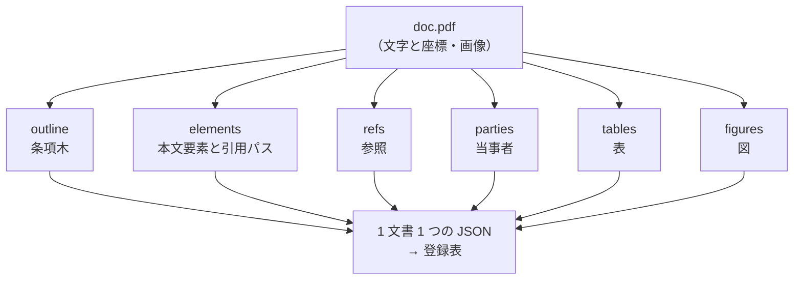

出力 JSON の該当部分は次のとおりです（run `h10-readme-contract` の出力から抜粋）。

```json
{
  "outline": [
    {"id": "c3",  "depth": 0, "node_kind": "article",   "label": "第１条", "title": "目的および検討の期間", "citation": "第１条"},
    {"id": "c12", "depth": 0, "node_kind": "article",   "label": "第３条", "title": "開示情報の特定および除外", "citation": "第３条"}
  ],
  "elements": [
    {"element_id": "c5",  "node_kind": "paragraph", "label": "２",     "citation": "第１条 ２",
     "parent_id": "c3",  "text": "本件共同検討は、本契約を締結した日から７か月の間に行う。…"},
    {"element_id": "c15", "node_kind": "paragraph", "label": "３",     "citation": "第３条 ３",
     "parent_id": "c12", "text": "配合条件および試作品は、第１項の表示の有無を問わず開示情報として扱う。",
     "refs_to": ["第3条"]},
    {"element_id": "c17", "node_kind": "item",      "label": "（１）", "citation": "第３条 ４ （１）",
     "parent_id": "c16", "text": "開示を受けた時に、受領した当事者が正当に保有していた情報"}
  ],
  "refs": [
    {"from_citation": "第3条 3", "to_citation": "第3条"},
    {"from_citation": "第6条",   "to_citation": "第1条 2"}
  ],
  "parties": [
    {"alias": "甲", "name": "株式会社霜月食品工業",     "role": "甲", "page": 1},
    {"alias": "乙", "name": "コトナミ冷熱技研株式会社", "role": "乙", "page": 1}
  ],
  "tables": [
    {"id": "r2t_p001_0", "pages": [1], "n_rows": 2, "n_cols": 2,
     "grid": [{"row": 0, "col": 0, "text": "甲", "is_header": true},
              {"row": 0, "col": 1, "text": "株式会社霜月食品工業", "is_header": true}, …]}
  ]
}
```

見どころは次の 4 点です。

- 「２」「（１）」には、親の条をたどった引用パス（`第１条 ２`・`第３条 ４ （１）`）が付きます。
- 本文の「第１項」は、同じ条の第 1 項として `第3条` に解決されます（`refs_to`）。
- 前文の「以下『甲』という」から、甲・乙が誰かが取り出されます。
- 番号の字形（全角の `１`、括弧の `（１）`）は、印刷されたとおりに残ります。

図は画像として切り出し、`AI_COMPLETE` でノードと矢印に変えます。
保険約款（`auto-0001--nl-a4-2col-mincho`）の 13 ページ目にある「保険金のお支払いの流れ」の図は、次の JSON になりました（run `h10-readme-yakkan`）。
下の Mermaid は、その JSON から描き直したものです。

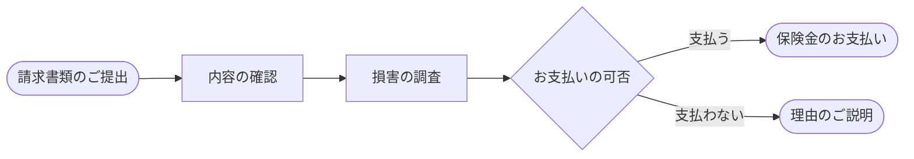

```json
{
  "id": "r4f_p013_0", "pages": [13],
  "nodes": [{"id": "n1", "label": "請求書類のご提出", "shape": "rounded"}, {"id": "n4", "label": "お支払いの可否", "shape": "diamond"}, …],
  "edges": [{"from": "n1", "to": "n2", "relation": "flow"}, …, {"from": "n4", "to": "n5", "relation": "flow", "label": "支払う"},
            {"from": "n4", "to": "n6", "relation": "flow", "label": "支払わない"}],
  "paths": [["請求書類のご提出", "内容の確認", "損害の調査", "お支払いの可否", "保険金のお支払い"],
            ["請求書類のご提出", "内容の確認", "損害の調査", "お支払いの可否", "理由のご説明"]]
}
```

### 学べること

- Snowflake の中だけで、PDF の取得 → 読み取り → 登録 → 評価をつなぐパイプラインの作り方（SQL のステップと SPCS のジョブを Task グラフでつなぐ）
- `AI_PARSE_DOCUMENT` と `AI_COMPLETE`（画像入力・few-shot）の実践的な使い方と、課金を抑えるキャッシュ
- 失敗したステップだけをやり直す再開の仕組み
- 予測と正解を別ロール・別 DB に分けた評価の仕組み（読み取り側が正解を見られないこと）
- 引用誤り率と網羅率による、構造の読み取り精度の測り方

---

## 2. 全体像

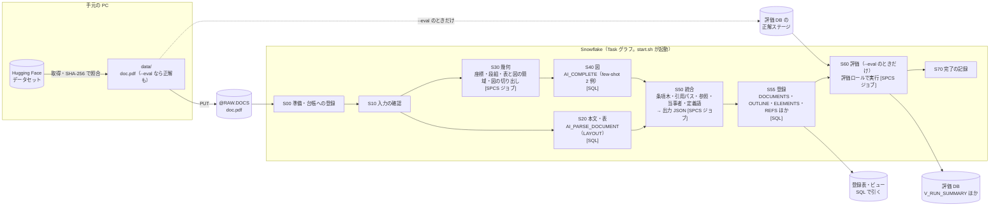

作る Snowflake のオブジェクトは、すべて接頭辞 `JA_DOC_STRUCTURED_` で始まります。

| 種類 | 名前 | 役割 |
|---|---|---|
| データベース | `JA_DOC_STRUCTURED_DB` | 読み取り側。PDF・中間成果物・出力 JSON・登録表・台帳・プロシージャ・Task |
| データベース | `JA_DOC_STRUCTURED_EVAL_DB` | 評価側。正解と評価結果。**読み取りのロールからは見えない** |
| ロール | `JA_DOC_STRUCTURED_ADMIN`・`_PREDICT`・`_EVAL_ROLE` | 管理・読み取り・評価 |
| ウェアハウス | `JA_DOC_STRUCTURED_WH`（XSMALL） | SQL と AI 関数 |
| コンピュートプール | `JA_DOC_STRUCTURED_POOL`（CPU_X64_S） | SPCS ジョブ |

アカウントの設定は変更しません。後片付けでは、これらの名前だけを指定して削除します。

---

## 3. 準備

### 3.1 必要なもの

| もの | 確認のしかた | 補足 |
|---|---|---|
| Snowflake アカウントと、ACCOUNTADMIN を使える接続 | `snow connection list` | ロール・データベース・ウェアハウス・コンピュートプールを作るために使います |
| Cortex AI 関数と SPCS が使えるリージョン | — | 図には `claude-opus-5` を使います。使えないときは「[14. 既知の限界と注意事項](#14-既知の限界と注意事項)」を参照 |
| [Snowflake CLI](https://docs.snowflake.com/en/developer-guide/snowflake-cli/index)（`snow`） | `snow --version` | 接続の設定は CLI のドキュメントを参照 |
| [uv](https://docs.astral.sh/uv/) | `uv --version` | Python 3.11 と依存を自動で用意します |
| Docker（buildx） | `docker info` | ジョブのイメージ（linux/amd64）を作ります。**ハンズオンの前に Docker を起動しておいてください** |
| git | `git --version` | |
| huggingface.co への HTTPS 接続 | `curl -sI https://huggingface.co` | データセットを取得します。アカウントとトークンは不要です |

### 3.2 リポジトリを取得して、接続名を設定する

```bash
git clone <このリポジトリの URL>
cd read-japanese-structured-document

# ローカル設定を作る（git 管理外）
cp configs/deploy.env.example configs/deploy.local.env
```

`configs/deploy.local.env` の `CONNECTION_NAME=<your_connection>` を、`snow connection list` に出る自分の接続名に書き換えます。
設定するのはこの 1 行だけです。接続名をリポジトリのほかのファイルに書かないでください。

### 3.3 依存を入れて、テストを流す（Snowflake には接続しない）

```bash
uv sync
scripts/start.sh --test        # lint・正解漏れのガード・単体テスト
```

最後に `[test] すべて通過` と出れば準備は完了です。
データをまだ取得していないので、実際の文書を読むテストは理由を表示してスキップされます。

---

## 4. ステップ 1：環境を作る（setup）

```bash
scripts/setup.sh
```

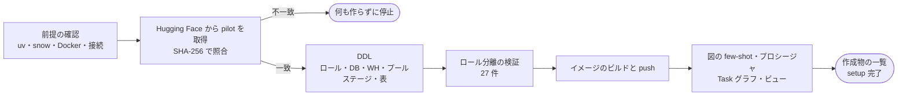

約 4 分かかります。次の順に進み、どこかで失敗したら、その時点で止まります。

1. 前提の確認（uv・snow・Docker・接続）
2. Hugging Face から、両コーパスの pilot（各 10 文書）の `doc.pdf` を取得し、manifest の SHA-256 で照合する。**1 件でも合わなければ、Snowflake には何も作らずに止まります**
3. ロール・データベース・ウェアハウス・コンピュートプール・ステージ・表を作る
4. ロール分離の検証（読み取りのロールが評価 DB を読めないことなど、27 件）
5. ジョブのイメージをビルドしてイメージリポジトリに push する
6. 図の few-shot（お手本 2 例）・プロシージャ・Task グラフ・ビューを登録する

最後に作成物の件数（データベース 2・ロール 3・ウェアハウス 1・コンピュートプール 1）と `setup 完了` が出ます。
setup は何度実行しても同じ状態になります。2 回目以降は `scripts/setup.sh --skip-build` でビルドを省けます。

> 取得のときに Hugging Face から「unauthenticated requests」の警告が出ますが、公開データセットなので問題ありません。

---

## 5. ステップ 2：契約書を読み取る（start）

秘密保持契約書（NDA）1 文書を読み取り、正解での採点（`--eval`）まで流します。

```bash
scripts/start.sh --corpus contract --docs nda-0003--ct-a4-1col-form --eval
```

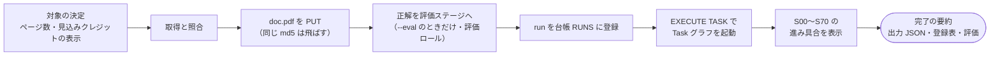

最初に対象と見込みクレジットが表示されます。

```
[run] 対象：contract 1 文書・3 ページ・見込み約 0.2 クレジット（docs。目安で請求額ではない）
```

続いて PDF と正解を Snowflake に置き、Task グラフを起動して、ステップごとの進み具合を表示します。

```
[run] S00 1✓  S10 3✓  S20 1✓  S30 3✓  S40 1✓  S50 1✓  S55 1✓  S60 1✓  S70 1✓
```

数字は処理した文書の数です。`✓` は成功、`…` は実行中、`✗` は失敗を表します。
S10・S30 が 3 件なのは、図の few-shot に使う「お手本」の文書 2 件も一緒に処理するためです。お手本の文書は評価から除きます。

5 分ほどで完了し、次のような要約が出ます（run `h10-readme-contract` の実行例）。

```
[run] 完了：run_id=20261013T000617Z_contract_custom  出力 JSON 1 件  @JA_DOC_STRUCTURED_DB.JA_DOC_STRUCTURED_OUTPUT.RESULTS/<run_id>/
[run] 登録表：DOCUMENTS 1・ELEMENTS 48・TABLES 4・FIGURES 4・REFS 14・PARTIES 2・DEFINED_TERMS 0
[run] 評価：n_docs=1  …  citation_error_rate=0.0  citation_coverage=1.0  text_cer=0.0609  article_recall=1.0  …
```

**表示された `run_id` を控えておいてください。** 次のステップの SQL で使います。既定の run_id は「UTC の日時_コーパス_指定の種類」で、`--run-id <名前>` で自分で付けることもできます。

対象の文書は `--docs id1,id2`（カンマ区切り）・`--docs-file <ファイル>`（1 行 1 文書）・`--slice pilot` のどれか 1 つで指定します。
`--eval` を付けなければ、正解を Snowflake に置かず、読み取りと登録だけを行います。

### 5.1 1 文書の読み取りの流れ

Task グラフの中で、1 つの `doc.pdf` は次のように読み取られます。
AI 関数を呼ぶのは S20 と S40 だけで、どちらも結果をキャッシュ表に保存します。
条項木・引用パス・参照・当事者・定義語は、S50 が PDF のテキスト層から規則で組み立てます。

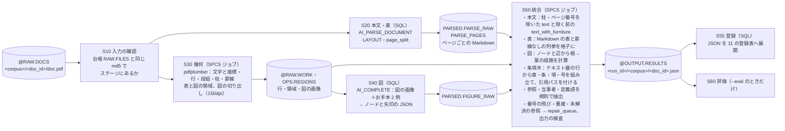

| ステップ | 何をするか | 書き出す先 | AI |
|---|---|---|---|
| S10 入力の確認 | PUT 済みの `doc.pdf` が、台帳と同じ md5 でステージにあるかを確かめる | `OPS.STEP_RUNS` | — |
| S20 本文・表 | `AI_PARSE_DOCUMENT`（LAYOUT）で、ページごとの Markdown（見出し・段落・表）を得る。NULL やページ数の不一致はエラー行として残す | `PARSED.PARSE_RAW`・`PARSE_PAGES` | ✔ |
| S30 幾何 | `pdfplumber` で文字の座標から行・段組・柱・罫線を取り、表と図の領域を見つけて、図だけを画像に切り出す | `@RAW.WORK`・`OPS.REGIONS` | — |
| S40 図 | 切り出した図の画像を、お手本 2 例（画像と期待 JSON）と一緒に `AI_COMPLETE` に渡し、ノードと矢印を JSON で受け取る | `PARSED.FIGURE_RAW` | ✔ |
| S50 統合 | 上の 3 つを合わせて 1 文書 1 つの JSON を作る。条項木と引用パスはテキスト層の行から規則で組み立てる。出力を検査し、違反があれば書かずに失敗する | `@OUTPUT.RESULTS` | — |
| S55 登録 | JSON を `DOCUMENTS`・`OUTLINE`・`ELEMENTS` などの表に展開する（§6.2） | `OUTPUT` スキーマの表 | — |

- **キャッシュ：** S20・S40 の結果は、入力のハッシュ・関数・モデル・オプションをキーに保存します。同じ PDF を別の run で読み直しても AI 関数は呼ばれません。
- **中間成果物の受け渡し：** ステップの間はステージとキャッシュ表だけで受け渡します。途中で失敗しても、成功したステップの結果を使って再開できます（§9）。
- **正解は使わない：** 読み取り（S10〜S55）は `doc.pdf` と自分の run の中間成果物だけを読みます。正解は評価（S60）のときに、評価ロールだけが読みます。

---

## 6. ステップ 3：結果を SQL で引く

### 6.1 出力 JSON の形

1 文書の読み取り結果は 1 つの JSON にまとまります。
主なキーは `outline`（条項木）・`elements`（本文要素）・`tables`・`figures`・`refs`（参照）・`parties`（当事者）・`defined_terms`（定義語）です。
上の契約書では、次のような値が入ります。会社名はデータセットの架空のものです。

```json
"outline": [
  {"id": "c3", "depth": 0, "node_kind": "article", "label": "第１条", "title": "目的および検討の期間", "citation": "第１条", "page": 1}
],
"parties": [
  {"alias": "甲", "name": "株式会社霜月食品工業", "role": "甲", "page": 1},
  {"alias": "乙", "name": "コトナミ冷熱技研株式会社", "role": "乙", "page": 1}
],
"refs": [{"from_citation": "第4条 6", "to_citation": "第4条"}]
```

番号の字形（`第１条` の全角数字など）は、PDF に印刷されたとおりに残します。
ほかに `pages`（ページごとの本文）・`repair_queue`（番号の飛び・重複など）・`provenance`（使った関数・モデル・イメージのタグ・エラー数）があります。

### 6.2 登録表とビュー

S55 が JSON を `JA_DOC_STRUCTURED_DB.JA_DOC_STRUCTURED_OUTPUT` の表に展開します。どの表も先頭の列は `run_id, corpus, doc_id` です。

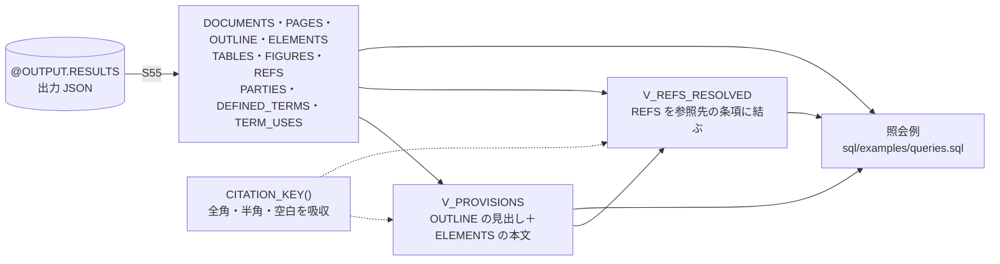

| 表・ビュー | 1 行の単位 |
|---|---|
| `DOCUMENTS` | 1 文書（題名・ページ数・エラー数・出力 JSON の場所） |
| `OUTLINE` | 条項木の 1 節点（章・条・項・号。見出しと引用パス） |
| `ELEMENTS` | 1 本文要素（項・号の本文と引用パス） |
| `TABLES`・`FIGURES` | 1 表・1 図（格子・ノードと辺） |
| `REFS` | 1 参照（参照元と参照先の引用パス） |
| `PARTIES`・`DEFINED_TERMS`・`TERM_USES` | 当事者・定義語・定義語の使用箇所（契約書だけ） |
| `V_PROVISIONS` | 条項の見出しと本文をまとめたビュー |
| `V_REFS_RESOLVED` | 参照を、文書内の参照先の条項に結び付けたビュー |
| `CITATION_KEY(c)` | 引用パスの照合キー（全角と半角、空白の違いを吸収する関数） |

### 6.3 照会例を流す

`sql/examples/queries.sql` に 5 つの照会があります。ファイル先頭の `SET run_id = '…'` を、ステップ 2 で控えた run_id に書き換えてから流します。

```bash
snow sql -c <接続名> -f sql/examples/queries.sql \
  -D db=JA_DOC_STRUCTURED_DB -D schema_output=JA_DOC_STRUCTURED_OUTPUT \
  -D role_predict=JA_DOC_STRUCTURED_PREDICT -D warehouse=JA_DOC_STRUCTURED_WH
```

Snowsight のワークシートで流すときは、`<% db %>` などのテンプレート変数を上の名前に置き換えてください。下の抜粋を単独で流すときは、先に `USE ROLE JA_DOC_STRUCTURED_PREDICT; USE WAREHOUSE JA_DOC_STRUCTURED_WH; SET run_id = '<run_id>'; SET doc_id = 'nda-0003--ct-a4-1col-form';` を実行します。主な照会は次のとおりです。

```sql
-- 条項を引用パスで引く。半角で書いても、全角で保存された「第３条 ４ （１）」が引ける
SELECT citation, title, text
FROM JA_DOC_STRUCTURED_DB.JA_DOC_STRUCTURED_OUTPUT.V_PROVISIONS
WHERE run_id = $run_id AND doc_id = $doc_id
  AND citation_key = JA_DOC_STRUCTURED_DB.JA_DOC_STRUCTURED_OUTPUT.CITATION_KEY('第3条 4 (1)');
```

```
| CITATION         | TITLE | TEXT                                                     |
| 第３条 ４ （１） |       | 開示を受けた時に、受領した当事者が正当に保有していた情報 |
```

```sql
-- 第４条を参照している条項
SELECT from_citation, to_citation, to_title
FROM JA_DOC_STRUCTURED_DB.JA_DOC_STRUCTURED_OUTPUT.V_REFS_RESOLVED
WHERE run_id = $run_id AND doc_id = $doc_id
  AND JA_DOC_STRUCTURED_DB.JA_DOC_STRUCTURED_OUTPUT.CITATION_KEY(to_citation)
      LIKE JA_DOC_STRUCTURED_DB.JA_DOC_STRUCTURED_OUTPUT.CITATION_KEY('第4条') || '%'
ORDER BY from_citation;

-- 甲は誰か
SELECT doc_id, alias, name, role
FROM JA_DOC_STRUCTURED_DB.JA_DOC_STRUCTURED_OUTPUT.PARTIES
WHERE run_id = $run_id;
```

ほかに「定義語の定義箇所と使用数」「参照の解決率」があります。

**やってみよう：** 引用パスを `'第6条 2'` などに変えて、条項の本文が引けることを確かめてください。

---

## 7. ステップ 4：精度を確かめる

`--eval` を付けた run は、正解と照合した結果が評価 DB に記録されます。評価 DB は評価ロールでしか読めません。
ステップ 2 では、次のように `--eval` を付けて流しました。

```bash
# 読み取り・登録に続けて、正解での採点（S60）まで流す
scripts/start.sh --corpus contract --docs nda-0003--ct-a4-1col-form --eval
```

`--eval` を付けずに流した run にも、あとから評価を足せます。対象文書の正解を取得して評価ステージに置き、S60 を実行します。

```bash
scripts/start.sh --resume <run_id> --eval
```

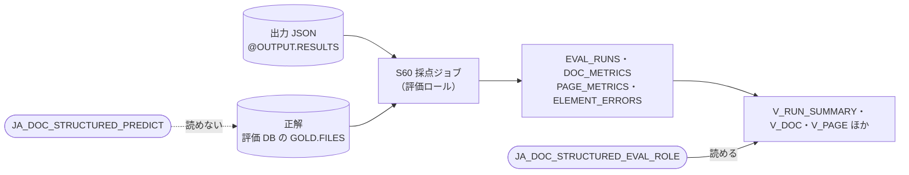

```sql
USE ROLE JA_DOC_STRUCTURED_EVAL_ROLE;
USE WAREHOUSE JA_DOC_STRUCTURED_WH;
SELECT pred_run_id, n_docs, citation_error_rate, citation_coverage, article_recall,
       text_cer, table_cell_f1, figure_edge_f1, refs_recall_reachable, parties_f1
FROM JA_DOC_STRUCTURED_EVAL_DB.JA_DOC_STRUCTURED_RESULTS.V_RUN_SUMMARY;
```

主な指標の意味は次のとおりです。

| 指標 | 意味 | 見方 |
|---|---|---|
| `citation_error_rate`（引用誤り率） | 正解と対応づいた本文要素のうち、引用パスが違うものの割合 | 主指標。小さいほどよい。**必ず網羅率と一緒に見る**（要素を出さなければ誤り率は下がるため） |
| `citation_coverage`（網羅率） | 正解の本文要素のうち、予測と対応づいたものの割合 | 大きいほどよい |
| `article_recall` | 条の再現率 | |
| `text_cer` | 本文の文字誤り率（編集距離 ÷ 正解の長さ） | AI（LAYOUT）の出力の質 |
| `table_cell_f1`・`figure_edge_f1` | 表のセルの一致、図の矢印（始点・終点・ラベル）の一致 | AI の出力に依存し、実行ごとに少し揺れる |
| `refs_recall_reachable` | 文書内にたどれる参照のうち、正しく取れた割合 | |
| `parties_f1` | 当事者（呼称と名称の対）の一致 | 契約書だけ |

文書ごとの値は `V_DOC`、ページごとの値は `V_PAGE` で見られます。

---

## 8. ステップ 5：保険約款を読み取る

同じパイプラインで、コーパスを切り替えて保険約款を読み取ります。約款は 2 段組で、表や図も多い文書です。

```bash
scripts/start.sh --corpus yakkan --docs auto-0001--nl-a4-2col-mincho --eval
```

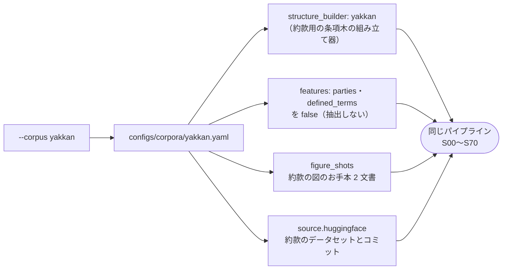

16 ページ・図 8 つの文書で、約 9 分かかります（見込み約 0.6 クレジット）。
完了したら、ステップ 3 と 4 の SQL を、この run の run_id と `doc_id = 'auto-0001--nl-a4-2col-mincho'` で流してください。

- 約款では当事者・定義語の抽出を無効にしているので、`PARTIES`・`DEFINED_TERMS` は 0 行です。
- 約款の評価に出る定義語の指標は、正解側の定義語と本文の対応を採点したものです。
- コーパスの違い（条項木の組み立て器・当事者抽出の有無・お手本の文書など）は、コードではなく `configs/corpora/<name>.yaml` で切り替えています。

参考までに、作成者の実行（run `h10-readme-yakkan`）では引用誤り率 0.022・網羅率 0.978・表セル F1 0.77 でした。

---

## 9. ステップ 6：失敗と再開を体験する

長いパイプラインは途中で失敗することがあります。故障注入オプションで、わざと失敗させてみます。

```bash
# S50（統合）で、指定した文書だけ失敗させる
scripts/start.sh --corpus contract --docs nda-0003--ct-a4-1col-form --fail S50:nda-0003--ct-a4-1col-form --run-id try-fail
```

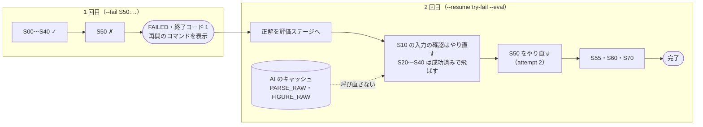

S50 で `✗` になり、失敗した理由・ジョブのログの末尾・再開のコマンドが表示されて終了します（終了コード 1）。

```
[run] run try-fail は FAILED で終わった。原因を直してから：scripts/start.sh --resume try-fail
```

再開します。`--eval` を付けると、評価も足せます。

```bash
scripts/start.sh --resume try-fail --eval
```

成功済みのステップは飛ばし、失敗した S50 と、まだ実行していない S55 以降を流します（S10 の入力の確認だけは、再開のたびにやり直します）。
AI 関数の結果はキャッシュ（入力のハッシュ・モデル・オプションをキーにした表）から引くので、
同じ PDF を読み直しても `AI_PARSE_DOCUMENT`・`AI_COMPLETE` は呼ばれず、課金されません。

**確かめてみよう：** 台帳を見ると、S50 だけ `attempt` が 2 になっています。

```sql
USE ROLE JA_DOC_STRUCTURED_ADMIN;
USE WAREHOUSE JA_DOC_STRUCTURED_WH;
SELECT step, doc_id, status, attempt
FROM JA_DOC_STRUCTURED_DB.JA_DOC_STRUCTURED_OPS.STEP_RUNS
WHERE run_id = 'try-fail' ORDER BY step;
```

---

## 10. ステップ 7：後片付け（teardown）

```bash
scripts/teardown.sh
```

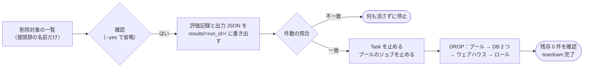

削除する対象を一覧表示し、確認してから次の順に進みます（`--yes` を付けると確認を省きます）。

1. 評価記録と出力 JSON を `results/<run_id>/` に書き出し、件数を照合する。合わなければ何も削除せずに止まります
2. Task・ジョブを止め、コンピュートプール・データベース 2 つ・ウェアハウス・ロールを、名前を指定して削除する
3. 接頭辞 `JA_DOC_STRUCTURED_` のオブジェクトが 0 件であることを確かめる

最後に `teardown 完了` が出れば、Snowflake 側は元の状態に戻っています。
`results/<run_id>/out/` には出力 JSON が残るので、Snowflake を消したあとも結果を見返せます。

手元のファイルは teardown では消えません。不要になったら、次のように削除します。

```bash
rm -rf data/ out/ work/ results/ logs/              # 取得したデータ・出力・評価記録・ログ（すべて git 管理外）
docker rmi $(docker images -q jpdocread | sort -u)  # ビルドしたイメージ（push 用の別名は docker images で確かめて消す）
```

---

## 11. 技術の解説

### 11.1 本文と表：`AI_PARSE_DOCUMENT`（S20）

- `LAYOUT` モード・`page_split => TRUE` で、ページごとの Markdown（見出し・段落・表）を得ます。
  OCR モードは 2 段組の読み順を崩すので使いません。
- 結果は、入力のハッシュ・関数・オプションをキーにして `PARSED.PARSE_RAW` に保存し、同じキーなら呼び直しません。
- NULL・エラー・ページ数の不一致は、空文字で埋めずにエラー行として残します（`sql/procedures/s20_parse_text.sql`）。
- 表は、LAYOUT の Markdown の表と、罫線の無い列挙を格子に組み直します。見出しの行・列（`header_path`）は規則で決めます。

### 11.2 幾何と図：pdfplumber と `AI_COMPLETE`（S30・S40）

- S30 は SPCS のジョブで動きます。`pdfplumber` で行の座標・段組・柱・罫線を取り、表と図の領域を見つけて、図の部分だけを画像に切り出します（`pypdfium2`、150dpi）。
- S40 は、切り出した画像を `AI_COMPLETE`（既定 `claude-opus-5`）に渡し、ノードと矢印を JSON で返させます。
  `PROMPT()` で、お手本 2 例（few-shot）の画像と期待 JSON を一緒に渡します。根から葉への経路（`paths`）は、返った辺から機械的に計算します。
- 実装で踏んだ注意点：
  - プロンプト本文に素の `{` があると、全行が黙って NULL になります。お手本の JSON は引数で渡します。
  - `response_format` は使わず、`TRY_PARSE_JSON` とコードフェンスの除去で解析します。解析に失敗したら 1 回だけ再試行します。
  - `max_tokens` は、予測したノード候補の数から決めます。正解の要素数は使いません。

### 11.3 条項木・参照・当事者：テキスト層と規則（S50）

- PDF のテキスト層（文字と座標）から、条・項・号の見出しの候補を規則で拾い、得点を付けて、条項木を組み立てます。
  約款と契約書では番号の付け方が違うので、文書の体裁を判定して、組み立て器を切り替えます。
- 引用パス（`第３条 ４ （１）`）は条項木から機械的に作ります。番号の字形は印刷されたとおりに残し、照会のときだけ `CITATION_KEY` で正規化して照合します。
- 「前条」「第５条第２項」「別表１」などの参照は、規則で引用パスに解決します。
- 契約書では、前文の「以下『甲』という」や当事者欄から当事者を、定義条から定義語を抽出します。
- AI を使わないので、同じ PDF からは毎回同じ結果になり、移植元の実装の出力とも 1 文字単位で比べられます。
- 番号の飛び・重複・解決できない参照は `REPAIR_QUEUE` に記録します。

### 11.4 パイプラインの仕組み

- **Task グラフ：** `start.sh` が run を台帳（`OPS.RUNS`）に登録し、`EXECUTE TASK … USING CONFIG` でルートの Task を起動します。
  各 Task の本体は、プロシージャを呼ぶ 1 文の `CALL` です。
- **SPCS ジョブ：** S30・S50・S60 は、ローカルでビルドしたイメージを `EXECUTE JOB SERVICE` で動かします。
  ジョブ内の接続は SPCS が渡すトークンを使い、資格情報はイメージに入れません。
- **再開：** `OPS.STEP_RUNS` に `(run_id, step, doc_id)` ごとの状態を記録します。成功済みは飛ばし、AI 関数はキャッシュで二重に守ります。
- **登録の冪等性：** S55 は `(run_id, doc_id)` ごとに削除してから挿入するので、何度流しても行は増えません。
- **評価の分離：** 正解は評価 DB のステージにだけ置きます。読み取りのロールは評価 DB の権限を持たず、正解を読めません。
  評価（S60）は、評価ロールが持つプロシージャから起動します。setup の検証では `USE SECONDARY ROLES NONE` を付けて、この分離を確かめます。

### 11.5 実装の場所

| ステップ | 実装 |
|---|---|
| 取得と照合・PUT・run の制御 | `src/jpdocread/fetch/`・`deploy.py`・`run.py` |
| S00・S10・S70・ジョブの起動 | `sql/procedures/steps.sql` |
| S20 本文・表 | `sql/procedures/s20_parse_text.sql` |
| S30・S50・S60 のジョブ本体 | `src/jpdocread/jobs.py`（読み取りは `src/jpdocread/read/`、採点は `src/jpdocread/eval/`） |
| S40 図 | `sql/procedures/s40_figures.sql` |
| S55 登録 | `sql/procedures/s55_register.sql`（列の定義は `src/jpdocread/load/rows.py`） |
| S60 評価の起動 | `sql/procedures/s60_evaluate.sql` |
| Task グラフ | `sql/tasks/dag.sql` |
| 登録表のビュー・評価ビュー | `sql/views/output_views.sql`・`eval_views.sql` |

各スクリプトは `--help`、`jpdocread` は `uv run jpdocread <サブコマンド> --help` で、すべてのオプションを確かめられます。

---

## 12. 発展：文書を増やす・設定を変える

### 12.1 対象の文書を増やす

`--slice pilot` で各コーパスの pilot 10 文書を流せます。`--slice all` は全文書です。
全文書の場合は、課金のページ数と見込みクレジットを表示して確認を求めます。参考までに、移植元の実測では約款で約 40、契約書で約 13〜15 クレジットでした。
文書の一覧は `uv run jpdocread fetch --corpus <c> --slice all --dry-run` で、取得せずに確かめられます。

### 12.2 設定を変える

| 変えたいもの | 場所 |
|---|---|
| 図のモデル・`max_tokens` の係数 | `configs/pipeline.yaml` の `figure` |
| コーパスごとの組み立て器・抽出の有無・お手本の文書・pilot | `configs/corpora/<name>.yaml` |
| データセットの版（Hugging Face のコミット） | `configs/corpora/<name>.yaml` の `source.huggingface.revision`（40 桁のコミット SHA。`main`・タグ・短縮した SHA はエラーになります） |
| 手元のデータセットから読む（ネットワークに出られない環境） | `configs/corpora/<name>.yaml` の `source.kind` を `local` にし、`configs/deploy.local.env` に `DATA_ROOT_YAKKAN`・`DATA_ROOT_CONTRACT`（`manifest.json` がある階層）を書く |

データセットの版を上げるときは、`revision` を新しいコミット SHA に書き換え、`uv run jpdocread fetch --corpus <name> --dry-run` で対象を確かめてから流してください。
取得元や版が違うデータは `data/` の別の場所に置かれます。同じ場所に中身の違う manifest が来たら、取得は止まります。

### 12.3 開発者向け

```bash
uv run ruff check . && uv run ruff format --check .   # lint と format
uv run pytest                                          # 単体テスト（Snowflake・Hugging Face への接続は既定で除外）
uv run pytest -m network                               # Hugging Face から実際に取得する試験
uv run jpdocread guard                                 # 正解漏れのガード（読み取り側が正解を参照していないか）
uv run jpdocread fetch --corpus contract --docs-file tests/fixtures/real_docs_contract.txt --eval  # 実文書のテスト用データ
```

```
configs/    設定（パイプライン・コーパス・オブジェクト名・ローカル設定のひな型）
scripts/    setup.sh・start.sh・teardown.sh と共通処理
sql/        setup（DDL）・procedures（各ステップ）・tasks（Task グラフ）・views・verify（ロール分離）・examples（照会例）
container/  ジョブのイメージと SPCS のジョブ仕様
src/jpdocread/  fetch（取得と照合）・read（読み取り）・load（登録表の行）・eval（採点）・run・deploy・jobs（Snowflake での実行）
tests/      unit・guard・ported（移植元のテスト）・integration・fixtures（合成データ）
```

---

## 13. 困ったとき

| 症状 | 対処 |
|---|---|
| `Docker デーモンが動いていない` | Docker Desktop を起動してから setup をやり直す（何も作られていません） |
| `接続名が無い` | `configs/deploy.local.env` の `CONNECTION_NAME` を、`snow connection list` の名前にする |
| snow が設定した接続を使わず認証に失敗する | 期限切れのトークンが環境変数に残っている。スクリプトは自動で外して実行する。手で snow を使うときは `env -u SNOWFLAKE_TOKEN snow …` |
| setup が DDL の前に止まる | 取得したデータが manifest と一致しない。表示されたファイルを確かめ、データを取り直す |
| huggingface.co に接続できない・429 が出る | ネットワークを確かめる。429 なら時間をおいて再実行する |
| `run_id が既にある` | 別の `--run-id` にするか、`--resume <run_id>` |
| start が途中で失敗した | 表示された理由とログを見て、`scripts/start.sh --resume <run_id>`。一時的な AI 関数のエラーは再開で通ることがあります |
| `--skip-build` で `イメージがリポジトリに無い` | teardown でイメージも消えている。`--skip-build` を外して setup |

ログは `logs/` に残ります（`setup-<日時>.log` など）。失敗したステップの理由は `JA_DOC_STRUCTURED_DB.JA_DOC_STRUCTURED_OPS.STEP_RUNS` の `error_text` で、ジョブのログは start.sh の失敗時の表示で確かめられます。

### 所要時間と費用の目安

作成者の環境（AWS 東京リージョン）で、2026-10-13 に計測した値です。

| 手順 | 時間 | AI 関数の見込み |
|---|---|---|
| `setup.sh`（クリーンから、ビルド込み） | 約 3.6 分 | なし |
| ステップ 2：契約書 1 文書（3 ページ） | 約 5.5 分（run `h10-readme-contract`） | 約 0.2 クレジット |
| ステップ 5：約款 1 文書（16 ページ・図 8） | 約 8.5 分（run `h10-readme-yakkan`） | 約 0.6 クレジット |
| ステップ 6：故障注入と再開 | 約 7.5 分（2 回分。run `h10-fail-contract`） | 0（キャッシュから引く） |
| `teardown.sh` | 約 1 分 | なし |

- 見込みクレジットは、ページ数と図の数に単価を掛けた目安で、請求額ではありません。単価は LAYOUT 約 0.0037 クレジット/ページ、図 約 0.042 クレジット/図（移植元の実測）。
- 実際の消費は、ウェアハウスとコンピュートプールの稼働分が加わります。どちらも短い時間で自動停止します。
- 実際の消費は、アカウントの使用量の画面で確かめてください。

---

## 14. 既知の限界と注意事項

- **データは合成です。** 架空の会社・商品・人物からなる合成データセットで、実在の約款・契約書とは関係ありません。法的な参照には使えません。
- **電子生成の PDF が前提です。** テキスト層のある PDF だけを対象にしています。スキャンした PDF には使えません。
- **日本語は `AI_PARSE_DOCUMENT` の公式対応言語に含まれません。** 動作は確認していますが、予告なく結果が変わる可能性があります。
- **AI の出力は揺れます。** 図の `AI_COMPLETE` は temperature 0 でも実行ごとに結果が少し変わり、本文と表も呼び直すと変わることがあります。1 回の実行の値の差で優劣を判断しないでください。
- **モデルとリージョン：** 図のモデル（既定 `claude-opus-5`）が自分のリージョンで使えないときは、`configs/pipeline.yaml` の `figure.model` を変えてください。
  クロスリージョン推論を有効にするかは、アカウント管理者が判断してください。本ハンズオンのスクリプトはアカウントの設定を変更しません。
- **規則は改善していません。** 社内で検証した構成をそのまま移しています。約款の重要事項説明書の扱いと号の再現率、図の領域の誤検出（余分な `AI_COMPLETE` の課金）に課題が残ります。
- **範囲外：** データセットに含まれる質問応答（`qa.json`）を使った検索・QA の評価は扱いません。
- **権限：** setup は ACCOUNTADMIN でロールとアカウント権限を作ります。共有のアカウントで流すときは、管理者に確認してください。
- **データの扱い：** 取得したデータ・出力・ログは `data/`・`out/`・`results/`・`logs/` に置き、`.gitignore` でコミットの対象から外しています。リポジトリにはデータを含めません。

---

## 15. 出典とライセンス

### データセット

次の 2 つのデータセットを、[CC BY 4.0](https://creativecommons.org/licenses/by/4.0/) のもとで利用しています。
取得したファイルは改変せずにそのまま読みます。リポジトリにはデータを含めず、実行時に Hugging Face から取得します。
正式な引用の書式は、各データカードの Citation を参照してください。

| コーパス | データセット | 作成者 | 規模 | URL |
|---|---|---|---|---|
| `yakkan` | Japanese Insurance Policy Document Understanding（日本語保険約款の合成データセット） | cvusk | 113 文書・1,437 ページ | <https://huggingface.co/datasets/cvusk/japanese-insurance-document-understanding> |
| `contract` | Japanese Contract Document Understanding（日本語ビジネス契約書の合成データセット） | cvusk | 100 文書・656 ページ | <https://huggingface.co/datasets/cvusk/japanese-contract-document-understanding> |

取得するコミットは、`configs/corpora/<name>.yaml` の `source.huggingface.revision` で固定しています。データセットが更新されても、入力は変わりません。

### フォント

データセットの PDF には、次のフォントが埋め込まれています。

- Noto フォント：SIL Open Font License 1.1
- IPAex フォント：IPA フォントライセンス v1.0

### 手法

社内で検証した 2 つのパイプライン（保険約款・契約書）の採用構成を、1 つの設定駆動のパイプラインとして整理し、移植したものです。
コードと設定のコメントに出てくる「移植元」は、この社内のパイプラインを指します。社内のパイプラインと資料は、このリポジトリには含まれません。
